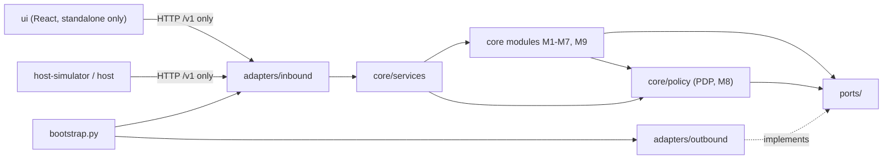
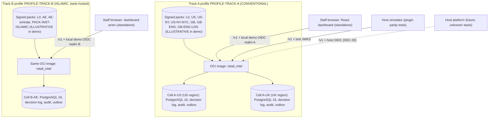
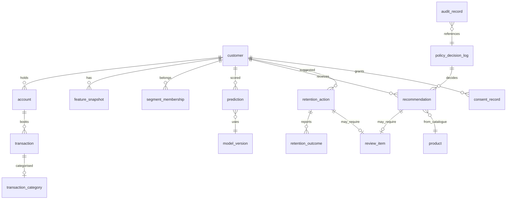

# Architecture Spine - Retail Banking AI Intelligence Subsystem

## Design Paradigm

The subsystem is a **hexagonal modular monolith** (planning/04 §1, §4). There is one Python distribution and one OCI image. Each deployment loads one signed deployment profile (AD-23). There are two tracks: Track A "Conventional" (one profile, two data cells `A-US` for `US`/`US-NY`/`US-NY-NYC` and `A-UK` for `GB`/`GB-ENG`/`GB-ENG-LDN`) and Track B "Islamic" (a separate, bank-hosted deployment with one cell `B-AE`, UAE onshore [ASSUMPTION], AD-24). Standalone and plugin modes are two adapter wirings of the same image, selected in the composition root. Jurisdiction behaviour lives in signed policy packs, evaluated by one in-process PDP. Each module has a PEP. *Source: planning/04, planning/14 §6.*

Layers map to directories (planning/04 §4):
- `core/` holds domain, calc, rules, models, recommend, orchestrator, policy and services.
- `ports/` holds the interfaces.
- `adapters/inbound` and `adapters/outbound` hold all I/O.
- `config/` holds reference data, deployments and modes.
- `bootstrap.py` is the composition root.
- `policy-packs/`, `contracts/`, `host-simulator/` and `ui/` sit beside the code.

## Invariants & Rules



### AD-1 - One core, two adapter configurations [ADOPTED]
- **Binds:** all
- **Prevents:** the standalone and plugin paths producing different results or duplicating logic.
- **Rule:** Mode differences live only in `bootstrap.py` wiring and `config/modes/*.yaml`. There is no `if MODE`, no shadow-mode flag and no host-specific code in `core/`. The deployment flag `demo` (AD-18) and a model's SHADOW status (AD-15) are config and registry data read through ports, not mode branches. The same contract tests and policy golden cases run against both modes in CI. *Source: planning/04 §5.1; planning/12 §H.1 DEC-05.*

### AD-2 - Dependency direction [ADOPTED]
- **Binds:** all modules, adapters
- **Prevents:** core logic importing frameworks, databases or host code.
- **Rule:** `core/` imports only `core/` and `ports/`. Adapters implement ports. Only `bootstrap.py` wires adapters. The UI and host reach the core only through `/v1` HTTP. An import-linter enforces this in CI. *Source: planning/04 §4.*

### AD-3 - Jurisdiction rules are data [ADOPTED]
- **Binds:** FR-26..FR-43, all modules
- **Prevents:** state-specific branching spreading into modules, and a new jurisdiction needing core changes.
- **Rule:** Jurisdiction codes (e.g. `US-NY`, `GB`, `AE`), track IDs and institution types (`ISLAMIC`, `CONVENTIONAL`) are forbidden as literals in `core/` outside `core/policy` and the profile loader; a CI lint enforces this. A jurisdiction is added as pack data plus reference data. Code changes only to add a reusable control to the catalogue. *Source: planning/14 PG-1, §12.*

### AD-4 - PDP owned by M8; a PEP in every module [ADOPTED]
- **Binds:** M1-M9, FR-29
- **Prevents:** a module producing output without a policy decision, or reading raw policies itself.
- **Rule:** Modules call the `core/policy` decide function before and after processing, and never read policy records. Every module result type has a required `decision_id` field. An obligation the PEP does not understand means DENY. Batch jobs call the PDP per customer, using the cached bundle. *Source: planning/14 §6; planning/06 §5.*

### AD-5 - Fail-safe resolution [ADOPTED]
- **Binds:** FR-26, FR-28, FR-30
- **Prevents:** uncertainty resolving to permit.
- **Rule:** Each of these is DENY or BLOCK for commercial activities, each with its own test:
  - PENDING_LEGAL_REVIEW. The only exception is a policy with an explicit `illustrative_assumption` inside an `ILLUSTRATIVE` bundle (standalone demo only, watermarked; DEC-44, AD-18).
  - Passed `review_due`, with no grace period; the last-good bundle is never used past its own `review_due` (DEC-14).
  - UNKNOWN or UNSUPPORTED jurisdiction (DEC-24).
  - Missing or conflicting residence and booking location, which resolves to UNKNOWN (DEC-25 safe assumption).
  - Unknown age.
  - Unknown consent.
  - No matching policy. The L0 permit whitelist is empty in v1 (DEC-45).
  - INDETERMINATE.
  - PDP exception.
  - Unknown control or obligation.

  Conflicts follow "most restrictive wins" (DEC-26). *Source: planning/14 §4.2, §10.*

### AD-6 - No credit-decision type; purpose label set centrally [ADOPTED]
- **Binds:** contracts, M6, M9, FR-21, FR-46, FR-55
- **Prevents:** any module or schema emitting approval, decline, limit, pricing or adverse action, and inconsistent purpose labels.
- **Rule:**
  - Customer-outcome schemas pass a forbidden-term linter (`approve*`, `decline*`, `credit_decision`, `credit_limit`, `apr`, `adverse_action`, `pre_approved`, `eligibility_decision`). The linter scope is the explicit schema-path list in planning/14 §13.1. Governance schemas (packs, model registry, `MINOR-APPROVAL-*`) are excluded, and adding an exclusion needs COMP sign-off.
  - Credit appears only as `CREDIT_REFERRAL`.
  - Only the shared-core response assembler sets `permitted_use` and `not_for_credit_decisioning: true` (DEC-42). It also sets `illustrative` and `watermark`, which are true and "illustrative - not legal advice - not for real customers" whenever the bundle is `ILLUSTRATIVE` (DEC-44).

### AD-7 - Locked L0 baseline and the minors two-tier list [ADOPTED]
- **Binds:** M1-M9, model training, FR-12, FR-33
- **Prevents:** a pack, overlay or config flag re-enabling commercial processing of minors or credit decisions.
- **Rule:** `PACK-GLOBAL-BASELINE` controls marked `locked: true` (`CTL-MINOR-PROTECT` Tier 1, `CTL-CREDIT-REFERRAL-ONLY`, `CTL-ADVERSE-ACTION-HANDOFF`, LLM guardrail) cannot be loosened by any pack or overlay. Tier 2 relaxes only with a signed `MINOR-APPROVAL-*` record referenced by policy. Minors' rows are filtered out of every training dataset. *Source: planning/14 §13.3.*

### AD-8 - Host overlay tightens only [ADOPTED]
- **Binds:** PolicyStorePort host adapter, FR-32
- **Prevents:** plugin mode becoming looser than standalone.
- **Rule:** An overlay is merged with the per-control combining rules from the control catalogue (deny-overrides, allow-list intersection, minimum of upper bounds, union of obligations). Loosening parts are rejected and emit `policy.overlay.rejected`. A host PDP reference does not replace ours; both must permit. Our approver signs base packs and host compliance signs overlays (DEC-17 DECIDED; DEC-27 DECIDED-DEFAULT, GATE-11). *Source: planning/14 §11.*

### AD-9 - Money, time and identity
- **Binds:** all data and contracts
- **Prevents:** float money, timezone drift, and PII leaking into the subsystem.
- **Rule:**
  - Money is `amount_minor` (integer) plus ISO 4217 `currency`, with derived values as NUMERIC(19,4). Floats are never used, and sums across currencies need explicit FX.
  - Timestamps are TIMESTAMPTZ in UTC. Business dates use the cell's timezone from the deployment profile (`A-US` `America/New_York`, `A-UK` `Europe/London`, `B-AE` `Asia/Dubai`). Each cell has one currency (USD, GBP, AED); there is no FX between cells.
  - Customers are keyed by token only. No names, SSN/ITIN, account numbers or full addresses are stored. Birth date is held as year-month. *Source: planning/07 §1; planning/08 PRV-02, PRV-05.*

### AD-10 - Append-only, hash-chained audit and decision log; erasure by crypto-shredding
- **Binds:** DecisionLogPort, AuditSinkPort, SubjectKeyPort, FR-31, FR-62, FR-65
- **Prevents:** DSR erasure breaking tamper evidence, or updates in place to audit history.
- **Rule:** `audit_record` and `policy_decision_log` are insert-only and hash-chained, and hold only the tokenised `subject_ref`. Any personal payload stored beside them is encrypted with a per-subject key. Erasure destroys that key and never rewrites rows (DEC-35 DECIDED; legal sufficiency [LEGAL-CONFIRM] by GATE-12). `retention_outcome` and `review_item` transitions are append-only and audited. *Source: planning/07 §8.2.*

### AD-11 - Version echo and replay
- **Binds:** all derived rows and responses, NFR-6
- **Prevents:** outputs that cannot be reproduced.
- **Rule:** Every derived row and every response carries `feature_set_version`, `model_version_id`, `config_version` and `decision_id`; the decision records the packs applied, `effective_bundle_sha256` and `as_of`. Time comes through an injectable `ClockPort`. *Source: planning/07 §1; planning/04 §6.*

### AD-12 - Data comes to us; stateless evaluate first
- **Binds:** inbound adapters, FR-56, FR-60
- **Prevents:** the subsystem reaching into host databases, or minimisation rules diverging between adapters.
- **Rule:**
  - The host pushes data in the payload or through bulk ingest, and the host-to-canonical mapping lives only in `host_data_mapper`.
  - Per-activity field allow-lists (`CTL-DATA-MINIMISE`) apply at the inbound adapters.
  - ZIP code and fine location never cross the boundary (DEC-34).
  - Stateless evaluate is built first (DEC-32). *Source: planning/04 §3; planning/15 §8.*

### AD-13 - Contract-first, versioned
- **Binds:** `contracts/`, all HTTP endpoints, FR-54, FR-55
- **Prevents:** code and contract drifting apart, and breaking changes reaching hosts.
- **Rule:**
  - OpenAPI 3.1 and JSON Schema 2020-12 under `contracts/` are the source of truth. Code conforms to them, not the reverse.
  - `/v1` carries the major version in the URL. A CI breaking-change diff blocks merges.
  - Clients read tolerantly; requests are validated strictly.
  - Deprecation: at least 6 months after the successor is published [ASSUMPTION]. Default rate limit: 50 req/s per client, burst 100 [ASSUMPTION] (DEC-31 DECIDED-DEFAULT, GATE-3).
  - The error model follows planning/15 §4, including `DATA_QUALITY_INSUFFICIENT`, `MINOR_PROTECTED`, `JURISDICTION_NOT_PERMITTED` and `OUT_OF_SCOPE_REQUEST`.

### AD-14 - LLM behind a port, template-only in the MVP
- **Binds:** M9, FR-44..FR-47
- **Prevents:** generated text stating unverified numbers or invented products, and tools with side effects.
- **Rule:**
  - `LLMPort` is bound to the template adapter; other adapters stay disabled until a separate MGR/SEC decision (DEC-06 DECIDED).
  - The tool registry is read-only with a fixed allow-list.
  - Every number, product code and fact in output is validated against the tool results; any mismatch falls back to the template.
  - Free text (transaction descriptions) is untrusted data, never instructions. *Source: planning/08 SEC-13, SEC-14.*

### AD-15 - Model governance gate
- **Binds:** M4, M5, ModelRegistryPort, FR-15, FR-16
- **Prevents:** unapproved or unjustified models serving predictions.
- **Rule:**
  - Registry entries have `kind` `RULESET` (DRAFT → ACTIVE → RETIRED, labelled "non-model") or `ML_MODEL` (DRAFT → SHADOW → APPROVED → RETIRED).
  - Only `RULESET` ACTIVE or `ML_MODEL` APPROVED serve (`CTL-MODEL-APPROVED-ONLY`). In v1 the deterministic rule baseline serves churn and needs.
  - `ML_MODEL` APPROVED needs an MRM approval reference and is refused while DEC-19 is unresolved (`MODEL_APPROVAL_UNAVAILABLE`).
  - SHADOW runs on synthetic data only. Its outputs go to a separate shadow log, never to `prediction`, the API, events, M6, M7 or M9. Only aggregate metrics are shown.
  - ML becomes eligible for MRM review only if it beats the baseline on a time split (BQ-11 margin [ASSUMPTION]).
  - Config `ruleset_requires_mrm_approval` (default false) applies MRM approval to rulesets if MRM classifies them as models at GATE-7.
  - Each entry declares its feature list, which CI checks against the exclusion lists. *Source: planning/08 CMP-06..CMP-08, NYC-07; DEC-19 safe assumption; DEC-47 (DECIDED-DEFAULT, MRM at GATE-7).*

### AD-16 - Deployment scope enforced three ways
- **Binds:** DB schema, identity adapter, bootstrap, FR-70
- **Prevents:** data or requests crossing deployment or cell scope.
- **Rule:** These three checks must all pass:
  - Every business row has `deployment_id` and `cell_id` check constraints equal to the cell's values.
  - The token claim `ri_deployment` equals the instance's ID, and `ri_jurisdictions` covers the request context; otherwise 403 `JURISDICTION_NOT_PERMITTED`.
  - The bootstrap refuses to start on a scope or pack mismatch.

  One database, secret set and key set per cell (AD-23). *Source: planning/07 §1, §5; planning/08 SEC-03, SEC-04; planning/21 §2.*

### AD-17 - Consent purposes are config reference data
- **Binds:** ConsentPort, contracts, FR-63
- **Prevents:** a hard-coded enum blocking the contract while legal decides DEC-18.
- **Rule:** Purpose codes are validated against versioned config, not a schema enum. MARKETING, affiliate and channel purposes deny unless an explicit consent record exists. *Source: planning/12 §H.1 DEC-18 (BLOCKED-EXTERNAL safe assumption).*

### AD-18 - Signed packs, pack lifecycle and readiness
- **Binds:** PolicyStorePort, `/ready`, NFR-5, FR-34..FR-40
- **Prevents:** running on tampered, unsigned, stale or unapproved policy, and an illustrative pack ever reaching a real customer.
- **Rule:**
  - The PDP refuses unsigned or hash-mismatched packs and overlays.
  - Pack lifecycle (DEC-45): `DRAFT` → `VALIDATED` → `IN_LEGAL_REVIEW` → `APPROVED` → `ACTIVE` → `RETIRED`, plus the demo branch `VALIDATED` → `ILLUSTRATIVE`. `VALIDATED` (loaded but unapproved) is used by the simulator only.
  - The runtime bundle is verified L0 plus `ACTIVE` packs, or L0 plus `ILLUSTRATIVE` packs; never mixed.
  - `/ready` is false until the DB is up, L0 is verified and every configured pack is verified and loadable. With no jurisdiction pack, the instance is ready and `CTL-DEFAULT-DENY` denies all non-governance activities.
  - L0 is restrictive-only (CI rejects an L0 policy that grants anything). It is approved as `INTERNAL_POLICY` by the developer with a second-person review and is then `ACTIVE`. It is signed with the `DEMO`-class key only where `demo=true`; every `demo=false` deployment uses the `DEPLOYMENT` key.
  - **`ILLUSTRATIVE` (DEC-44):** loads only if `mode=STANDALONE`, `demo=true` and the AD-19 guard is on. Any other deployment refuses it at load and stays not ready. The bootstrap refuses `demo=true` in plugin mode. Non-demo deployments trust no `DEMO` key. Policies with `illustrative_assumption` are evaluated on it, and every output carries the watermark (AD-6). Config `honour_illustrative_assumptions` turns this off.
  - At runtime the last verified bundle is kept until max-age, then `CTL-DEFAULT-DENY` applies.
  - Every MVP pack carries `illustrative: true` and its policies stay PENDING_LEGAL_REVIEW.
  - `ACTIVE` needs `APPROVED`, `policy_release` and recorded MGR/LEG sign-off, which is impossible while DEC-11 is unresolved.
  - Governance actions use the `/v1` endpoints in planning/15 §2.1 (DEC-46). *Source: planning/08 SEC-18; planning/14 §8-§9, §8.4; planning/12 §H.6.*

### AD-19 - Synthetic-only guard
- **Binds:** standalone ingest adapters, generator
- **Prevents:** real data entering before 12 §H.4 condition 1 is lifted.
- **Rule:** Standalone ingest rejects any row without `is_synthetic=true`. No adapter connects to a real bank system. Lifting this needs recorded resolution of DEC-10, 18, 20, 23 and 25. *Source: planning/07 §7; planning/12 §H.4.*

### AD-20 - Events through a transactional outbox
- **Binds:** EventPublisherPort, FR-59
- **Prevents:** each module inventing its own event delivery.
- **Rule:** Modules write CloudEvents 1.0 payloads to the outbox in the same transaction as the state change. Transport is a port adapter; there is no broker in the MVP (DEC-33 safe assumption). *Source: planning/15 §9.*

### AD-21 - Role-to-scope matrix is deny-by-default and versioned with the contract
- **Binds:** IdentityPort, all endpoints and screens, FR-61
- **Prevents:** endpoints or screens granting access ad hoc.
- **Rule:**
  - Each endpoint declares its scope.
  - The roles x scopes x screens matrix (planning/15 §5.1) lives beside `contracts/openapi/retail-intelligence-v1.yaml`, with one negative test per cell.
  - Separation of duties is enforced: maker != approver, `policy_release` cannot author or approve, auditors are read-only (DEC-38 DECIDED, developer-delegated 2026-11-10; manager countersignature recommended).
  - `sharia_approver` (ISLAMIC deployments only) holds only `ri.meta.read`, `ri.policy.read` and `ri.sharia.approve`, and never an author, approve or release scope (SOD-9; planning/20 SDC-17). Per user, the Sharia approver differs from the maker and from the legal approver of the same pack version, and the activator differs from both.
  - Customer tokens are listed for people only through the purpose-bound directory (`searchCustomerDirectory`, scope `ri.customers.list`, held by `analyst` and `relationship_staff` only): a registered access purpose from a closed list, an exact token lookup or a narrowing filter, bounded pages and totals, per-user quotas, and an audit record for every call including denials. `auditor` and `service_host` hold no directory scope; `listCustomers` is deprecated and not implemented (contract 1.2.0; DEC-68; SOD-10).

### AD-22 - Data quality short-circuits per module
- **Binds:** M1-M7, FR-9
- **Prevents:** outputs built on thin data, and modules each inventing their own thresholds.
- **Rule:** DQ rules DQ-01..DQ-10 are versioned THRESHOLDS config (DEC-39), evaluated at ingest and before each module. A blocking breach returns `DATA_QUALITY_INSUFFICIENT` for that module only; gaps are never imputed. *Source: planning/07 §4.1.*

### AD-23 - Deployment profile and data cells [ADOPTED]
- **Binds:** bootstrap, all modules, DB schema, FR-69, FR-70, NFR-14
- **Prevents:** track-specific code branches, personal data crossing the US/UK boundary, and a host switching the institution type per request.
- **Rule:**
  - Each deployment loads exactly one signed, versioned deployment profile (track, `institution_type`, mode, demo, cells, packs, institution overlay, age-of-majority map, LLM hosting, registry scope, IdP realm). It is read-only at runtime; its hash is recorded on every decision. No request field, header, environment variable, feature flag or config file can set any of these (DEC-61); other flags are read after the profile and may only tighten.
  - The profile carries a detached signature (Ed25519, or ECDSA P-256 where FIPS modules are required [ASSUMPTION]) checked against track-bound public keys shipped in the image; private keys stay in the track's KMS/HSM and signing is maker-checker. A missing, unreadable, altered, incompatible or rolled-back profile, or a key bound to another track, keeps the instance not ready (planning/21 §3.1).
  - A **cell** is the unit of personal-data isolation: one runtime instance with its own `deployment_id`, PostgreSQL database, subject-key store, audit and decision log, outbox, backups, object store, secret scope and region. Track A has cells `A-US` and `A-UK`; there is no cross-cell join, and a token's `ri_deployment` claim binds a session to one cell. Telemetry is token-free; tokens are not reversible by the subsystem and are keyed per cell and track (planning/21 §2.1, §2.2).
  - A request is served only by the cell whose `jurisdiction_roots` contain the resolved residence and booking codes. Residence in one cell and booking in another resolves to UNKNOWN (AD-5).
  - Only aggregate, non-personal metrics combine across Track A cells (portfolio summary), and only from each cell's own suppressed, rounded output; no component reads another cell's store. The portfolio follows aggregate disclosure control AG-1..AG-10 (planning/21 §10A).
  - The bootstrap refuses (not ready) an invalid profile signature, `ISLAMIC` without an overlay pack, any pack, catalogue, model or template whose `track` tag differs, a region not allowed by `CTL-DATA-RESIDENCY`, or a disallowed LLM hosting value. *Source: planning/21 §2-§3; DEC-51, DEC-52, DEC-61.*

### AD-24 - Track B is a separate, bank-hosted deployment [ADOPTED]
- **Binds:** deployment, keys, IdentityPort, ModelRegistryPort, FR-71, NFR-14, NFR-15
- **Prevents:** Islamic-bank data, models or approvals mixing with Track A.
- **Rule:** Track B runs on bank-hosted, on-premises infrastructure with its own database, deployment and demo-class keys, IdP realm, registry, catalogue, packs, templates, logs and backups. It shares only release images, the contract, the control catalogue, the DSL and schemas. A Track A token, key, pack or model reference is rejected by Track B and vice versa, and isolation tests prove it. *Source: planning/21 §2, §9; DEC-53.*

### AD-25 - Institution-type overlay is a tighten-only policy layer [ADOPTED]
- **Binds:** `core/policy`, M2, M3, M6, M7, M9, FR-72, FR-73
- **Prevents:** Islamic-bank rules becoming code branches, and any overlay loosening a jurisdiction or L0 rule.
- **Rule:**
  - Resolution order: L0 → jurisdiction packs → institution overlay `PACK-INST-ISLAMIC` (only when `institution_type = ISLAMIC`) → host overlay. Combining is per control, most restrictive wins (DEC-26).
  - CI rejects an overlay policy that grants, widens or raises anything; the monotonicity property test includes the overlay. Locked L0 controls and the minors list are untouchable.
  - New catalogue controls: `CTL-CATALOGUE-ELIGIBILITY`, `CTL-TERMINOLOGY` (violation blocks the text and falls back to the template), `CTL-PROHIBITED-CATEGORY` (never offered, never a feature, never used to infer religion) and `CTL-SHARIA-APPROVAL`.
  - Sharia approval state (`NOT_REVIEWED` → `IN_SHARIA_REVIEW` → `SHARIA_APPROVED` / `SHARIA_REJECTED`) is a second dimension next to legal approval. In an ISLAMIC deployment the pack `:submit` step also moves the overlay policies and released Track B artefacts to `IN_SHARIA_REVIEW` (contract 1.1.1); `sharia_approver` records the outcome. The demo assumption is only the separate attribute `illustrative_sharia_assumption: ASSUME_COMPLIANT`, never a Sharia status value. A Track B pack is `APPROVED` only with both; any customer-facing artefact without `SHARIA_APPROVED` is BLOCK (`SHARIA_REVIEW_PENDING`). Inside an `ILLUSTRATIVE` bundle only, an activator-confirmed `illustrative_sharia_assumption` is honoured and the assembler adds the watermark "illustrative - not a Sharia ruling" (AD-6).
  - In ISLAMIC deployments the assembler attaches the catalogue item's Sharia disclosure (`sharia_disclosure`, planning/20 SDC-11: Sharia basis, ISSC approval, certificate and KFS references per locale, contract type) to every product suggestion and credit referral; an item without a complete disclosure is suppressed, never rendered. Outside an `ILLUSTRATIVE` bundle only the approved shape (`SHARIA_APPROVED` plus approval references) passes the contract; CONVENTIONAL responses never carry the block (contract 1.2.0). *Source: planning/21 §4, §4.4; DEC-54, DEC-55.*

### AD-26 - Model registry is scoped per track [ADOPTED]
- **Binds:** ModelRegistryPort, M4, M5, FR-75
- **Prevents:** a model, feature set or training set trained on one track's (or, with real data, one cell's) data serving another.
- **Rule:** Registry entries carry `track` and `cell_scope`. The loader refuses an entry whose `track` differs from the profile. Training, evaluation, validation and fairness reports run per track, and per cell in Track A for synthetic and real data alike; only the data-free rule baseline serves both cells (pooling real data needs a transfer assessment [LEGAL-CONFIRM]). AD-15 applies unchanged inside each track. *Source: planning/21 §6; DEC-57.*

### AD-27 - LLM hosting is bounded per track [ADOPTED]
- **Binds:** LLMPort, bootstrap, FR-47
- **Prevents:** customer data leaving the bank (Track B) or its region (Track A) through an LLM call.
- **Rule:** AD-14 still holds (template-only in the MVP). The profile's `llm.hosting` is validated at bootstrap: Track B allows only `NONE` or `BANK_ON_PREM` (no hosted or external LLM, ever; customer data, prompts, logs and backups stay in the UAE on the bank's systems; third-party hosting or a vendor foundation model is refused until planning/20 IQ3 is answered); Track A allows only in-region hosting per cell. Enabling any LLM adapter remains a separate MGR/SEC decision and a no-go trigger until then. *Source: planning/21 §7; DEC-06, DEC-58; planning/20 IQ3.*

## Consistency Conventions

| Concern | Convention |
|---|---|
| Naming: modules | M1 Customer Intelligence, M2 Transaction Intelligence, M3 Segmentation, M4 Needs, M5 Churn, M6 Recommendation, M7 Retention, M8 Risk & Compliance, M9 Orchestrator (planning/05 §2) |
| Naming: controls, policies, packs | `CTL-*`, `POL-<jurisdiction>-NNNN`, `PACK-*` (incl. `PACK-INST-*` institution overlays), `EXCL-*`, `MINOR-APPROVAL-*` (planning/14, planning/21) |
| Naming: activities | Uppercase taxonomy from planning/14 §3.3; an unknown activity means DENY |
| Naming: events | Dotted lowercase, e.g. `policy.pack.activated`, `policy.overlay.rejected`, `model.status_changed` (planning/15 §9) |
| Naming: scopes | `ri.<area>.<verb>` (planning/15 §2) |
| Customer-outcome enum values | Never `approve*` or `decline*`: use `DISMISSED_BY_CUSTOMER`, `CLEARED_TO_SHOW` (planning/14 §13.1) |
| Jurisdiction codes | ISO 3166-1/-2 plus custom local levels (`US-NY-NYC`, `GB-ENG-LDN`); coarse codes only |
| Tracks, cells, catalogues | Track `A` / `B`; cells `A-US`, `A-UK`, `B-AE`; profiles `PROFILE-TRACK-A`/`-B`; catalogues `CAT-<cell>-...-SYNTH`; overlay `PACK-INST-ISLAMIC` |
| Locales | BCP 47 per cell (`en-US`, `en-GB`, `ar-AE`, `en-AE`); Arabic is right-to-left in the UI |
| IDs | Internal UUIDs; customer tokens at the boundary; `decision_id` on every output |
| Money on the wire | Decimal strings plus currency; minor units in storage |
| Timestamps | ISO 8601 UTC on the wire |
| Error shape | planning/15 §4 error model; `INDETERMINATE` never returned, sent as DENY with `POLICY_INDETERMINATE` |
| Reason codes | Only from the versioned library (DEC-40); never free text; cite policy IDs and statuses, never a law |
| Logging | Structured JSON, PII-free, correlation IDs, OpenTelemetry traces |
| Config | Reference data, thresholds and catalogue under maker-checker `config_version`; legal policy only in packs |
| Secrets | Environment or secret store only; never in the repo or images |

## Stack

Versions are taken from planning/03 §4. Rows marked "pin at GATE-2" have no version in the pack; they must be pinned and re-verified as current when the manager ratifies DEC-05 at GATE-2. The skill's web-verification step was not run; this is planning only.

| Name | Version |
|---|---|
| Python | 3.12 (file 03; currency re-check at GATE-2) |
| FastAPI + Pydantic | Pydantic v2; FastAPI pin at GATE-2 |
| PostgreSQL | 16 per deployment (file 03; currency re-check at GATE-2) |
| DuckDB + Parquet (batch) | pin at GATE-2 |
| scikit-learn, Fairlearn (LightGBM + SHAP gated) | pin at GATE-2 |
| React + TypeScript + Vite (standalone UI) | pin at GATE-2 |
| OpenAPI / JSON Schema | OpenAPI 3.1 / JSON Schema 2020-12 |
| CloudEvents | 1.0 |
| Policy packs | In-house PDP, YAML + JSON Schema, closed predicate DSL (DEC-29); OPA/Cedar deferred |
| Packaging | Wheel + OCI image + compose; signed, with SBOM; pin at GATE-2 |
| Test tooling (Hypothesis, Schemathesis, import-linter) | pin at GATE-2 |

## Structural Seed

```text
retail_intel/
  core/        domain, calc, rules, models, recommend, orchestrator, policy (only home of jurisdiction logic), services
  ports/       CustomerDataPort, TransactionDataPort, ProductCatalogPort, ConsentPort, IdentityPort,
               PolicyStorePort, DecisionLogPort, AuditSinkPort, EventPublisherPort, LLMPort, ModelRegistryPort, ClockPort,
               ReferenceDataPort, ResultStorePort, BulkStagingPort, SubjectKeyPort, CreditBoundaryPort (full list: contracts/ports.md)
  adapters/
    inbound/   http_api, cli_batch
    outbound/  postgres_repo, duckdb_batch, synthetic_source, host_data_mapper, jwt_local_issuer, oidc_validator,
               audit_pg, audit_host_forwarder, llm_template, outbox_publisher, policy_store_local, policy_store_host_overlay
  config/      reference/<cell>/, profiles/PROFILE-TRACK-A.yaml, profiles/PROFILE-TRACK-B.yaml, modes/standalone.yaml, modes/plugin.yaml
  bootstrap.py
policy-packs/  PACK-GLOBAL-BASELINE, PACK-US, PACK-US-NY, PACK-US-NY-NYC, PACK-GB, PACK-GB-ENG, PACK-GB-ENG-LDN, PACK-AE, PACK-AE-<emirate>, PACK-INST-ISLAMIC (signed manifests)
catalogues/    CAT-A-US-SYNTH, CAT-A-UK-SYNTH, CAT-B-AE-ISLAMIC-SYNTH (synthetic)
contracts/     openapi/retail-intelligence-v1.yaml, schemas/, events/, examples/, role-scope-matrix
host-simulator/
ui/
```





Environments: the MVP runs locally, standalone (compose), on synthetic data, with no backup (DEC-36). The Track A demo runs both cells as two separate databases on one host; the Track B demo is a separate compose project, URL, realm and key set (DEC-64). Pilot and plugin environments, the orchestrator platform, KMS and SIEM are platform-wide and deferred.

## Capability → Architecture Map

| Capability / Area | Lives in | Governed by |
|---|---|---|
| FR-1..FR-4 Synthetic data | `adapters/outbound/synthetic_source`, generator CLI | AD-19, AD-9 |
| FR-5..FR-9 Transaction intelligence | `core/calc`, `core/rules` (M2) | AD-4, AD-9, AD-22 |
| FR-10..FR-13 Profile, segments, minors, fairness | M1, M3, M8 fairness monitor | AD-4, AD-7, AD-22 |
| FR-14..FR-18 Needs, churn, registry | `core/models`, ModelRegistryPort (M4, M5) | AD-15, AD-11 |
| FR-19..FR-22 Recommendations | `core/recommend` (M6) | AD-4, AD-6, AD-7 |
| FR-23..FR-25 Retention, review, outcomes | M7, `review_item` | AD-10, AD-21 |
| FR-26..FR-43 Policy layer, packs, simulator | `core/policy` (M8), `policy-packs/`, PolicyStorePort | AD-3, AD-4, AD-5, AD-7, AD-8, AD-18 |
| FR-44..FR-47 Orchestrator | `core/orchestrator` (M9), LLMPort | AD-14, AD-6 |
| FR-48..FR-53 Dashboard | `ui/` via `/v1` | AD-1, AD-2, AD-21 |
| FR-54..FR-60 Contract v1, plugin | `contracts/`, `adapters/inbound/http_api`, `host-simulator/` | AD-12, AD-13, AD-16, AD-20 |
| FR-61..FR-68 Security, privacy, operations | IdentityPort, AuditSinkPort, DecisionLogPort | AD-10, AD-16, AD-17, AD-21 |
| FR-69..FR-71 Deployment profile, cells, Track B isolation | `bootstrap.py`, `config/profiles/`, DB per cell | AD-23, AD-24, AD-16 |
| FR-72, FR-73, FR-78 Institution overlay, Sharia approval, AE content | `core/policy`, `policy-packs/PACK-INST-ISLAMIC`, PolicyStorePort | AD-25, AD-18, AD-3 |
| FR-74, FR-76, FR-77, FR-79 Catalogues, locales, UK packs, demos | `catalogues/`, generator, templates, `ui/` | AD-19, AD-3, AD-9 |
| FR-75 Per-track registry | ModelRegistryPort | AD-26, AD-15 |
| FR-81, FR-82 Track A human review (DEC-66), Track B contact caps (DEC-67) | `policy-packs/PACK-GB`, `PACK-US`, `PACK-AE`; M6, M7 review queue | AD-5, AD-6 |
| FR-80 Customer list, stored transactions, portfolio | `adapters/inbound/http_api`, ResultStorePort | AD-21, AD-23, AD-6 |

## Deferred

- **Policy engine technology** (OPA/Rego or Cedar): revisit at the first new jurisdiction (DEC-29 DECIDED).
- **Event transport/broker and MVP events:** host facts needed (DEC-33, GATE-11). The outbox (AD-20) keeps modules consistent until then.
- **Host IdP, claim names, mTLS:** generic OIDC adapter plus mock IdP meanwhile (DEC-30, GATE-11).
- **LLM provider and hosting:** platform-wide; MGR/SEC decision before PH-9 (DEC-06).
- **Container orchestrator, KMS, SIEM, observability backend:** platform-wide (planning/03 §5).
- **Feature store and microservices split:** only on host evidence (planning/09 §2).
- **Supranational jurisdictions and further markets** (other US states, other UK nations, EU, Qatar, GCC, UAE free zones): later packs and cells, no core change. Residency for the two tracks is no longer deferred (AD-23, AD-24; DEC-13 and DEC-28 superseded).
- **Retention period values:** DEC-20. Mechanism fixed (CTL-RETENTION, report-only purge); values in config.
- **Exact stack versions:** pinned at GATE-2 (DEC-05).
- **ERD with full attributes and the normative OpenAPI v1 file:** delivered in PH-3 (`contracts/data-model/erd.md`, `contracts/openapi/retail-intelligence-v1.yaml`, `contracts/ports.md`, `contracts/role-scope-matrix.*`); they must honour the invariants here.
- **Credit-platform feed (CI-1..CI-9):** contract fields optional and stub-filled; no live feed (DEC-03, GATE-3).
- **Per-track pack content:** DEC-50 is resolved (two tracks). GB pack content waits for planning/19 and AE + Sharia overlay content for planning/20 (both written 2026-11-10), and for named legal and Sharia approvers (DEC-11, DEC-63). Nothing in this spine is market-specific beyond profiles, packs, catalogues and reference data, which are data (AD-3).

## Change Log

- 2026-11-09 (readiness fixes, planning/12 §H.6): AD-1 note on the `demo` flag and SHADOW. AD-5 adds the ILLUSTRATIVE exception and the empty L0 whitelist. AD-6 adds the watermark. AD-15 is rewritten for RULESET/ML_MODEL, SHADOW and no approval while DEC-19 is blocked (DEC-47). AD-18 is rewritten for the pack lifecycle, runtime bundle, `/ready`, L0 approval and signing, and the ILLUSTRATIVE load guard (DEC-44, DEC-45, DEC-46). The deployment diagram label is updated, and a Deferred entry is added for the target market (DEC-50).
- 2026-11-10 (PH-3, readiness P-4): Structural Seed adds ReferenceDataPort, ResultStorePort, BulkStagingPort, SubjectKeyPort and CreditBoundaryPort (normative list `contracts/ports.md`); AD-10 binds SubjectKeyPort; the Deferred ERD entry points to the delivered `contracts/` files.
- 2026-11-10 (two-track scope, planning/21, 12 §H.7): Design Paradigm describes the two tracks and cells; AD-3 lint covers track and institution literals; AD-9 per-cell timezone and currency; AD-16 adds `cell_id` and one DB per cell; new AD-23 (deployment profile and data cells), AD-24 (Track B separate, bank-hosted), AD-25 (institution overlay, tighten-only, Sharia approval), AD-26 (per-track registry), AD-27 (LLM hosting per track); conventions, Structural Seed, deployment diagram, capability map (FR-69..FR-80) and Deferred updated; binds FR-1..FR-80, NFR-1..NFR-15.
- 2026-11-10 (alignment with planning/19 and planning/20): AD-27 Track B no hosted/external LLM, data stays in the UAE (planning/20 IQ3); binds FR-1..FR-82; capability map row for FR-81/FR-82 (DEC-66, DEC-67).
- 2026-11-10 (readiness re-run fixes): AD-21 DEC-38 developer-delegated and `sharia_approver`/SOD-9 rule; AD-25 submit transition to IN_SHARIA_REVIEW and attribute-only illustrative Sharia assumption (contract 1.1.1).
- 2026-11-10 (independent two-track validation): AD-21 per-user Sharia SoD; AD-23 profile signature, keys and fail-closed cases, no env/flag override, one instance per cell, token scheme, aggregate disclosure control; AD-26 ML per cell in the synthetic MVP too (planning/21 §2.1, §2.2, §3.1, §6, §10A; 12 §H.7.3).
- 2026-11-10 (contract 1.2.0, V-8 and V-9): AD-21 purpose-bound customer directory rule (DEC-68, SOD-10); AD-25 Sharia disclosure rule (planning/20 SDC-11). Tightenings only.
