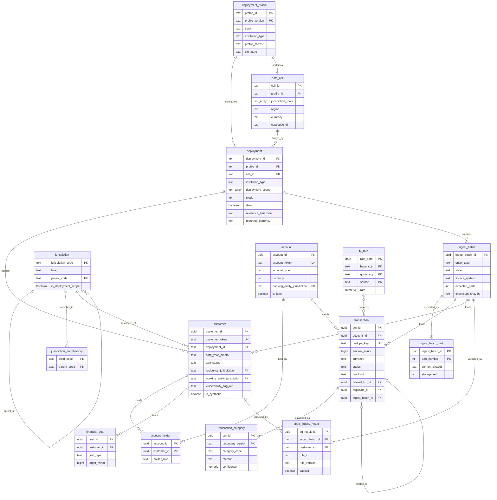
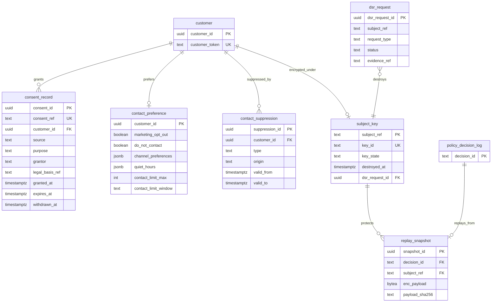
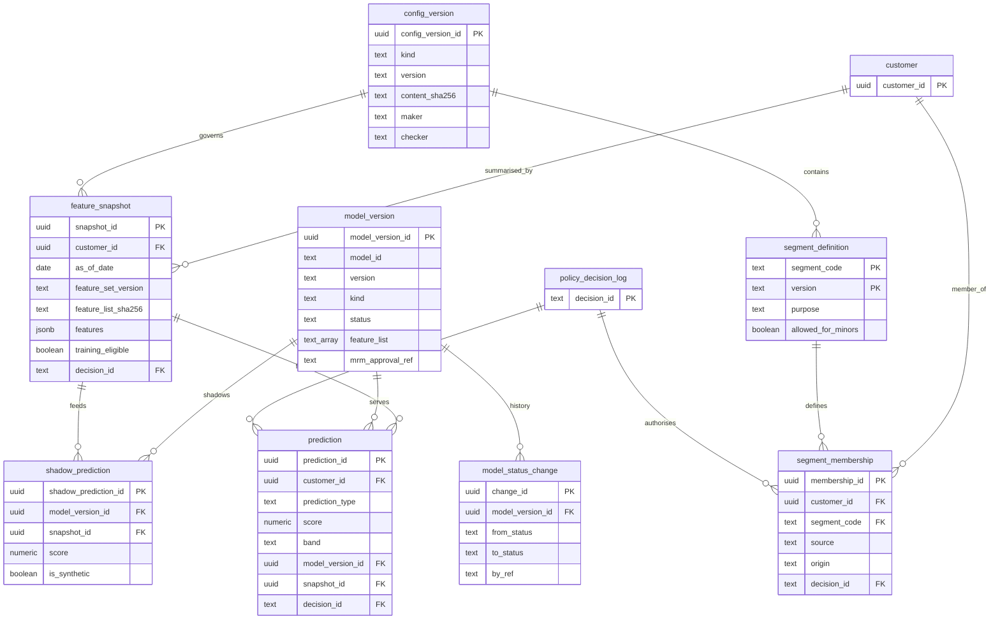
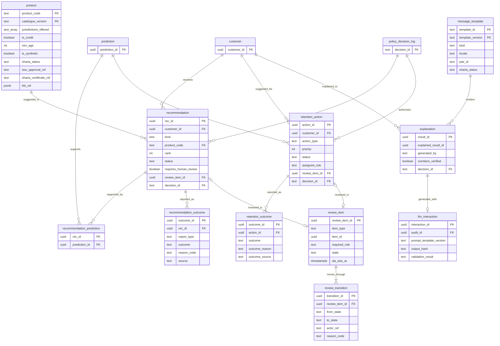
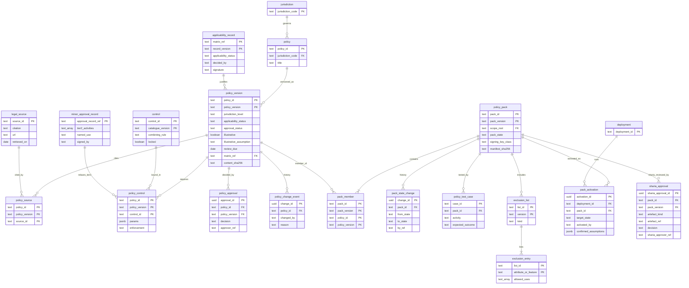
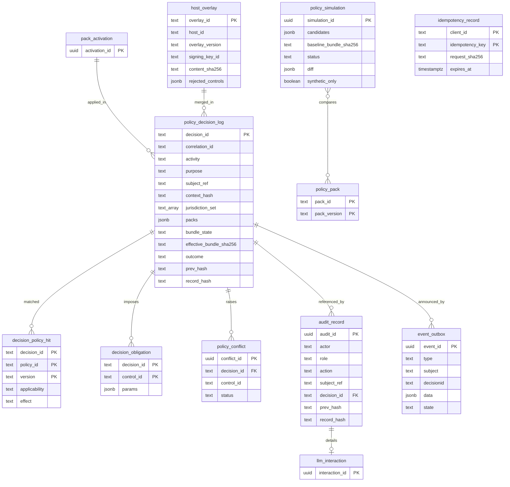

# Logical ERD - retail intelligence subsystem (PH-3)

**Status:** normative logical data model, PH-3 (readiness P-4; planning/10 S3.1), 2026-11-10. This is a planning artefact: there is no DDL, no migration and no code. The physical schema is derived from it once implementation is approved (GATE-1 ratification) and the stack is pinned at GATE-2.

**Authority:**
- This file is the full ERD that planning/07 §3 and the spine (Deferred: "ERD with full attributes") point to.
- Where it differs from planning/07 §2, this file wins. planning/07 is read-only (AGENTS.md), so every difference is listed in §9.
- Field names and enums follow the normative contract `contracts/openapi/retail-intelligence-v1.yaml` where an entity crosses the boundary.

**Market-neutral (two tracks, DEC-50/DEC-51; planning/21).** No column, check or enum holds a jurisdiction, track or institution literal; `track`, `cell_id`, Islamic product structures and Sharia artefact kinds are reference data, and `institution_type` (CONVENTIONAL / ISLAMIC) comes only from the signed deployment profile. Jurisdiction codes, consent purposes, segment, need, playbook and reason codes are reference data (AD-3, AD-17). Examples such as `US-NY-NYC` are illustrative only.

## 1. Conventions

| Topic | Rule |
|---|---|
| Money | `amount_minor bigint` plus `currency char(3)` (ISO 4217). Derived values are `numeric(19,4)`, and rates are `numeric(19,8)`. Floats are never used (AD-9) |
| Time | `timestamptz` in UTC. Business dates are `date` in the deployment `reference_timezone` |
| Identity | Internal `uuid` surrogate keys. A customer is identified by `customer_token` (host token). `subject_ref` in chained stores **is** the customer token. There is no column for a name, national ID, account number, full address, phone, email or full date of birth (AD-9; planning/15 §8) |
| History | Append-only facts; corrections are new rows. Bitemporal `valid_from`, `valid_to` and `recorded_at` where state changes |
| Lineage | Ingested rows carry `ingest_batch_id`, `source_system`, `source_type` and `is_synthetic`. Derived rows carry `decision_id`, `feature_set_version`, `model_version_id` and `config_version_id` where relevant (AD-11) |
| Types in diagrams | Mermaid shows simplified types (`numeric`, `text`). The tables give the full logical type |
| Data cell (DEC-52, DEC-53) | One physical database per data cell (`A-US`, `A-UK`, `B-AE`; planning/21 §2). Every business row lives only in its cell's database; the DS check constraint is per cell instance. No foreign key, view or join crosses cells or tracks; only aggregate rows without tokens (portfolio, DEC-62) may be combined inside one track |

### 1.1 Column legends used in every entity table

**PII class.** No class holds direct identifiers; the model has no column for them.

| Code | Meaning |
|---|---|
| N | No personal data: reference data, signed policy content, configuration |
| ST | Staff or service actor reference only (staff token, service id: maker, approver, reviewer, activator). This is employee data under bank HR/IAM rules; it is outside customer DSR scope [LEGAL-CONFIRM] |
| PS | Pseudonymous subject reference only (customer token or `subject_ref`, hashes); no customer attributes |
| PF | Pseudonymous financial or behavioural data linked to a customer token |
| PR | Pseudonymous restricted data: age status or birth year-month, consent grantor and legal basis, vulnerability flag reference, DSR facts. Narrower read access; minors rules apply (planning/14 §13.3) |

**Retention hook.** Each entity names its `CTL-RETENTION{entity}` code (planning/14 §5). The policy-resolved `[min_keep, max_keep]` window drives the purge job.
- All values are UNKNOWN (DEC-20, BLOCKED-EXTERNAL). Until legal confirms them, the purge job runs report-only (planning/07 §8).
- `min_keep > max_keep` raises a `policy_conflict` and goes to legal review; it is never auto-resolved.
- Hash-chained stores are never purged row by row. They expire by partition, at the longest approved period.

**Scope.**

| Code | Meaning |
|---|---|
| DS | `deployment_id text NOT NULL` with a check constraint equal to the instance id (AD-16). Every business row has it |
| JC | Carries coarse jurisdiction context codes (residence, booking entity, servicing location) |
| JS | Carries the resolved `jurisdiction_set text[]` |
| GC | Deployment-neutral signed content (packs, policies, controls). It is bound to a deployment only through `pack_activation` |
| RD | Reference data inside a deployment `config_version` (maker-checker) |

**Erasure.** These codes describe what an approved DSR delete or objection does.
- Legal holds (`REJECTED_LEGAL_HOLD`) and an approved `min_keep` take precedence, where legal confirms (planning/07 §8.2) [LEGAL-CONFIRM].
- Whether crypto-shredding plus token destruction counts as deletion is UNRESOLVED APPLICABILITY. DEC-35 decides the method; LEG/PRIV confirm it by GATE-12.

| Code | Meaning |
|---|---|
| E-DEL | Operational row deleted, or anonymised by dropping the customer link and keeping aggregates. After any restore from backup, the restore procedure re-applies every COMPLETED `dsr_request` delete before `/ready` is true. This keeps backups consistent with SEC-20 |
| E-CS | **Crypto-shredding.** The row is append-only or hash-chained and is never changed. It holds only `subject_ref` and hashes. Any personal payload beside it sits in `enc_payload bytea`, encrypted with the subject's data key (`subject_key`). The DSR destroys that key through `SubjectKeyPort`, and the host destroys its token mapping. The hash chain stays verifiable; replay of the inputs returns `SUBJECT_ERASED` |
| E-UNLINK | The row is kept as evidence. It holds only the token, which becomes unlinkable when the host destroys the token mapping |
| E-NA | No subject data |

## 2. Diagram map

| Diagram | Entities |
|---|---|
| D1 Deployment, jurisdiction and ledger | deployment_profile, data_cell, deployment, jurisdiction, jurisdiction_membership, customer, account, account_holder, transaction, transaction_category, fx_rate, financial_goal, ingest_batch, ingest_batch_part, data_quality_result |
| D2 Consent, preferences and erasure | consent_record, contact_preference, contact_suppression, subject_key, dsr_request, replay_snapshot |
| D3 Features, segments, predictions and model registry | config_version, feature_snapshot, segment_definition, segment_membership, model_version, model_status_change, prediction, shadow_prediction |
| D4 Suggestions, retention, review and explanations | product, message_template, recommendation, recommendation_prediction, recommendation_outcome, retention_action, retention_outcome, review_item, review_transition, explanation, llm_interaction |
| D5 Policy content and pack lifecycle | policy, policy_version, legal_source, policy_source, control, policy_control, policy_approval, policy_change_event, applicability_record, minor_approval_record, policy_pack, pack_member, pack_state_change, policy_test_case, exclusion_list, exclusion_entry, pack_activation, sharia_approval |
| D6 Decision log, audit, overlay, simulation and operations | policy_decision_log, decision_policy_hit, decision_obligation, policy_conflict, audit_record, host_overlay, policy_simulation, event_outbox, idempotency_record |

That is 67 entities (63 at PH-3, plus `deployment_profile`, `data_cell` and `sharia_approval` from the two-track update, and `message_template` from contract 1.2.0, V-9, 2026-11-10). An entity that appears in a second diagram is shown there only as a link stub, with its key.

## 3. D1 - Deployment, jurisdiction and ledger

| Entity | Key fields and types | PII | Retention hook | Scope | Erasure |
|---|---|---|---|---|---|
| `deployment_profile` | `profile_id text`, `profile_version text` (PK pair); `track text` (RD code, e.g. A / B); `institution_type text` (CONVENTIONAL / ISLAMIC); `mode text`; `demo boolean`; `synthetic_only boolean`; `packs jsonb` (baseline, jurisdiction packs, `institution_overlay` pack ref or null); `age_of_majority jsonb` (per jurisdiction root; config, DEC-60 [LEGAL-CONFIRM]); `llm_hosting text` (NONE / BANK_ON_PREM / IN_REGION; Track B allows NONE or BANK_ON_PREM only, DEC-58); `model_registry_scope text`; `idp_realm text`; `profile_sha256 char(64)`; `signature text`; `loaded_at timestamptz`. Signed and read-only at runtime; bootstrap refuses a profile whose packs, catalogue, models or templates carry another track (planning/21 §3) | N | none (deployment config) | self | E-NA |
| `data_cell` | `cell_id text PK` (RD code, e.g. `A-US`, `A-UK`, `B-AE`); `profile_id text FK`; `jurisdiction_roots text[]`; `in_scope text[]`; `region text` (`CTL-DATA-RESIDENCY`); `currency char(3)`; `locales text[]`; `catalogue_id text`. One database per cell (DEC-52, DEC-53) | N | none (deployment config) | self | E-NA |
| `deployment` | `deployment_id text PK`; `profile_id text FK`, `profile_version text` (DEC-61); `cell_id text FK`; `track text`; `institution_type text` (copied from the profile at bootstrap); `deployment_scope text[]`; `mode text` (STANDALONE / PLUGIN); `demo boolean` (AD-18); `reference_timezone text`; `reporting_currency char(3)`; `created_at timestamptz` | N | none (deployment config) | self | E-NA |
| `jurisdiction` | `jurisdiction_code text PK`; `level text` (GLOBAL_BASELINE / NATIONAL / SUBNATIONAL / LOCAL, which map to policy L0..L3); `parent_code text FK`; `name text`; `in_deployment_scope boolean`; `config_version_id uuid FK` | N | none (RD) | RD | E-NA |
| `jurisdiction_membership` | `child_code text`, `parent_code text` (PK pair). Supranational cases only [UNKNOWN until needed] | N | none | RD | E-NA |
| `customer` | `customer_id uuid PK`; `customer_token text UK`; `deployment_id text`; `birth_year_month char(7) null`; `age_status text` (ADULT / MINOR_PROTECTED / AGE_UNKNOWN); `host_age_flag text null`; `residence_jurisdiction text FK`; `booking_entity_jurisdiction text FK`; `servicing_location text null FK`; `relationship_start date`; `vulnerability_flag_ref text null` (reference only, never details, never inferred); `source_system text`; `ingest_batch_id uuid FK`; `is_synthetic boolean`; `recorded_at timestamptz` | PR | CUSTOMER | DS, JC | E-DEL |
| `account` | `account_id uuid PK`; `account_token text UK`; `account_type text` (CURRENT / SAVINGS / CARD / LOAN); `currency char(3)`; `opened_on date`; `closed_on date null`; `status text`; `is_joint boolean`; `booking_entity_jurisdiction text FK`; `ingest_batch_id uuid FK`; `is_synthetic boolean`; `deployment_id text` | PF | ACCOUNT | DS, JC | E-DEL (a joint account stays for the other holder; only this subject's `account_holder` row goes) |
| `account_holder` | `account_id uuid FK`, `customer_id uuid FK` (PK pair); `holder_role text` (PRIMARY / JOINT); `valid_from date`; `valid_to date null` | PF | ACCOUNT | DS | E-DEL |
| `transaction` | `txn_id uuid PK`; `account_id uuid FK`; `source_txn_id text` (contract `txn_ref`); `dedupe_key text UK` = hash(account_token, source_txn_id); `booking_ts timestamptz`; `value_date date`; `amount_minor bigint`; `currency char(3)`; `direction text` (CR / DR); `status text` (PENDING / BOOKED / REVERSED); `txn_kind text`; `related_txn_id uuid FK null`; `transfer_group_id uuid null`; `merchant_ref text`; `mcc char(4)`; `description_redacted_enc bytea null` (untrusted free text, encrypted with the subject key); `duplicate_of uuid FK null`; `source_type text`; `source_system text`; `ingest_batch_id uuid FK`; `is_synthetic boolean`; `deployment_id text`; `recorded_at timestamptz` | PF | TRANSACTION | DS | E-DEL; the description column is E-CS |
| `transaction_category` | `txn_id uuid FK`, `taxonomy_version text` (PK pair, one active row per pair); `category_code text`; `method text` (RULE / ML / HOST); `confidence numeric(5,4)`; `rule_id text`; `decision_id text FK`. The taxonomy holds no forbidden-inference label | PF | TRANSACTION | DS | E-DEL |
| `fx_rate` | `rate_date date`, `base_ccy char(3)`, `quote_ccy char(3)`, `source text` (PK); `rate numeric(19,8)`; immutable | N | FX_RATE | DS | E-NA |
| `financial_goal` | `goal_id uuid PK`; `goal_ref text`; `customer_id uuid FK`; `goal_type text` (RD code); `target_minor bigint`; `currency char(3)`; `target_date date`; `source text` (CUSTOMER / HOST; never inferred for minors); `status text`; `deployment_id text` | PF | FINANCIAL_GOAL | DS | E-DEL |
| `ingest_batch` | `ingest_batch_id uuid PK` (contract `batch_id`); `entity_type text` (CUSTOMER / ACCOUNT / TRANSACTION / FINANCIAL_GOAL / PRODUCT_CATALOGUE); `state text` (OPEN / COMMITTING / COMMITTED / HELD_FOR_REVIEW / FAILED / EXPIRED); `source_system text`; `client_id text` (ST); `mapping_ref text null`; `format text`; `expected_parts int`; `parts_received int`; `received_at`, `committed_at timestamptz`; `counts jsonb`; `validation_report_ref text`; `checksum_sha256 char(64)`; `deployment_id text` | PS (reject samples hold tokens only) | INGEST_BATCH | DS | E-UNLINK |
| `ingest_batch_part` | `ingest_batch_id uuid FK`, `part_number int` (PK pair); `content_sha256 char(64)` (`X-Content-SHA256`); `byte_size bigint`; `storage_ref text` (staged NDJSON, through `BulkStagingPort`); `received_at timestamptz` | PF (staged raw rows) | INGEST_BATCH (staging is deleted after commit plus a window) | DS | E-DEL |
| `data_quality_result` | `dq_result_id uuid PK`; `ingest_batch_id uuid FK null`; `customer_id uuid FK null`; `module text null` (M1..M7); `rule_id text` (DQ-01..DQ-10); `rule_version text`; `dimension text`; `measured_value numeric(19,4)`; `threshold text`; `passed boolean`; `effect text`; `created_at timestamptz`; `deployment_id text` | PS | DATA_QUALITY_RESULT | DS | E-DEL (customer-level rows); batch-level rows E-NA |

## 4. D2 - Consent, preferences and erasure

| Entity | Key fields and types | PII | Retention hook | Scope | Erasure |
|---|---|---|---|---|---|
| `consent_record` | `consent_id uuid PK`; `consent_ref text UK` (contract upsert key); `customer_id uuid FK`; `source text`; `purpose text` (RD code, AD-17; not an enum); `grantor text` (CUSTOMER / PARENT_GUARDIAN); `legal_basis_ref text`; `granted_at`, `expires_at`, `withdrawn_at timestamptz`; `host_ref text`; `is_synthetic boolean`; `valid_from`, `valid_to`, `recorded_at timestamptz` (every upsert is a new history row) | PR | CONSENT_HISTORY | DS | E-DEL where legally allowed. Withdrawal evidence kept under `min_keep` is E-UNLINK [LEGAL-CONFIRM] |
| `contact_preference` | `customer_id uuid PK FK`; `marketing_opt_out boolean`; `do_not_contact boolean`; `channel_preferences jsonb` (`channel`, `allowed`, `contact_consent_ref`); `quiet_hours jsonb`; `contact_limit_max int`; `contact_limit_window text` (ISO 8601 duration); `updated_at timestamptz`; `is_synthetic boolean`; `deployment_id text`. Host-owned, mirrored read-only; inputs to `CTL-CONTACT-LIMIT` | PR | CONTACT_PREFERENCE | DS | E-DEL |
| `contact_suppression` | `suppression_id uuid PK`; `customer_id uuid FK`; `type text` (PAUSE_OFFERS / MARKETING_OPT_OUT / RESTRICTED_OUTREACH, extensible); `source text` = HOST; `origin text` (HOST_CORE / CREDIT_PLATFORM: the CI-2 stub); `valid_from`, `valid_to timestamptz`; `recorded_at timestamptz`. Consumed only by `CTL-MARKETING-SUPPRESS`, never a feature | PR | CONTACT_PREFERENCE | DS | E-DEL |
| `subject_key` | `subject_ref text PK` (= customer token); `key_id text UK` (key handle in the KMS; **no key material in the database**); `key_state text` (ACTIVE / DESTROYED); `created_at`, `destroyed_at timestamptz`; `dsr_request_id uuid FK null`; `deployment_id text` | PS | SUBJECT_KEY (kept at least as long as any row encrypted under it) | DS | E-UNLINK (the row is the shredding evidence; after a restore, a DESTROYED key stays destroyed) |
| `dsr_request` | `dsr_request_id uuid PK`; `subject_ref text`; `request_type text` (ACCESS / DELETE / OBJECT_PROFILING); `received_at timestamptz`; `host_ref text`; `jurisdiction_context jsonb null`; `status text` (RECEIVED / IN_PROGRESS / COMPLETED / REJECTED_LEGAL_HOLD); `legal_hold_ref text null`; `completed_at timestamptz`; `evidence_ref text`; `deployment_id text`. Placeholder in v1 | PR | DSR_REQUEST | DS, JC | E-UNLINK (needed for the post-restore re-apply of deletions) |
| `replay_snapshot` | `snapshot_id uuid PK`; `decision_id text FK`; `subject_ref text FK`; `key_id text`; `enc_payload bytea` (canonical request context plus input references, AES-GCM under the subject key); `payload_sha256 char(64)`; `created_at timestamptz`; `deployment_id text`. This is the "stored request snapshot for replay" of planning/07 §8.2 | PS (ciphertext) | DECISION_LOG | DS | E-CS |

**Erasure sequence** (planning/07 §8.2, AD-10, DEC-35):
1. The `dsr_request` reaches IN_PROGRESS.
2. Every E-DEL row for the subject is deleted or anonymised, in dependency order: review_item and outcomes, then recommendation, retention_action, prediction, feature_snapshot, segment_membership, transaction, account_holder, consent history where allowed, preferences, and finally the customer.
3. `SubjectKeyPort.destroy(key_id)` runs, and `subject_key.key_state` becomes DESTROYED. Every E-CS payload is now unreadable.
4. The host destroys its token mapping. This is a host action, recorded through `host_ref`.
5. An `audit_record` "erasure executed" is appended, with no personal data, and the `dsr_request` becomes COMPLETED.

No hash-chained row changes at any step. Replay for this subject returns 422 `DATA_QUALITY_INSUFFICIENT` with reason `SUBJECT_ERASED`, as the contract specifies.

## 5. D3 - Features, segments, predictions and model registry

| Entity | Key fields and types | PII | Retention hook | Scope | Erasure |
|---|---|---|---|---|---|
| `config_version` | `config_version_id uuid PK`; `deployment_id text`; `kind text` (REFERENCE_DATA / THRESHOLDS / CATALOGUE / TEMPLATES / ACCESS_PURPOSE_REGISTRY; the last holds the per-role and per-client directory access purposes, DEC-68, seeded from `contracts/role-scope-matrix.json` `role_purpose`, no client registered in contract 1.2.0); `version text`; `content_sha256 char(64)`; `maker`, `checker text` (ST, maker != checker); `effective_from timestamptz`; `recorded_at timestamptz`. Market reference data only; legal policy lives in packs | ST | CONFIG | DS, RD | E-NA |
| `feature_snapshot` | `snapshot_id uuid PK`; `customer_id uuid FK`; `as_of_date date`; `feature_set_version text`; `feature_list_sha256 char(64)`; `exclusion_list_versions jsonb`; `features jsonb` (excluded attributes removed before storage); `data_window_start`, `data_window_end date`; `training_eligible boolean` (false for MINOR_PROTECTED and AGE_UNKNOWN: Tier 1 `MODEL_TRAINING`, AD-7); `config_version_id uuid FK`; `decision_id text FK`; `computed_at timestamptz`; `deployment_id text` | PF | FEATURE_SNAPSHOT | DS | E-DEL |
| `segment_definition` | `segment_code text`, `version text` (PK pair); `rule_expr_ref text`; `purpose text` (INSIGHT / COMMERCIAL); `allowed_for_minors boolean`; `jurisdiction_scope text[]`; `config_version_id uuid FK` | N | none (RD) | RD | E-NA |
| `segment_membership` | `membership_id uuid PK`; `customer_id uuid FK`; `segment_code text`, `segment_version text` (FK); `valid_from`, `valid_to date`; `evidence jsonb`; `reason_codes text[]`; `source text` (RULE / HOST); `origin text null` (HOST_CORE / CREDIT_PLATFORM: CI-1, read-only, never a credit-product ranking feature); `decision_id text FK`; `deployment_id text` | PF | SEGMENT_MEMBERSHIP | DS | E-DEL |
| `model_version` | `model_version_id uuid PK`; `model_id text` and `version text` (contract key, UK pair); `model_name text`; `kind text` (RULESET / ML_MODEL); `status text` (RULESET: DRAFT / ACTIVE / RETIRED; ML_MODEL: DRAFT / SHADOW / APPROVED / RETIRED; checked per kind, DEC-47); `registry_label text` ("non-model" for RULESET); `activity text`; `algorithm text`; `feature_set_version text`; `feature_list text[]`; `exclusion_check_passed boolean`; `training_data_ref text`; `training_jurisdiction_scope text[]`; `track text` and `cell_scope text[]` (DEC-57: trained and evaluated per track, per cell for real data; never spans tracks); `metrics jsonb` (aggregates only); `fairness_report_ref text`; `artefact_sha256 char(64)`; `materiality_tier text`; `is_model_per_bank_policy boolean`; `mrm_approval_ref text null` (required for APPROVED; APPROVED is refused while DEC-19 is unresolved); `approved_by text` (ST); `approved_at timestamptz`; `deployment_id text`. Serving = RULESET ACTIVE or ML_MODEL APPROVED (`CTL-MODEL-APPROVED-ONLY`) | ST | MODEL_REGISTRY | DS | E-NA |
| `model_status_change` | `change_id uuid PK`; `model_version_id uuid FK`; `from_status`, `to_status text`; `at timestamptz`; `by_ref text` (ST); `reason text`; `mrm_approval_ref text null`. Append-only; emits `model.status_changed` | ST | MODEL_REGISTRY | DS | E-NA |
| `prediction` | `prediction_id uuid PK`; `customer_id uuid FK`; `prediction_type text` (CHURN, or NEED with `need_code` RD); `need_code text null`; `score numeric(5,4)`; `band text`; `horizon_days int`; `model_version_id uuid FK` (must be serving; trigger-checked); `snapshot_id uuid FK`; `reason_codes text[]`; `drivers jsonb`; `config_version_id uuid FK`; `decision_id text FK`; `created_at timestamptz`; `deployment_id text` | PF | PREDICTION | DS | E-DEL |
| `shadow_prediction` | The same columns as `prediction`, plus `is_synthetic boolean CHECK (is_synthetic)`. `model_version_id` must be in status SHADOW. Kept in a separate schema with **no grant** to the API, M6, M7, M9 or event roles. Nothing has a foreign key into it, and only aggregate metrics leave it (DEC-47, AD-15) | PF (synthetic only) | SHADOW_PREDICTION | DS | E-DEL |

## 6. D4 - Suggestions, retention, review and explanations

| Entity | Key fields and types | PII | Retention hook | Scope | Erasure |
|---|---|---|---|---|---|
| `product` | `product_code text`, `catalogue_version text` (PK pair); `catalogue_id text` and `track text` (DEC-56); `jurisdictions_offered text[]`; `product_structure text null` (RD code, e.g. WAKALA / MUDARABAH / MURABAHA / TAWARRUQ / IJARAH / TAKAFUL; synthetic and illustrative); `sharia_status text null` (NOT_REVIEWED / IN_SHARIA_REVIEW / SHARIA_APPROVED / SHARIA_REJECTED / RETIRED; never an illustrative value; `CTL-CATALOGUE-ELIGIBILITY`, DEC-55); `illustrative_sharia_assumption text null` (`ASSUME_COMPLIANT` only, demo catalogues inside an `ILLUSTRATIVE` bundle only, activator-confirmed; planning/21 §4.3); `sharia_approval_ref text null`; Sharia disclosure references (planning/20 SDC-11, SH03, SH11, SDC-14; contract 1.2.0 `ShariaDisclosure`, V-9): `sharia_basis_ref jsonb null` (locale -> approved text ref), `issc_approval_ref text null`, `sharia_certificate_ref text null`, `kfs_ref jsonb null` (locale -> KFS ref), `contract_consequences_ref jsonb null`, `education_ref jsonb null`, `operator_sharia_approval_ref text null` (Takaful items only), `aaoifi_basis text[] null`, `hsa_resolution_refs text[] null`, `issc_resolution_ref text null`. All are opaque references to bank-approved documents, never free text and never parsed for figures (SDC-05, SDC-16). `product_structure` is the file 20 `contract_type` (exposed as `sharia_disclosure.contract_type`; a `CONVENTIONAL_*` code is refused at load in an ISLAMIC catalogue, SDC-02). Validation: in an ISLAMIC catalogue a product or financing item without `sharia_basis_ref`, `issc_approval_ref`, `sharia_certificate_ref` or a `kfs_ref` for every profile locale is not eligible (`CTL-CATALOGUE-ELIGIBILITY` required attributes) and is never rendered; `issc_approval_ref` and `sharia_approval_ref` are set only when `sharia_status = SHARIA_APPROVED`; in a CONVENTIONAL catalogue all Sharia columns are null (load check); a demo item uses `illustrative_sharia_assumption` with synthetic refs and no approval refs. Whether `issc_approval_ref` may equal `sharia_approval_ref`, whether the certificate needs one ref per language and whose ISSC approves Takaful text are [SHARIA-CONFIRM]; `requires_human_review boolean` (e.g. Mudarabah and Takaful items); `late_payment_treatment text null` (descriptive approved-text reference only, e.g. CHARITY_UNDERTAKING; never calculated, charged, waived or used as a feature, planning/21 §4.4); `name text`; `product_family text`; `is_credit boolean`; `is_fee_bearing boolean`; `min_age int`; `eligibility_rule_ref text`; `terms_ref text` (bank-supplied, never authored by us or an LLM); `effective_from`, `effective_to date`; `approved_by text` (bank reference); `is_synthetic boolean` (demo catalogue "SYNTHETIC - DEMO"); `deployment_id text` | N | CATALOGUE | DS, RD | E-NA |
| `message_template` | `template_id text`, `template_version text` (PK pair); `deployment_id text`; `track text` (RD code; bootstrap refuses another track's template, DEC-51); `config_version_id uuid FK` (maker-checker release); `kind text` (EXPLANATION / MARKETING / REASON_CODE_TEXT / ASSISTANT_HANDOFF / DISCLOSURE_EDUCATION; RD); `locale text` (BCP 47, one of the profile locales, DEC-59); `pair_id text null` (links the language twins approved as a pair, SDC-04); `body_ref text` (approved text in the bank library; never authored by us or an LLM, SDC-05); `slots text[]` (typed slot whitelist: catalogue names, verified numbers, disclosure refs; no fee, profit or settlement arithmetic, SDC-16); `term_list_version text null` (`CTL-TERMINOLOGY` list the text passed); `sharia_status text null` (ISLAMIC only; derived from the latest `sharia_approval` row, DEC-55); `illustrative_sharia_assumption text null` (`ASSUME_COMPLIANT`, `ILLUSTRATIVE` demo bundles only); `sharia_approval_ref text null` (set only when `SHARIA_APPROVED`); `compliance_approval_ref text null` (marketing templates: Compliance sign-off as well, SDC-04 [LEGAL-CONFIRM]); `aaoifi_basis text[] null`, `hsa_resolution_refs text[] null`, `issc_resolution_ref text null` (re-review on Sharia change, SDC-14); `is_synthetic boolean`; `effective_from timestamptz`. A template without a twin for every profile locale, or (ISLAMIC, non-demo) without `SHARIA_APPROVED`, is never rendered (`CTL-SHARIA-APPROVAL`, BLOCK `SHARIA_REVIEW_PENDING`). In CONVENTIONAL deployments the Sharia columns are null. Contract 1.2.0 (V-9); before it, templates were described only as reference data inside `config_version` | N | CONFIG | DS, RD | E-NA |
| `recommendation` | `rec_id uuid PK`; `customer_id uuid FK`; `kind text` (closed: PRODUCT_SUGGESTION / SERVICE_SUGGESTION / EDUCATIONAL_CONTENT / CREDIT_REFERRAL); `product_code`, `catalogue_version text FK`; `rank int`; `reason_codes text[]`; `rule_trace jsonb`; `gate_trace jsonb`; `allowed_channels text[]`; `requires_human_review boolean`; `review_item_id uuid FK null`; `status text` (PROPOSED / SUPPRESSED / PENDING_REVIEW / SHOWN / ACCEPTED / DISMISSED_BY_CUSTOMER / OVERRIDDEN / EXPIRED); `suppression_reason text null`; `referral_target text null` (CREDIT_REFERRAL only); `expires_at timestamptz`; `decision_id text FK`; `sharia_disclosure jsonb null` (ISLAMIC only: snapshot of the `ShariaDisclosure` references and status served, for SDC-15 evidence; null in CONVENTIONAL deployments; contract 1.2.0, V-9); `created_at timestamptz`; `deployment_id text`. **No credit approval, decline, limit, rate or likelihood column exists** (AD-6) | PF | RECOMMENDATION | DS | E-DEL |
| `recommendation_prediction` | `rec_id uuid FK`, `prediction_id uuid FK` (PK pair). Replaces the `prediction_ids` array of planning/07 | PF | RECOMMENDATION | DS | E-DEL |
| `recommendation_outcome` | `outcome_id uuid PK` (contract receipt `outcome_id`); `rec_id uuid FK`; `report_type text` (CUSTOMER_OUTCOME / REVIEW_RESULT); `outcome text` (CUSTOMER_OUTCOME: SHOWN / ACCEPTED / DISMISSED_BY_CUSTOMER / OVERRIDDEN; REVIEW_RESULT: CLEARED_TO_SHOW / REJECTED / ESCALATED / EXPIRED); `reason_code text`; `source text` (HOST / STAFF); `channel text null`; `reporter_ref text` (ST or service); `occurred_at timestamptz`; `correlation_id text`; `recorded_at timestamptz`. Append-only; the latest report wins | PF | RECOMMENDATION_OUTCOME | DS | E-DEL |
| `retention_action` | `action_id uuid PK`; `customer_id uuid FK`; `action_type text` (`RA_*` playbook code, RD); `priority int`; `trigger_prediction_id uuid FK`; `status text` (PROPOSED / SUPPRESSED / PENDING_REVIEW / SHOWN / ACTIONED / EXPIRED); `assigned_role text` (ReviewerRole: analyst / relationship_staff); `requires_human_review boolean`; `review_item_id uuid FK null`; `allowed_channels text[]`; `contact_constraints jsonb`; `reason_codes text[]`; `expires_at timestamptz`; `decision_id text FK`; `created_at timestamptz`; `deployment_id text`. The latest outcome (`outcome`, `outcome_reason`, `outcome_at`, `outcome_source`, `outcome_recorded_by`) is a derived view over `retention_outcome` | PF | RETENTION_ACTION | DS | E-DEL |
| `retention_outcome` | `outcome_id uuid PK`; `action_id uuid FK`; `report_type text` (RETENTION_OUTCOME / REVIEW_RESULT); `outcome text` (NOT_ACTIONED / CONTACTED / RETAINED / CLOSED / UNKNOWN); `outcome_reason text` (fixed code); `outcome_at timestamptz`; `outcome_source text` (HOST / STAFF); `reported_by text` (ST or service token); `correlation_id text`; `recorded_at timestamptz`. Append-only; never feeds credit processes | PF | RETENTION_OUTCOME | DS | E-DEL (each report's audit record survives with `subject_ref` only) |
| `review_item` | `review_item_id uuid PK`; `item_type text` (RECOMMENDATION / RETENTION_ACTION / EXPLANATION_TEMPLATE); `item_id uuid`; `customer_id uuid FK`; `decision_id text FK`; `trigger_control text` (e.g. `CTL-HUMAN-REVIEW`); `required_role text` (ReviewerRole); `state text` (current: QUEUED / IN_REVIEW / CLEARED_TO_SHOW / REJECTED / ESCALATED / EXPIRED / CANCELLED); `reason_code text null` (mandatory on REJECTED and ESCALATED); `reviewer_ref text null` (ST, != requester); `sla_due_at`, `created_at`, `decided_at timestamptz`; `deployment_id text` | PF | REVIEW_ITEM | DS | E-DEL |
| `review_transition` | `transition_id uuid PK`; `review_item_id uuid FK`; `from_state`, `to_state text`; `actor_ref text` (ST or SYSTEM for EXPIRED and CANCELLED); `reason_code text null`; `at timestamptz`; `correlation_id text`; `audit_id uuid FK`. Append-only history behind `review_item.state` | ST, PS | REVIEW_ITEM | DS | E-DEL with its parent (the audit chain keeps the transition record) |
| `explanation` | `result_id uuid PK` (contract `result_id`); `explained_result_id uuid` (recommendation, prediction or retention action); `customer_id uuid FK`; `language text`; `generated_by text` (TEMPLATE / LLM); `template_id text`; `text_enc bytea` (under the subject key); `numbers_verified boolean`; `ai_assisted boolean`; `reason_codes text[]`; `decision_id text FK`; `created_at timestamptz`; `deployment_id text` | PF | EXPLANATION | DS | E-CS (text), then E-DEL (row) |
| `llm_interaction` | `interaction_id uuid PK`; `audit_id uuid FK`; `decision_id text FK`; `explanation_result_id uuid FK null`; `conversation_id text null` (assistant); `llm_adapter text` (template-only in the MVP, AD-14); `model_id text`; `prompt_template_version text`; `tool_calls jsonb` (tool names, ids and hashes only); `output_hash char(64)`; `validation_result text` (PASS / FALLBACK); `fallback_reason text`; `refusal boolean`; `enc_payload bytea null` (only if prompt or output text is retained; no raw PII in prompts); `created_at timestamptz` | PS | LLM_INTERACTION | DS | E-CS |

## 7. D5 - Policy content and pack lifecycle

| Entity | Key fields and types | PII | Retention hook | Scope | Erasure |
|---|---|---|---|---|---|
| `policy` | `policy_id text PK` (stable, never reused, `POL-<jurisdiction>-NNNN`); `jurisdiction_code text FK`; `title text` | N | POLICY_RECORD | GC | E-NA |
| `policy_version` | `policy_id text FK`, `policy_version text` (SemVer; PK pair); `jurisdiction_level text` (L0..L3); `activity_scope text[]`; `customer_scope jsonb` (closed predicate DSL, DEC-29); `product_scope`, `channel_scope`, `purpose_scope text[]`; `effective_from`, `effective_to date`; `recorded_at timestamptz`; `review_due date`; `applicability_status text` (APPLICABLE / NOT_APPLICABLE / PENDING_LEGAL_REVIEW; set only by the approver); `approval_status text` (DRAFT / LEGAL_REVIEW / APPROVED / RETIRED); `maker`, `approver text` (ST, different); `approved_at timestamptz`; `approval_evidence_ref text`; `matrix_ref text` (applicability-matrix row); `illustrative boolean` (true means it cannot be APPROVED); `illustrative_assumption text null` (ASSUME_APPLICABLE / ASSUME_NOT_APPLICABLE, only when illustrative; DEC-44); `supersedes jsonb`; `summary text`; `content_sha256 char(64)`. Immutable once in LEGAL_REVIEW | ST | POLICY_RECORD | GC | E-NA |
| `legal_source` | `source_id text PK`; `citation text`; `url text`; `retrieved_on date` (the baseline cites `INTERNAL-POLICY`) | N | POLICY_RECORD | GC | E-NA |
| `policy_source` | `policy_id`, `policy_version`, `source_id` (PK); `excerpt_ref text null` | N | POLICY_RECORD | GC | E-NA |
| `control` | `control_id text`, `catalogue_version text` (PK pair); `param_schema_ref text`; `combining_rule text`; `restrictiveness_order text`; `locked boolean` (L0 locked controls) | N | POLICY_RECORD | GC | E-NA |
| `policy_control` | `policy_id`, `policy_version`, `control_id` (PK); `params jsonb` (validated by the control's JSON Schema; may hold `approval_record_ref`); `enforcement text` (BLOCK / OBLIGATION / MONITOR) | N | POLICY_RECORD | GC | E-NA |
| `policy_approval` | `approval_id uuid PK`; `pack_id`, `pack_version text`; `policy_id`, `policy_version text FK`; `role text`; `approver_ref text` (ST, != maker); `decision text` (APPROVED / CHANGES_REQUESTED, governance values outside the linter scope); `applicability_status text`; `approval_evidence_ref text`; `reason text`; `recorded_at timestamptz`. Append-only. No rows exist while DEC-11 is unresolved | ST | POLICY_RECORD | GC | E-NA |
| `sharia_approval` | `sharia_approval_id uuid PK`; `pack_id`, `pack_version text`; `artefact_kind text` (POLICY / CATALOGUE_ITEM / EXPLANATION_TEMPLATE / MARKETING_TEMPLATE / REASON_CODE_TEXT); `artefact_ref text`; `artefact_version text`; `language text null`; `decision text` (SHARIA_APPROVED / SHARIA_REJECTED / CHANGES_REQUESTED; governance values); `sharia_approval_ref text` (ISSC / Sharia Compliance resolution reference); `sharia_approver_ref text` (ST, != maker); `reason text`; `recorded_at timestamptz`. Append-only. Only in ISLAMIC deployments; no rows exist until DEC-63 records a named Sharia approver. The current Sharia status of a template or reason-code text is the latest row for that artefact (templates themselves are reference data in `config_version`) | ST | POLICY_RECORD | GC | E-NA |
| `policy_change_event` | `change_id uuid PK`; `policy_id`, `policy_version text`; `changed_by text` (ST); `changed_at timestamptz`; `reason text`; `diff_ref text`; `ticket_ref text`. Append-only (planning/14 §3.1 `change_history`) | ST | POLICY_RECORD | GC | E-NA |
| `applicability_record` | `matrix_ref text`, `record_version text` (PK pair); `applicability_status text` (PENDING_LEGAL_REVIEW until DEC-10 is resolved); `decided_by text` (ST, `policy_approver` only); `decided_at timestamptz`; `evidence_ref text`; `signature text`; `content_sha256 char(64)`. Story 2.9; applicability as signed data | ST | POLICY_RECORD | GC | E-NA |
| `minor_approval_record` | `approval_record_ref text PK` (`MINOR-APPROVAL-*`); `jurisdiction_code text FK`; `tier2_activities text[]` (subset of Tier 2 only; Tier 1 can never appear, enforced by a check); `named_use text`; `purpose text` = MINOR_EDU; `legal_basis_ref text`; `grantor_rule text`; `signed_by text` (ST, legal or compliance); `signature text`; `effective_from`, `effective_to`, `review_due date` | ST | POLICY_RECORD | GC | E-NA |
| `policy_pack` | `pack_id text`, `pack_version text` (PK pair); `scope_root text FK` (jurisdiction); `manifest_sha256 char(64)`; `signature text`; `signing_key_class text` (DEMO / DEPLOYMENT; the TEST class exists only inside the test-port double, never in a deployment store); `pack_state text` (current: DRAFT / VALIDATED / IN_LEGAL_REVIEW / APPROVED / ACTIVE / ILLUSTRATIVE / RETIRED; DEC-45); `control_catalogue_version text`; `layer text` (BASELINE / JURISDICTION / INSTITUTION_OVERLAY; an INSTITUTION_OVERLAY pack is restrictive-only by CI invariant, DEC-54); `sharia_approval_status text null` (ISLAMIC deployments; derived from `sharia_approval` rows, DEC-55); `maker text` (ST); `validation_report_ref text`; `created_at timestamptz`. Content is immutable | ST | POLICY_RECORD | GC | E-NA |
| `pack_member` | `pack_id`, `pack_version`, `policy_id`, `policy_version` (PK) | N | POLICY_RECORD | GC | E-NA |
| `pack_state_change` | `change_id uuid PK`; `pack_id`, `pack_version text FK`; `from_state`, `to_state text`; `at timestamptz`; `by_ref text` (ST or SYSTEM for VALIDATED); `reason text`; `correlation_id text`. Append-only | ST | POLICY_RECORD | GC | E-NA |
| `policy_test_case` | `case_id text PK`; `pack_id`, `pack_version text FK`; `activity text`; `context jsonb` (synthetic codes only); `expected_outcome text`; `expected_obligations jsonb` | N | POLICY_RECORD | GC | E-NA |
| `exclusion_list` | `list_id text`, `version text` (PK pair); `kind text` (SENSITIVE / FORBIDDEN_INFERENCE / PROXY / PROTECTION_ONLY); `pack_id`, `pack_version text FK null` | N | POLICY_RECORD | GC | E-NA |
| `exclusion_entry` | `list_id`, `version`, `attribute_or_feature` (PK); `jurisdictions text[]`; `allowed_uses text[]`; `rationale text`; `matrix_ref text`. Contents [LEGAL-CONFIRM] (DEC-23) | N | POLICY_RECORD | GC | E-NA |
| `pack_activation` | `activation_id uuid PK`; `deployment_id text FK`; `pack_id`, `pack_version text FK`; `target_state text` (ACTIVE / ILLUSTRATIVE); `activated_at timestamptz`; `activated_by text` (ST, != maker); `signoff_refs text[]` (MGR/LEG; required for ACTIVE); `confirmed_assumptions jsonb` (policy_id, version, assumption: the DEC-44 second-user check); `replaced_pack_version text null`; `reason text`. Append-only. A check refuses ILLUSTRATIVE unless the deployment has `mode = STANDALONE` and `demo = true` | ST | POLICY_RECORD | DS | E-NA |

## 8. D6 - Decision log, audit, overlay, simulation and operations

| Entity | Key fields and types | PII | Retention hook | Scope | Erasure |
|---|---|---|---|---|---|
| `policy_decision_log` | `decision_id text PK`; `correlation_id text`; `trace_id text`; `decided_at timestamptz`; `as_of timestamptz`; `deployment_id text`; `mode text`; `profile_id text`, `track text`, `institution_type text`, `cell_id text` (DEC-61; exact replay); `caller_module text`; `service_identity text`; `host_id text null`; `activity text`; `purpose text`; `subject_ref text null` (token; null for dry-run and governance); `context_hash char(64)`; `jurisdiction_set text[]`; `packs jsonb` (pack ids, versions, manifest hashes); `overlay_id text FK null`; `effective_bundle_sha256 char(64)`; `bundle_state text` (ACTIVE / ILLUSTRATIVE); `outcome text` (PERMIT / PERMIT_WITH_OBLIGATIONS / DENY; INDETERMINATE is stored as DENY with `POLICY_INDETERMINATE`); `reason_codes text[]`; `flags text[]`; `prev_hash`, `record_hash char(64)`. Insert-only and hash-chained; one record per PDP call | PS | DECISION_LOG | DS, JS | E-CS (payload in `replay_snapshot`) |
| `decision_policy_hit` | `decision_id`, `policy_id`, `version` (PK); `applicability text`; `effect text`. Covered by the parent's record hash | N | DECISION_LOG | DS | E-NA |
| `decision_obligation` | `decision_id`, `control_id` (PK); `params jsonb`. Covered by the parent's record hash | N | DECISION_LOG | DS | E-NA |
| `policy_conflict` | `conflict_id uuid PK`; `decision_id text FK`; `control_id text`; `details jsonb`; `status text` (OPEN / IN_LEGAL_REVIEW / RESOLVED); `created_at timestamptz` (e.g. retention `min_keep > max_keep`) | N | DECISION_LOG | DS | E-NA |
| `audit_record` | `audit_id uuid PK`; `ts timestamptz`; `record_kind text` (AUDIT / DECISION, export view); `actor text` (ST or service); `act text null` (on-behalf-of); `role text`; `scopes text[]`; `deployment_id text`; `profile_id text`, `track text`, `institution_type text`, `cell_id text` (DEC-61); `jurisdiction_set text[]`; `action text`; `object_type`, `object_id text`; `subject_ref text null`; `request_hash char(64)`; `versions jsonb`; `decision_id text FK null`; `outcome text`; `correlation_id text`; access columns for token-returning list calls (contract 1.2.0 `AccessAuditDetail`, V-8, DEC-68): `client_id text null`, `access_purpose text null`, `access_kind text null` (LOOKUP / ENUMERATION / QUEUE / EXPORT), `access_filters jsonb null` (codes, dates and tokens only), `result_count int null`, `query_result_count int null`, `denial_code text null`; `enc_payload bytea null`, `key_id text null` (only where a view log needs detail); `prev_hash`, `record_hash char(64)`. Insert-only and hash-chained; every view of personal data is logged, and every customer-directory call, allowed or denied, writes one row | ST, PS | AUDIT_RECORD | DS, JS | E-CS |
| `host_overlay` | `overlay_id text PK`; `host_id text`; `overlay_version text`; `signing_key_id text`; `signature text`; `content_sha256 char(64)`; `controls jsonb`; `accepted_controls jsonb`; `rejected_controls jsonb` (emits `policy.overlay.rejected`); `received_at timestamptz`; `deployment_id text`. Plugin only; tighten-only merge | N | HOST_OVERLAY | DS | E-NA |
| `policy_simulation` | `simulation_id uuid PK`; `requested_by text` (ST); `candidates jsonb` (pack refs); `populations text[]`; `as_of timestamptz`; `baseline_bundle_sha256 char(64)`; `status text` (QUEUED / RUNNING / COMPLETED / FAILED); `golden_cases jsonb`; `diff jsonb` (aggregate counts per activity and jurisdiction); `pending_legal_review_hits jsonb`; `review_required_event_emitted boolean`; `synthetic_only boolean CHECK (synthetic_only)`; `created_at`, `completed_at timestamptz`; `deployment_id text` | ST | SIMULATION | DS | E-NA (synthetic aggregates) |
| `event_outbox` | `event_id uuid PK` (CloudEvents `id`); `type text`; `source text`; `subject text null` (customer token); `time timestamptz`; `decisionid text null`; `correlationid text`; `contractversion text`; `jurisdiction text null`; `illustrative boolean`; `data jsonb` (ids and summaries only); `state text` (PENDING / PUBLISHED / FAILED); `attempts int`; `published_at timestamptz`; `deployment_id text`. Written in the same transaction as the state change (AD-20) | PS | EVENT_OUTBOX | DS | E-DEL (PENDING events for an erased subject are dropped) |
| `idempotency_record` | `client_id text`, `idempotency_key text` (PK pair); `request_sha256 char(64)`; `response_status int`; `response_enc bytea` (stored response, under the subject key where it is customer-level); `subject_ref text null`; `created_at timestamptz`; `expires_at timestamptz` (24 h, planning/15 §7) | PS | IDEMPOTENCY (24 h, technical) | DS | E-DEL |

## 9. Changes against planning/07 §2 (planning/07 is read-only; this file wins)

| # | Change | Reason |
|---|---|---|
| 1 | `deployment.demo` added | AD-18, DEC-44 load guard |
| 2 | `account.account_token`, `account_holder` added | planning/07 promised tokens and a holder link [ASSUME]; the contract keys accounts by `account_token` |
| 3 | `ingest_batch` gains `entity_type`, `state`, `mapping_ref`, `format`, `expected_parts`, `parts_received`, `committed_at`, `client_id`; new `ingest_batch_part` | Contract bulk ingest (Story 3.6) |
| 4 | `contact_preference` reshaped to the contract (`do_not_contact`, `channel_preferences`, `quiet_hours`, contact limit); new `contact_suppression` | Contract `PreferenceRecordIn`; CI-2 (Story 2.10) |
| 5 | `consent_record.consent_ref` (UK), `is_synthetic`, history columns | Contract upsert key; AD-19 |
| 6 | `policy_version.illustrative_assumption` added | planning/14 §3.1, DEC-44 (it was missing from 07) |
| 7 | New `policy_approval`, `policy_change_event`, `applicability_record`, `minor_approval_record`, `pack_state_change`, `policy_test_case`, `policy_control` | planning/14 §3.2 entities not in 07; Story 2.9; planning/14 §13.3 |
| 8 | New `model_status_change`; `model_version` gains `model_id`, `activity`, `feature_list`, `exclusion_check_passed`, `registry_label` | Contract `ModelVersion`, DEC-47 |
| 9 | `shadow_prediction` specified (separate schema, no grants, synthetic check) | DEC-47, AD-15 |
| 10 | New `recommendation_outcome`, `recommendation_prediction`, `review_transition`, `explanation` | Contract outcome, explanation and review endpoints; append-only review history (AD-10) |
| 11 | `recommendation.referral_target`, `expires_at`; `retention_action.priority`, `allowed_channels`, `contact_constraints`, `expires_at` | Contract `Recommendation`, `RetentionAction` |
| 12 | New `replay_snapshot`; encrypted columns (`description_redacted_enc`, `text_enc`, `enc_payload`, `response_enc`) | Makes the planning/07 §8.2 "personal payload beside chained rows" concrete |
| 13 | New `policy_simulation`, `event_outbox`, `idempotency_record` | Contract simulation endpoints; AD-20 outbox; planning/15 §7 |
| 14 | `feature_snapshot.training_eligible` | AD-7 (minors are excluded from training) |
| 15 | Retention entity codes for every entity (planning/07 §8 named 13) | `CTL-RETENTION` needs a code per entity; values remain DEC-20 |
| 16 | Post-restore re-application of COMPLETED DSR deletions | SEC-20 says backups inherit erasure; without this, deleted operational rows would reappear on restore |
| 17 | New `deployment_profile`, `data_cell`, `sharia_approval`; `deployment` gains `profile_id`, `cell_id`, `track`, `institution_type`; `product` gains track, Islamic structure, Sharia status, human-review and descriptive late-payment fields; `policy_pack` gains `layer`, `sharia_approval_status`; `model_version` gains `track`, `cell_scope`; decision log and audit gain profile fields | Two-track scope (planning/21; planning/12 DEC-51..DEC-57, DEC-61) |
| 18 | New `message_template`; `product` gains the SDC-11/SH03/SH11/SDC-14 disclosure references; `recommendation.sharia_disclosure`; `audit_record` access columns; `config_version.kind` adds TEMPLATES and ACCESS_PURPOSE_REGISTRY | Contract 1.2.0: V-9 (planning/20 SDC-11) and V-8 (planning/12 DEC-68) |

## 10. Cross-consistency with the contract, events and ports

| Contract or event artefact | Entity |
|---|---|
| `IngestEntityType` CUSTOMER / ACCOUNT / TRANSACTION / FINANCIAL_GOAL / PRODUCT_CATALOGUE | `customer` / `account` (+ `account_holder`) / `transaction` / `financial_goal` / `product` |
| `ConsentRecordIn`, `PreferenceRecordIn`, `Suppression` | `consent_record`, `contact_preference`, `contact_suppression` |
| `Recommendation`, `RetentionAction`, `ReviewItem`, `SegmentMembership`, `ChurnScore`, `Need`, `Profile`, `EnrichedTransaction`, `Explanation` | `recommendation`, `retention_action`, `review_item`, `segment_membership`, `prediction` (CHURN), `prediction` (NEED), `feature_snapshot`, `transaction` + `transaction_category`, `explanation` |
| `RecommendationOutcomeRequest`, `RetentionOutcomeRequest`, `ReviewTransitionRequest` | `recommendation_outcome`, `retention_outcome`, `review_transition` |
| `PackSummary`, `PackStatus`, `PolicyMemberStatus`, `PackActivationRecord`, `PackApprovalRecordResponse`, `StateChange` | `policy_pack`, `pack_member` + `policy_version`, `pack_activation`, `policy_approval`, `pack_state_change` |
| `SimulationResultResponse`, `HostOverlayResponse`, `ModelVersion`, `DecisionLogRecord`, `AuditExportRecord` | `policy_simulation`, `host_overlay`, `model_version` + `model_status_change`, `policy_decision_log` + children, `audit_record` |
| `DsrRequestResponse`, `IngestBatch`, `DataQualityResult` | `dsr_request`, `ingest_batch`, `data_quality_result` |
| `DeploymentProfile` (capabilities), `ShariaApprovalRecordResponse`, `CustomerListItem`, `StoredTransaction`, `PortfolioCell` (contract 1.1.0) | `deployment_profile` + `data_cell` + `deployment`, `sharia_approval`, `customer` (token, residence, age status, DQ status only), `transaction` + `transaction_category` (no description, merchant or location), aggregates over `segment_membership` / `prediction` / `retention_action` (no stored entity) |
| `CustomerDirectoryPage` / `searchCustomerDirectory`, `AccessAuditDetail`, `ShariaDisclosure` (contract 1.2.0) | `customer` (token, residence, age status, DQ status only; deprecated `listCustomers` not implemented), `audit_record` access columns, `product` disclosure references (snapshot in `recommendation.sharia_disclosure`); templates in `message_template` |
| The 15 CloudEvents types | `event_outbox` rows. Their sources are: `insights.updated` from feature_snapshot; `segments.changed` from segment_membership; `churn.band_changed` and `needs.detected` from prediction; `recommendation.proposed` and `recommendation.suppressed` from recommendation; `retention.action_suggested` from retention_action; `retention.outcome_recorded` from retention_outcome; `review.item_changed` from review_transition; `consent.applied` from consent_record; `policy.pack.activated` from pack_activation; `policy.review.required` from policy_decision_log or policy_simulation; `policy.overlay.rejected` from host_overlay; `model.status_changed` from model_status_change; `ingest.completed` from ingest_batch |
| Ports (`contracts/ports.md`) | Each entity has exactly one owning port. That port is the only one that writes the entity |

The check script `crosscheck.py` (session scratch folder) confirms three things. Every entity in planning/07 §2 is in this file. Every entity named in this file has a row in §3-§8 and appears in a diagram. Every entity is owned by exactly one port in `contracts/ports.md`.

## Change log

- 2026-11-10: created (PH-3, readiness P-4, planning/10 S3.1). 63 entities in six Mermaid diagrams, each rendered with mermaid-cli 11.16.0 from the session scratch folder (nothing installed in the project): 6/6 PASS. Changes against planning/07 are in §9.
- 2026-11-10 (two-track scope, planning/21; planning/12 §H.7): additive. New entities `deployment_profile`, `data_cell` (D1) and `sharia_approval` (D5): 66 entities. New fields on `deployment`, `product`, `policy_pack`, `model_version`, `policy_decision_log`, `audit_record` (§9 row 17). Data-cell convention added (one database per cell; nothing crosses cells or tracks). Mapping to contract 1.1.0 added in §10. All six diagrams re-rendered with mermaid-cli 11.16.0 from the session scratch folder: 6/6 PASS. `crosscheck.py`: PASS (66 entities, each owned by one port).
- 2026-11-10 (readiness re-run fixes): `product.sharia_status` no longer takes an illustrative value; the demo assumption is the separate attribute `illustrative_sharia_assumption: ASSUME_COMPLIANT`.
- 2026-11-10 (contract 1.2.0; V-8, V-9 of handoff/two-track-validation-report-2026-11-10.md; planning/12 DEC-68, §H.7.4): additive. New entity `message_template` (D4; owned by `ReferenceDataPort`): 67 entities. `product` gains the Sharia disclosure references (SDC-11, SH03, SH11, SDC-14) with load validation; `recommendation.sharia_disclosure` snapshot; `audit_record` access columns for directory, queue and export calls; `config_version.kind` adds TEMPLATES and ACCESS_PURPOSE_REGISTRY. §9 row 18, §10 mapping. Mermaid 6/6 re-rendered with mermaid-cli 11.16.0 (scratch): PASS. `crosscheck.py`: PASS (67 entities). Sharia content and wording stay [SHARIA-CONFIRM]; nothing here is a Sharia ruling.
