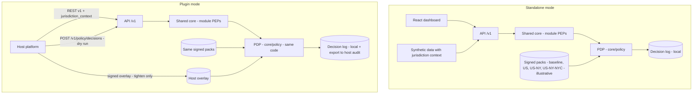

# 04 - Standalone vs Plugin Architecture Proposal

**Label key:** [DOC p.N] PDF page | [REC] recommendation | [ASSUME] assumption | [UNKNOWN] | [MANAGER] needs manager approval | [LEGAL-CONFIRM] legal/compliance must confirm.

> **Scope update (2026-11-09, authoritative user requirement):** initial market is **New York City, USA** (US federal + New York State + New York City only); no 50-state rulebooks in MVP. Jurisdictions are **versioned, approved policy packs** evaluated by one **Policy Decision Point (PDP)** inside the shared core, identical in both modes. This replaces the earlier "one image per market instance (US, UK)" and `config/markets/US|UK` framing; UK/other markets are future expansion [MANAGER confirm]. Design detail: `14-jurisdiction-policy-layer-design.md`; contracts: `15-integration-contracts.md`; legal content: `13-nyc-regulatory-applicability-matrix.md` (not legal advice; all applicability [LEGAL-CONFIRM]).

## 1. Decision summary

**Recommendation:** a **modular monolith with ports-and-adapters** (hexagonal), shipped as **one container image** deployed per **deployment scope** (MVP: one deployment, `deployment_scope = [US-NY-NYC]`), exposing a **versioned REST API**. Standalone and plugin are **two adapter configurations of the same image**, selected at start-up. A **jurisdiction policy layer (PDP + signed policy packs)** sits inside the core and is used the same way in both modes; the host can supply a stricter overlay but can never loosen policy. Events and file/batch ingest are optional adapters added only when the host confirms it needs them. [REC]

Why: it satisfies "one core, no duplicated logic", needs no knowledge of the host language, lets new states or countries be added as policy data rather than code (file 14 §12), and mirrors the integration styles the wider platform already expects (real-time API, nightly batch, event streaming, file drop) [DOC p.53] without building all of them on day one.

## 2. Mechanism evaluation

| Mechanism | What it gives | Cost / risk | Needed for MVP? | Verdict |
|---|---|---|---|---|
| Modular package (host imports our library) | Lowest latency | Forces host to run Python; couples to host internals; breaks "avoid host internals" | No | **Rejected** as integration style; still used *internally* (core = package) [REC] |
| **REST API (versioned, OpenAPI)** | Language-neutral, testable, matches platform's real-time API pattern [DOC p.53] | Network hop; needs auth | **Yes** | **Primary mechanism** [REC] (file 15 §2) |
| Event-driven (consume txn events / publish insight events) | Near-real-time signals, decoupling | Broker dependency, ordering, idempotency work | No | **Contract defined, transport deferred** until host confirms [DOC p.53] [UNKNOWN] |
| Batch / file ingest (bulk upload, secure file drop) | Bulk customer/txn loads for nightly scoring; pilot without live integration [DOC p.53] | Scheduling, file validation | Yes (standalone loads synthetic data this way) | **Included** as `bulk ingest` adapter [REC] |
| Shared authentication | Host remains identity authority | Requires host IdP details | Yes (design), host details later | **Validate host tokens via `IdentityPort`**; claims `ri_deployment` + `ri_jurisdictions`; no own user store in plugin mode [REC] |
| Data adapters | Translate host schemas to our canonical model, incl. jurisdiction context | Mapping maintenance | Yes | **Included** (anti-corruption layer) [REC] |
| Versioned contracts | Safe upgrades | Discipline | Yes | **Included** (policy in §6; file 15 §6) [REC] |
| **Policy Decision Point (in-process) + `POST /v1/policy/decisions`** | Jurisdiction-aware allow/deny + obligations, same in both modes; hosts can query it | Policy authoring and approval workflow | **Yes** | **Included** (file 14 §4, §6) [REC] |
| **Host policy overlay** (`PUT /v1/policy/overlays/{id}`) | Host compliance can add or tighten controls | Signature/merge validation | Plugin only, minimal | **Included; stricter-only merge** (file 14 §11) [REC] |
| Plugin registration / lifecycle | Host discovers capabilities | Host may have no plugin registry | Minimal | Expose `/health`, `/ready`, `/v1/capabilities` manifest (incl. jurisdictions in deployment scope and active pack versions) only [REC] |

## 3. Integration posture: data comes to us

[REC] In plugin mode the **host pushes authorised data** (in the request payload or via bulk ingest); the subsystem **does not reach into host databases**. Reasons: host systems remain system of record [DOC p.53]; consent is checked per source and purpose [DOC p.8, p.16, p.56]; minimises our data footprint.

Every customer-level request carries a **`jurisdiction_context`** (residence, booking entity, servicing location, channel - coarse codes only, e.g. `US-NY-NYC`) and a consent purpose; every response carries the **policy `decision_id`**, the jurisdiction set and pack versions applied (file 15 IC4, §3). Missing context -> `UNKNOWN_JURISDICTION` -> restrictive default; context outside the deployment scope (e.g. `US-CA` in the NYC MVP) -> `UNSUPPORTED_JURISDICTION` (file 14 §10). Which attributes legally connect a customer to a jurisdiction is [LEGAL-CONFIRM] (file 14 §16 J2).

Two call styles, both on the same core:
- **Stateless evaluate:** host sends customer + accounts + transactions window + jurisdiction context -> receives intelligence result. Nothing persisted except audit, decision log and result (retention set by policy, values [UNKNOWN]). Best for first integration. [REC]
- **Stateful profile:** host bulk-loads data; nightly batch computes features/predictions (PDP called per customer, cached bundle); host reads results by customer token. Needed for churn trend and portfolio analytics. [REC]

Outputs are **advisory only**: recommendations and retention actions are returned to the host, which owns customer contact and any account change (bank systems send all customer communications [DOC p.53]; "the system never changes accounts itself" [DOC p.69]). No contract type represents a credit approval, decline, limit, pricing or adverse action (file 15 §3.3, file 14 §13.1).

**Not for credit decisioning (contract principle IC7, file 15 §1)** [REC] [LEGAL-CONFIRM]: every customer-level response and customer-outcome event carries `permitted_use: ["RETAIL_INSIGHT","MARKETING_SUGGESTION"]` and `not_for_credit_decisioning: true`. The host integration terms must prohibit using our outputs (profile features, scores, segments, reason codes) for credit eligibility, pricing, limits or any other credit decision, because such use could turn our outputs into consumer-report or credit-decision inputs (file 13 rows F04, F06; **UNRESOLVED APPLICABILITY**). The labels are set by the response assembler in the shared core, identically in both modes; enforcement against misuse is a contractual and host-governance control, not something our code can guarantee.

## 4. Ports-and-adapters layout

```
retail_intel/                      (one repo, one Python distribution)
  core/                            (pure, no I/O, no framework imports)
    domain/        money, customer, account, transaction, product, segment, jurisdiction_context ...
    calc/          deterministic financial calculations (income, spend, savings rate)
    rules/         categorisation rules, eligibility guard (minor protection now a policy control)
    models/        inference wrappers (churn, needs, segmentation), explainers
    recommend/     candidate generation -> PEP gate -> ranking -> reasons
    orchestrator/  tool registry, structured-output validation, template fallback
    policy/        PDP: jurisdiction resolution, control catalogue, combining rules,
                   overlay merge, decision log writer (the ONLY place jurisdiction logic lives)
    services/      use cases: EvaluateCustomer, RunNightlyBatch, ExplainResult, DecidePolicy ...
  ports/           interfaces (Protocols) incl. PolicyStorePort, DecisionLogPort
  adapters/
    inbound/  http_api (FastAPI), cli_batch, event_consumer (later)
    outbound/ postgres_repo, duckdb_batch, synthetic_source, host_data_mapper,
              jwt_local_issuer, oidc_validator, audit_pg, audit_host_forwarder,
              llm_template, llm_local, llm_bank_endpoint, outbox_publisher,
              policy_store_local (signed packs), policy_store_host_overlay
  config/
    reference/US/   market reference data: currency, catalogue ref, category maps,
                    languages, timezone (versioned; NOT legal policy)
    deployments/nyc-mvp-01.yaml   deployment_id, deployment_scope [US-NY-NYC], active packs
    modes/standalone.yaml, modes/plugin.yaml   (adapter wiring only)
  bootstrap.py     composition root: reads MODE + DEPLOYMENT_ID, verifies pack signatures, wires adapters
policy-packs/      PACK-GLOBAL-BASELINE, PACK-US, PACK-US-NY, PACK-US-NYC (YAML, signed manifests)
                   future: PACK-US-<state>, PACK-GB ... (data only, file 14 §12)
contracts/         openapi/retail-intelligence-v1.yaml, schemas/*.json, events/*.json, examples/ (file 15)
host-simulator/    test harness (§7)
ui/                React dashboard (standalone only, calls the public API)
```

Ports (illustrative):

| Port | Standalone adapter | Plugin adapter |
|---|---|---|
| `CustomerDataPort`, `TransactionDataPort` | Postgres loaded from synthetic generator (customers carry synthetic jurisdiction context) | Payload / bulk ingest via `host_data_mapper` (host supplies jurisdiction context) |
| `ProductCatalogPort` | Demo catalogue (synthetic, labelled; `jurisdictions offered` per product) | Host catalogue feed [UNKNOWN] |
| `ConsentPort` | Synthetic consent records | Host consent service [DOC p.56, p.74] [UNKNOWN interface] |
| `IdentityPort` | Local issuer + demo roles (incl. `policy_author`, `policy_approver`, `policy_release`; role-to-scope matrix file 15 §5.1) | Host OIDC JWKS / mTLS [UNKNOWN] |
| `PolicyStorePort` | Local signed packs (dev signing key; all packs `illustrative: true`) | Our signed packs **plus** host-signed overlay (stricter-only) |
| `DecisionLogPort` | Local append-only, hash-chained table | Local table + export to host audit sink |
| `AuditSinkPort` | Local append-only table | Local table + forward to host audit [UNKNOWN] |
| `EventPublisherPort` | Outbox table (UI polls) | Outbox -> host bus [UNKNOWN] |
| `LLMPort` | Template-only or local model | Bank-approved model [DOC p.73] [MANAGER] |
| `ModelRegistryPort`, `ClockPort` | Local | Local (clock injectable for replay) |

Rules: `core/` may import only `core/` and `ports/` (import-linter in CI). Jurisdiction code literals (e.g. `"US-NY"`) are forbidden in `core/` outside `core/policy` (CI lint, file 14 PG-1). Modules never read raw policies; they call `decide()` and enforce obligations at their PEPs. [REC]

Contract sketch (illustrative only; normative version in file 15 §3):

```yaml
# POST /v1/customers/{customer_token}/evaluate   (X-Contract-Version: 1.x)
request:  { contract_version: "1.0.0", as_of: date-time,
            jurisdiction_context: { residence_jurisdiction: "US-NY-NYC", booking_entity_jurisdiction: "US-NY",
                                    servicing_location: "US-NY-NYC", channel: "MOBILE_APP" },
            consent: { purpose: "PERSONALISATION", consent_refs: [...] },
            subject: { customer_token: "...", age_status: "ADULT" },
            host_policy_decision_ref: null,
            data: { accounts: [...], transactions: [...] } }
response: { contract_version: "1.0.0", advisory_only: true, customer_token: "...",
            permitted_use: ["RETAIL_INSIGHT","MARKETING_SUGGESTION"], not_for_credit_decisioning: true,
            protection_status: "ADULT|MINOR_PROTECTED|AGE_UNKNOWN",
            policy: { decision_id: "dec_...", outcome: "PERMIT_WITH_OBLIGATIONS",
                      jurisdiction_set: ["*","US","US-NY","US-NY-NYC"],
                      packs_applied: [{pack_id: "PACK-US-NYC", pack_version: "0.3.0"}],
                      obligations: [...], flags: [] },
            insights: {...}, segments: [{code, source:"rule", purpose:"INSIGHT", valid_from}],
            predictions: [{type:"churn", score:0.31, band:"MEDIUM", model_version:"churn-nyc-0.4.0", reasons:[...]}],
            recommendations: [{kind:"PRODUCT_SUGGESTION|CREDIT_REFERRAL|...", product_code, rank,
                               reason_codes:[...], gate_trace:[...], requires_human_review, allowed_channels}],
            suppressed: [{product_code, reason_codes:[...]}],
            explanation: {text, generated_by:"TEMPLATE|LLM", numbers_verified:true},
            audit_id: "..." }
```

## 5. How both modes share the core

### 5.1 Policy Decision Point in both modes



| Aspect | Standalone | Plugin | Shared? |
|---|---|---|---|
| Intelligence logic, rules, models, guards, orchestrator | `core/` | `core/` | **Yes - identical code, same image** |
| **Policy Decision Point** | `core/policy`, in-process | `core/policy`, in-process; also queryable via `POST /v1/policy/decisions` | **Yes - identical code** |
| **Policy packs** (federal / NY State / NYC / baseline) | Local signed packs, `illustrative: true` until legal approves | Same packs **plus** host overlay | Packs shared; overlay plugin-only |
| **Host overlay** | n/a | Host may **add or tighten** controls; looser parts rejected (`policy.overlay.rejected` event); merge uses per-control combining rules | n/a |
| Host's own PDP | n/a | Host may pass `host_policy_decision_ref`; we still run our PDP - both must permit (defence in depth) | n/a |
| API surface | `/v1/...` | `/v1/...` | Yes (standalone UI is just another API client) |
| Data source | Synthetic generator -> Postgres | Host payload / bulk ingest | Adapter differs |
| Jurisdiction context | Synthetic customers carry it (incl. NYC, out-of-scope `US-CA`, missing) | Host supplies per request; absent -> `UNKNOWN_JURISDICTION` | Same resolution rules |
| Identity | Local demo issuer | Host IdP | Adapter differs |
| UI | React dashboard (incl. pack viewer, decision-log view, simulator) | None (host UI) | n/a |
| Market reference data | `config/reference/US` | Same, or host catalogue feed | Yes |

Guarantees: (1) the same contract test suite and policy golden cases run against both modes in CI; (2) mode differences are only in `bootstrap.py` wiring and YAML; (3) no `if MODE == ...` and no jurisdiction literals inside `core/` outside `core/policy` (lint rules); (4) adding a jurisdiction pack never needs a mode-specific change. [REC]

### 5.2 Host can only tighten

[REC] (file 14 §4.2, §10, §11) - "Stricter" is defined **per control** by the control catalogue's combining rule (deny-overrides, intersection of allow-lists, minimum of upper bounds, union of obligations), not by who authored the rule. A host request to loosen (e.g. re-enable marketing for minors, add a channel) is not applied automatically: it requires a new version of *our* pack through the maker-checker / legal approval workflow, with host legal evidence attached [MANAGER] [LEGAL-CONFIRM]. Locked baseline controls (no credit decisions, minors protection, adverse-action handoff) cannot be overridden by any pack or overlay.

## 6. Contract versioning policy

| Rule | Detail |
|---|---|
| Versioned artefacts | REST API (`/v1`), JSON Schemas, event schemas, model output schema, **policy packs, control catalogue, exclusion lists**, market reference data - each with SemVer [REC] (file 14 §8.2, file 15 §6) |
| Major version in URL | `/v1/...`; breaking change -> `/v2` served in parallel [REC] |
| Minor / patch | Additive optional fields, new enum values only when consumers are told to tolerate unknowns (new jurisdiction codes are data, not contract changes) [REC] |
| Tolerant reader | Clients must ignore unknown fields; we reject unknown *request* fields only in strict mode [REC] |
| Deprecation | Old major supported for an agreed window (proposal: 2 host release cycles or 6 months) with `Deprecation`/`Sunset` headers [MANAGER] |
| Version echo | Every response carries `contract_version`, `model_version`, `config_version`, and a `policy` block (`decision_id`, `jurisdiction_set`, `packs_applied`, `effective_bundle_sha256`) [REC] |
| Policy pack change | Never a contract change; may change outcomes; announced via `policy.pack.activated` event (file 15 §9) [REC] |
| Change control | Contract changes reviewed by host team; model/config changes follow maker-checker [DOC p.9, p.63]; **policy packs require legal/compliance approval** (maker != approver) [MANAGER] [LEGAL-CONFIRM] |
| Compatibility check | CI diff of OpenAPI (breaking-change detector) blocks merges that break `v1`; forbidden-term linter blocks any credit-decision field in customer-outcome output schemas (recommendation, insight, prediction, segment, retention, explanation, assistant responses and their event payloads); governance/lifecycle schemas (policy packs, model registry) are outside its scope (file 14 §13.1, file 15 §3.3) [REC] |

## 7. Testing plugin mode without the host

| Technique | What it proves |
|---|---|
| **Contract tests** (Schemathesis from OpenAPI + golden request/response examples in `contracts/examples/`) | API conforms to published contract in both modes [REC] |
| **Host simulator** (small separate app) | Plays the host: issues OIDC-style tokens from a test JWKS with roles + `ri_deployment` + `ri_jurisdictions` claims, sends payloads in a *host-shaped* schema (incl. jurisdiction context) through `host_data_mapper`, receives results, simulates consent withdrawal, out-of-scope jurisdiction tokens/contexts, expired tokens, replayed requests, malformed/duplicate transactions, and pushes a signed stricter overlay and a deliberately looser one [REC] (file 15 §13) |
| **Policy golden cases + simulator** | Same `(context, activity) -> outcome + obligations` expectations pass in both modes; pack diff report before activation (file 14 §14) [REC] |
| **Adapter tests** | Each adapter vs its port interface (same test suite for standalone and plugin adapters) [REC] |
| **Negative security tests** | Jurisdiction claim mismatch denied (`JURISDICTION_NOT_PERMITTED`); `US-CA` context -> `UNSUPPORTED_JURISDICTION`; looser overlay rejected; minor customer blocked per the two-tier list in file 14 §13.3 (never a commercial output, never used for training; tier-2 educational outputs only with a `MINOR-APPROVAL-*` record); credit-approval request to assistant refused; LLM numbers mismatch -> template fallback [DOC p.40, p.44] [REC] |
| **Equivalence test** | Same inputs via standalone path and simulator plugin path -> identical results and policy outcomes [REC] |
| **Consumer-driven contracts (Pact)** | Deferred until a real host team and stack exist [REC] |
| **Shadow mode flag** | Plugin can run with results logged but not returned for display, mirroring the platform's "Challenger" mode [DOC p.4, p.53] [REC]. **Where it lives:** a per-deployment / per-client setting in `config/modes/plugin.yaml` (and the deployment config), read only by the **inbound API adapter / response layer** (`adapters/inbound/http_api`). The adapter runs the normal core use case, writes results, audit and decision log as usual, and returns a `shadow: true` envelope without displayable results. `core/` is unaware of shadow mode (no `if SHADOW` / `if MODE` in core; enforced by the same import/lint rules as §5.1) |

## 8. Open items

- Does the host have a plugin registry, API gateway, or service mesh? [UNKNOWN]
- Stateless vs stateful integration first? Proposal: stateless evaluate first. [MANAGER]
- Who owns next-best offers - us or platform Release 3 "next-best offers" [DOC p.70]? [MANAGER]
- Host consent and tokenisation service interfaces [DOC p.8, p.56] [UNKNOWN].
- Who signs policy packs and overlays in plugin mode (us, host compliance, both) (file 14 §16 J7) [MANAGER].
- Human review in plugin mode: items flagged `requires_human_review` are returned with the flag and the host reports the reviewer outcome via `POST /v1/recommendations/{rec_id}/outcomes` (file 15 §2); in standalone the dashboard review queue is used (workflow states: file 07 §2.1 `review_item`). Host review-queue capability [UNKNOWN].
- Does the host run its own PDP / policy engine, and should it consume ours via `POST /v1/policy/decisions`? [UNKNOWN]
- Which jurisdiction-context attributes the host can reliably supply (residence, booking entity, servicing location) [UNKNOWN]; which are legally decisive [LEGAL-CONFIRM].
- Confirm UK/other markets are future expansion only (file 14 §16 J1) [MANAGER].

## Change log (NYC scope update)

- 2026-11-09: Added scope-update banner and [LEGAL-CONFIRM] label; NYC-first (federal + NY State + NYC), jurisdictions as policy packs, UK/other markets future [MANAGER confirm].
- §1/§2: "one image per market instance" replaced by one image per deployment scope (MVP `US-NY-NYC`); added PDP and host-overlay mechanisms.
- §3: jurisdiction context required in every customer-level request; decision id and packs in every response; unknown/unsupported jurisdiction behaviour; link to file 15.
- §4: layout adds `core/policy`, `PolicyStorePort`, `DecisionLogPort`, `policy-packs/`, deployment config; `config/markets/US|UK` replaced by market reference data; contract sketch uses `jurisdiction_context` instead of `X-Market`.
- §5: new Mermaid diagram showing the PDP in both modes; new "host can only tighten" rule (§5.2); table rows for PDP, packs, overlay, host PDP.
- §6-§8: policy packs versioned and legal-approved; policy block in version echo; simulator/claims/negative tests updated; new open items (J1, J2, J7).

## Change log (validation pass 2026-11-09)

- §2, §4: section references "s6", "s12", "s7" -> "§6", "§12", "§7" (D-27).
- §3, §4: "file 15 C4" -> "file 15 IC4"; "file 14 G1" -> "file 14 PG-1"; file 14 open items cited as "§16 Jn" (D-06 shared ID scheme).
- §3: new "Not for credit decisioning" paragraph (contract principle IC7, file 15 §1); contract sketch response gains `permitted_use` and `not_for_credit_decisioning: true` (D-11).
- §4 contract sketch: `protection_status` now `ADULT|MINOR_PROTECTED|AGE_UNKNOWN` (D-20).
- §6: forbidden-term linter scope stated (customer-outcome output schemas only; governance schemas excluded) (D-05).
- §7: shadow-mode flag location specified - inbound API adapter/response layer via config; core unaware (D-38). Minor negative test aligned to the two-tier block list in file 14 §13.3 (D-01).
- §8: human review handling per mode added (gap G-1) [REC].
