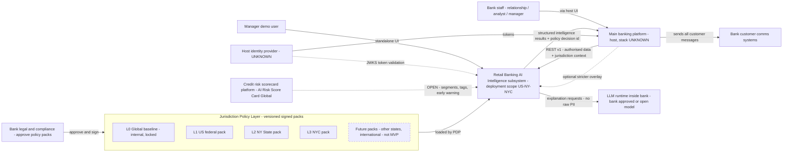
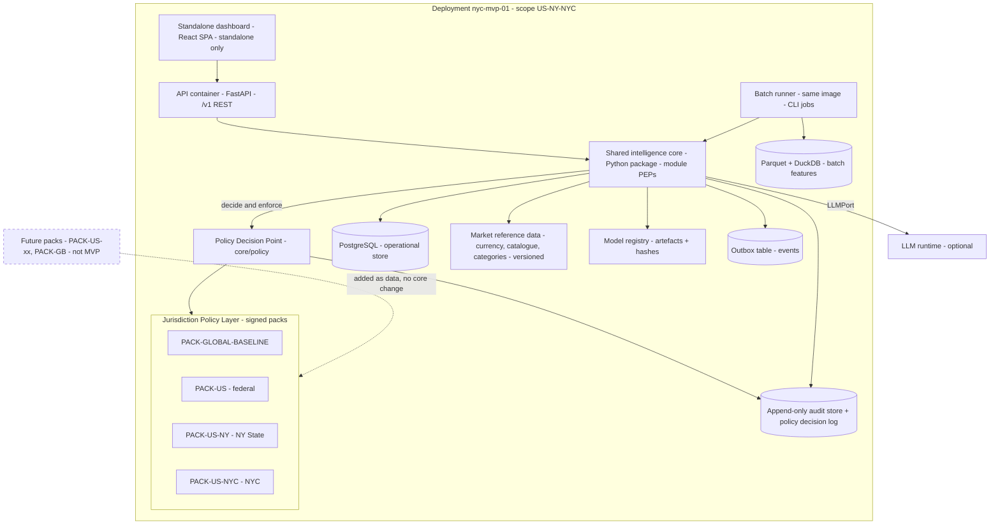
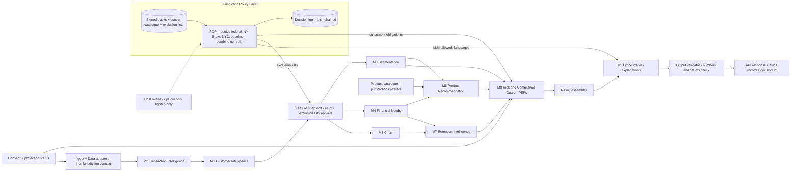
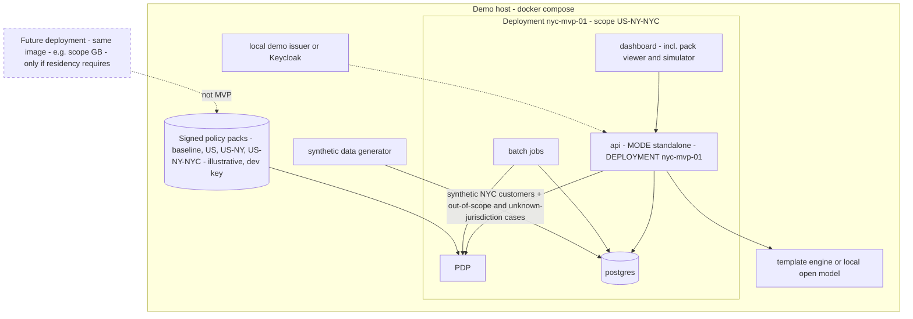
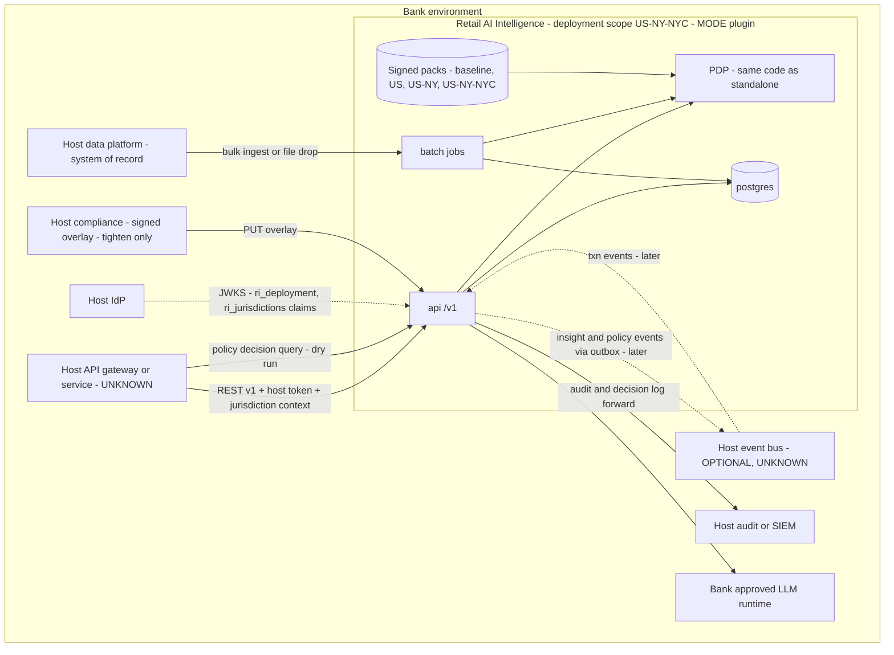
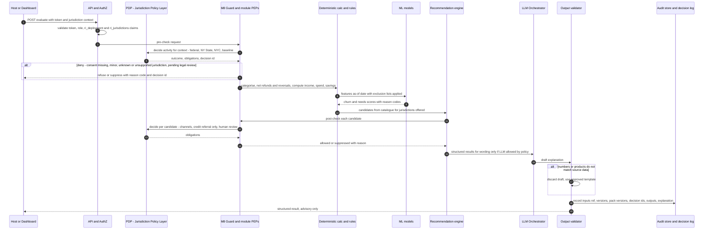

# 05 - High-Level System Architecture

**Label key:** [DOC p.N] PDF page | [REC] recommendation | [ASSUME] assumption | [UNKNOWN] | [MANAGER] needs manager approval | [LEGAL-CONFIRM] legal/compliance must confirm.
All diagrams are proposals [REC] unless a node is marked with a PDF cite.

> **Scope update (2026-11-09, authoritative user requirement):** initial market is **New York City, USA** (US federal + New York State + New York City only); no 50-state rulebooks in MVP. A **Jurisdiction Policy Layer** (federal / NY State / NYC packs, plus future packs) feeds one PDP in the shared core; other US states and international markets are added as packs without core rewrite. This replaces the earlier US/UK separate-instance framing; UK/other markets are future expansion [MANAGER confirm]. See `13-nyc-regulatory-applicability-matrix.md` (legal content, not legal advice), `14-jurisdiction-policy-layer-design.md` (policy layer), `15-integration-contracts.md` (contracts).

## 1. Architectural principles

| # | Principle | Label |
|---|---|---|
| PR-1 | Rules and bank policy first; AI never overrides a rule | [DOC p.50, p.75] |
| PR-2 | Deterministic code for all money figures; ML only for validated predictions; LLM only for orchestration and wording | Brief + [DOC p.40, p.73] |
| PR-3 | Advisory only: the subsystem never changes accounts, never sends customer communications, never approves/declines credit (no credit-decision type exists in any contract); outputs are labelled not for credit decisioning (file 15 IC7) | [DOC p.53, p.69]; file 14 §13.1 |
| PR-4 | One core, two modes, wired by adapters | [REC] |
| PR-5 | **Jurisdiction rules are data**: versioned, signed, legal-approved policy packs evaluated by one PDP; no jurisdiction branching in core code. One deployment per deployment scope (MVP `US-NY-NYC`); separate deployments only where data residency requires (future) [LEGAL-CONFIRM] | User; file 14 |
| PR-6 | Every result explainable and replayable (data, rule, model, config **and policy pack** versions recorded) | [DOC p.13, p.50] |
| PR-7 | Minors (16-17) get a protected path: no commercial profiling, targeting or model training (locked baseline control `CTL-MINOR-PROTECT`, two-tier block list) | [DOC p.44, p.67, p.81]; file 14 §13.3 |
| PR-8 | Modular monolith; no microservices without justification | Brief [REC] |
| PR-9 | **Fail safe**: unknown or pending-legal-review policy, unknown/unsupported jurisdiction, or unknown age -> restrictive default | User; file 14 §10 |

## 2. Module map (refined from the nine proposed)

| Module | Kind | Core output |
|---|---|---|
| M2 Transaction Intelligence | Deterministic + rules (ML fallback for categorisation) | Normalised, de-duplicated, categorised transactions; income/expense/transfer flags |
| M1 Customer Intelligence | Deterministic | Financial profile: income stability, spend mix, savings rate, balances trend |
| M3 Customer Segmentation | Rules (+ optional clustering for behaviour personas) | Multi-membership segments with validity dates |
| M4 Financial Needs Prediction | Rules first, then ML | Need signals (e.g. emergency buffer, savings goal gap) with reasons |
| M5 Churn Prediction | ML baseline (logistic regression) | Disengagement score, band, reason codes |
| M6 Product Recommendation | Rules guard + ranking | Eligible, ranked, explained product suggestions from catalogue only |
| M7 Retention Intelligence | Rules over M5 + M4 | Suggested retention actions for staff (advisory) |
| M8 Risk & Compliance Guard | Cross-cutting policy enforcement; **hosts the PDP**, decision log, fairness monitor, retention jobs | Allow/suppress decisions with obligations, protection status, consent checks, fairness reports |
| M9 Central AI Orchestrator | LLM + tool registry | Explanations, staff Q&A over tool results only |

[REC] M8 is a **guard layer** every outbound result passes through, not a peer module. Each module has its own Policy Enforcement Point (PEP) that calls the PDP before and after processing (file 14 §6). Numbering aligned with files 06 and 14: M1 = Customer Intelligence, M2 = Transaction Intelligence.

**Jurisdiction Policy Layer (logical levels, file 14 §2):** L0 `GLOBAL_BASELINE` (internal safeguards, locked) -> L1 `US` (federal) -> L2 `US-NY` (New York State) -> L3 `US-NY-NYC` (New York City). Future: `US-<state>`, `GB`, etc. as new packs, not in MVP.

## 3. Context diagram

Credit platform link is dashed: no integration point is defined in the PDF [UNKNOWN]. Comms ownership: [DOC p.53]. LLM hosting: [DOC p.73]. Pack content comes only from file 13 rows after legal approval [LEGAL-CONFIRM].

## 4. Container diagram (one deployment)

## 5. Component / module interaction

Notes: M8 calls the PDP **before** processing (consent, jurisdiction set, deployment scope, minor status) and **after** (suppression, channel filter, credit referral-only, human-review flag, fairness logging). Minor customers are blocked per file 14 §13.3 (two-tier block list) after age/routing checks in M2; no M1 profile or later module output without a legal approval record (`MINOR-APPROVAL-*`), and even then only a named non-commercial educational use; commercial activities, credit referral and model training stay blocked for minors in all cases [DOC p.44, p.67] [MANAGER] [LEGAL-CONFIRM]. A `PENDING_LEGAL_REVIEW` policy hit is enforced as BLOCK (file 14 §4.1).

## 6. Standalone deployment

[REC] One deployment in the demo. The jurisdiction behaviour is demonstrated by **policy outcomes**, not by separate instances: NYC adult customer (permit with obligations), `US-CA` customer (`UNSUPPORTED_JURISDICTION`, commercial deny), customer with missing jurisdiction (`UNKNOWN_JURISDICTION`), minor (blocked), policy in `PENDING_LEGAL_REVIEW` (blocked, flagged).

## 7. Plugin deployment

A future international market is the **same image** with its own pack(s) and, if data residency requires, a separate deployment [LEGAL-CONFIRM] [MANAGER]. No dashboard ships in plugin mode [REC].

## 8. Decision / explanation flow - where rules, ML, policy and LLM sit

| Step | Engine | May the LLM change it? |
|---|---|---|
| Money figures, netting, FX conversion | Deterministic code | No [DOC p.40] |
| Categorisation | Rules, ML fallback with confidence | No |
| Segment membership | Rules | No |
| Churn / needs score | Validated ML (or rules baseline) | No |
| Jurisdiction resolution, policy outcome, obligations | PDP over approved packs (most restrictive wins per control, file 14 §4.2) | No |
| Product eligibility / suppression | Rules from bank-provided config (never invented) + PDP obligations | No |
| Ranking | Deterministic scoring over ML outputs | No |
| Reason codes | Fixed library mapped from rules/model/policy | No - LLM only words them [DOC p.11, p.73] |
| Explanation text | LLM (if `CTL-LLM-GUARDRAIL` allows) or template | Wording only; numbers verified, else template [DOC p.40] |

## 9. Non-functional targets (proposed)

| NFR | Target | Label |
|---|---|---|
| Evaluate API latency (stateless, 12 months txns) | p95 under 1 s demo; tighten if host needs real-time | [REC] [MANAGER] |
| PDP decision latency | In-process, cached bundle; p95 under 5 ms per decision [ASSUME] | [REC] |
| Nightly batch | Synthetic 50k customers per deployment within 30 min on a laptop | [REC] |
| Availability with LLM down | Full function via templates | [DOC p.73] |
| Availability with policy store down | Not ready at start-up; at runtime keep last verified bundle, then fail to `CTL-DEFAULT-DENY` after max-age [MANAGER] | file 14 §8.3 |
| Replay | Re-running a stored request with stored versions (incl. pack versions and `as_of`) reproduces identical deterministic output and policy outcome | [DOC p.13] [REC] |
| Backup / restore / DR | Encrypted backups of DB, audit store, decision log, signed packs and model artefacts; RPO/RTO targets [MANAGER] (standalone demo: none); quarterly restore test that re-verifies the audit and decision-log hash chains end to end; restored instance starts not-ready until the policy bundle signature is verified (file 08 SEC-20) | [REC] [MANAGER] |
| Observability | Structured logs without PII, OpenTelemetry traces and metrics, `/metrics`; alerts on: PDP DENY/INDETERMINATE spikes, `PENDING_LEGAL_REVIEW` hits, bundle age near max-age, LLM fallback rate, drift breach, data-quality reject rate (file 07 §4.1), human-review queue age, audit-chain verification failure (file 08 SEC-21) | [REC] |
| Accessibility | Standalone dashboard targets WCAG 2.2 AA; plain-language explanation templates | [REC] [MANAGER] |
| Erasure vs append-only logs | DSR deletion must not break hash chains: audit and decision-log rows hold only tokenised `subject_ref`; erasure destroys the per-subject key / token mapping (crypto-shredding) instead of rewriting rows (file 07 §8.2) | [REC] [LEGAL-CONFIRM] |

## Change log (NYC scope update)

- 2026-11-09: Added scope-update banner and [LEGAL-CONFIRM] label; NYC-first (federal + NY State + NYC), UK/other markets future [MANAGER confirm].
- §1: P5 rewritten (jurisdiction rules as data, deployment scope instead of per-market installs); P3/P6/P7 extended; new P9 fail-safe (principles renumbered PR-1..PR-9 in the validation pass).
- §2: M8 hosts the PDP; module PEPs; jurisdiction levels L0-L3 listed; numbering aligned with files 06/14 (M1 = Customer Intelligence, M2 = Transaction Intelligence).
- All Mermaid diagrams (§3 context, §4 container, §5 component, §6 standalone, §7 plugin, §8 sequence) now include the Jurisdiction Policy Layer (federal / NY State / NYC / future, future shown dashed); US/UK instances and `MARKET` switch removed.
- §6: single NYC deployment demo; jurisdiction behaviour shown by policy outcomes (NYC, `US-CA`, unknown, minor, pending review).
- §8/§9: policy steps added to the decision table; PDP latency, policy-store availability and policy replay targets added.

## Change log (validation pass 2026-11-09)

- §1: architecture principles renamed P1-P9 -> **PR-1..PR-9** (shared ID scheme; avoids clash with roadmap phases PH-n) (D-06, R-04). PR-3 now cites the not-for-credit-decisioning label (file 15 IC7) (D-11); PR-7 cites the two-tier minor block list and the training ban (D-01).
- §5 notes: "Minor customers stop after M2" replaced with the file 14 §13.3 two-tier rule (age/routing checks in M2 only; no M1 profile or later output without a `MINOR-APPROVAL-*` record) (D-01).
- §9: new NFR rows Backup/restore/DR (G-3, D-31), Observability (alerting set), Accessibility WCAG 2.2 AA (G-7, D-35) and Erasure vs append-only logs (G-4, D-32) [REC].
- NYC change log: "numbering mismatch noted" corrected to "numbering aligned" (D-13).
- No Mermaid block was changed in this pass.
