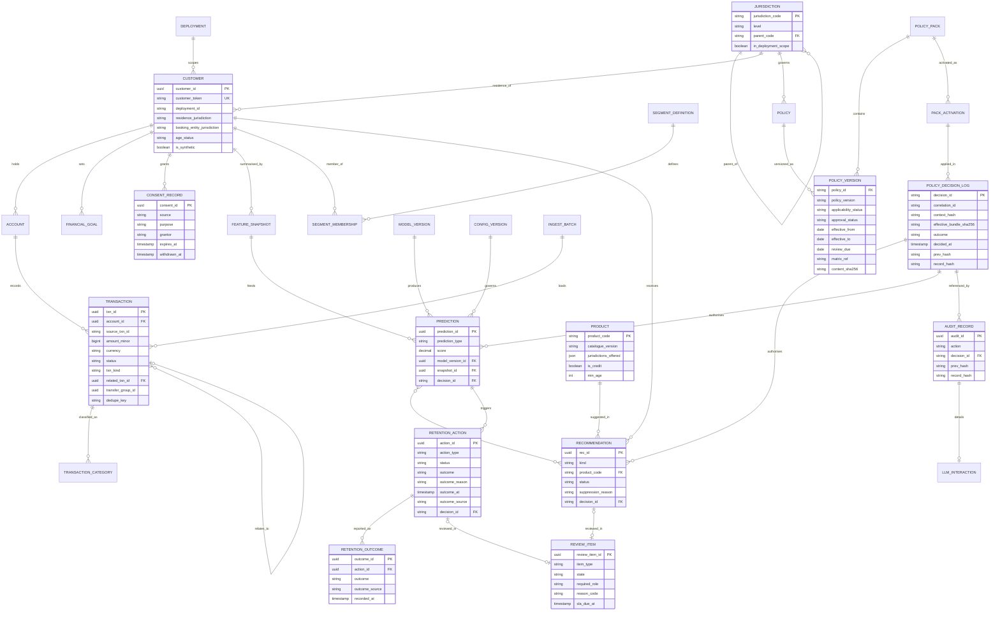
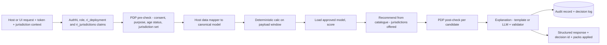

# 07 - Initial Database and Data Flow Design

**Label key:** [DOC p.N] PDF page | [REC] recommendation | [ASSUME] assumption | [UNKNOWN] | [MANAGER] needs manager approval | [LEGAL-CONFIRM] legal/compliance must confirm.
Store: PostgreSQL per **deployment** (MVP: one deployment `nyc-mvp-01`, `deployment_scope = [US-NY-NYC]`); batch features via DuckDB/Parquet (see 03). All data synthetic [REC].

> **Scope update (2026-11-09, authoritative user requirement):** initial jurisdiction is **New York City, USA** (US federal + New York State + New York City only); no 50-state rulebooks in MVP. The earlier "one database per market (US/UK)" and `market_code` design is replaced by **deployment scoping + per-record jurisdiction context**, with legal rules held as versioned policy data (`14-jurisdiction-policy-layer-design.md`). UK/other markets are future expansion [MANAGER confirm]. Legal content lives in `13-nyc-regulatory-applicability-matrix.md`; nothing here is legal advice.

## 1. Modelling conventions

| Convention | Rule | Label |
|---|---|---|
| Money | `amount_minor BIGINT` + `currency CHAR(3)` (ISO 4217); derived values `NUMERIC(19,4)`; never float; banker's rounding only at presentation | [REC] |
| Time | `TIMESTAMPTZ` UTC; business dates as `DATE` in the deployment's reference timezone (MVP `America/New_York`) | [REC] |
| Identity | Internal surrogate UUIDs; customers keyed by **token**, never name / SSN / account number | [DOC p.8, p.16, p.74]; file 13 F01, S10 |
| **Deployment scope** | `deployment_id` on every business row as defence in depth (check constraint = instance `deployment_id`); token `ri_deployment` claim must match | file 14, file 15 §5 [REC] |
| **Jurisdiction context** | Coarse jurisdiction codes (ISO 3166-1/-2 + custom local, e.g. `US`, `US-NY`, `US-NY-NYC`) on customer, account, product and every decision; never street address or ZIP unless legal approves (ZIP is on the proxy list) | file 14 §3.4 [LEGAL-CONFIRM] |
| History | Append-only facts; corrections as new rows; bitemporal fields `valid_from/valid_to` + `recorded_at` where state changes (incl. policy versions) | [REC] |
| Provenance | `source_system`, `source_type` (OWN_EXPERIENCE / AFFILIATE / CRA / THIRD_PARTY), `ingest_batch_id`, `is_synthetic` on ingested rows | [REC]; file 13 F04, F16 |
| Versions | Every derived row references `feature_set_version`, `model_version_id`, `config_version` **and `decision_id`** (which records the policy pack versions applied) | [DOC p.13] [REC] |

## 2. Entities and key fields

### 2.1 Business entities

| Entity | Key fields | Notes |
|---|---|---|
| `customer` | customer_id, customer_token (unique), deployment_id, birth_year_month, age_status (ADULT / MINOR_PROTECTED / AGE_UNKNOWN), host_age_flag (if supplied), residence_jurisdiction, booking_entity_jurisdiction, relationship_start, vulnerability_flag_ref (host-supplied only), is_synthetic | No names, IDs, addresses stored [REC]. Never infer sensitive characteristics (brief; `EXCL-FORBIDDEN-INFERENCE`). MVP residence `US-NY-NYC`; other codes accepted and resolved as `UNSUPPORTED_JURISDICTION` |
| `account` | account_id, customer_id, account_type (current, savings, card, loan), currency, opened_on, closed_on, status, is_joint, booking_entity_jurisdiction | Joint holders via `account_holder` link [ASSUME]; account numbers never stored (tokens only) |
| `transaction` | txn_id, account_id, source_txn_id, booking_ts, value_date, amount_minor, currency, direction (CR/DR), status (PENDING, BOOKED, REVERSED), txn_kind (PURCHASE, INCOME, TRANSFER, REFUND, REVERSAL, FEE, INTEREST, OTHER), related_txn_id, transfer_group_id, merchant_ref, mcc, description_redacted, dedupe_key, duplicate_of, ingest_batch_id, source_type | See §4 |
| `transaction_category` | txn_id, category_code, taxonomy_version, method (RULE/ML/HOST), confidence, rule_id | One active row per txn+taxonomy; taxonomy has no forbidden-inference labels |
| `fx_rate` | rate_date, base_ccy, quote_ccy, rate NUMERIC(19,8), source | Dated, immutable [REC] |
| `financial_goal` | goal_id, customer_id, goal_type, target_minor, currency, target_date, source (CUSTOMER/HOST), status | Customer-stated only; never inferred for minors [REC] |
| `product` (catalogue) | product_code, catalogue_version, jurisdictions_offered[], name, product_family, is_credit, is_fee_bearing, min_age, eligibility_rule_ref, terms_ref, effective_from, effective_to, approved_by | Eligibility and terms **supplied by the bank**, never authored by us or the LLM [REC]; demo catalogue clearly synthetic |
| `feature_snapshot` | snapshot_id, customer_id, as_of_date, feature_set_version, feature_list_sha256, exclusion_list_versions, features JSONB, data_window_start/end, computed_at, decision_id | Point-in-time features; excluded attributes removed before storage [REC] |
| `segment_definition` | segment_code, version, rule_expr_ref, purpose (INSIGHT/COMMERCIAL), allowed_for_minors, jurisdiction_scope[] | Multi-membership allowed (brief) |
| `segment_membership` | customer_id, segment_code, segment_version, valid_from, valid_to, evidence JSONB, source (RULE/HOST), origin (null / HOST_CORE / CREDIT_PLATFORM), decision_id | Credit-platform income segments S0-S5/tags only as read-only `source=HOST`, `origin=CREDIT_PLATFORM` if integrated (file 15 §11 CI-1) [DOC p.60-61] [UNKNOWN] |
| `prediction` | prediction_id, customer_id, prediction_type (CHURN, NEED_*), score NUMERIC, band, model_version_id, snapshot_id, reason_codes, decision_id, created_at | Only from registry entries cleared to serve (`RULESET` ACTIVE or `ML_MODEL` APPROVED). SHADOW outputs go to a separate `shadow_prediction` table (same columns), synthetic data only, never read by APIs, M6, M7 or M9 (DEC-47) |
| `recommendation` | rec_id, customer_id, kind (PRODUCT_SUGGESTION / SERVICE_SUGGESTION / EDUCATIONAL_CONTENT / CREDIT_REFERRAL), product_code, catalogue_version, rank, reason_codes, rule_trace JSONB, gate_trace JSONB, allowed_channels[], requires_human_review, review_item_id, status (PROPOSED, SUPPRESSED, PENDING_REVIEW, SHOWN, ACCEPTED, DISMISSED_BY_CUSTOMER, OVERRIDDEN, EXPIRED), suppression_reason, prediction_ids, decision_id | Suppressed rows kept for audit [REC]. **No credit approval/decline/limit/price field exists** (file 15 §3.3). `DISMISSED_BY_CUSTOMER` (customer did not take up a suggestion) replaces the earlier `DECLINED` so that the forbidden-term linter (file 14 §13.1) never meets a credit-sounding value in an output schema |
| `retention_action` | action_id, customer_id, action_type, trigger_prediction_id, status (PROPOSED, SUPPRESSED, PENDING_REVIEW, SHOWN, ACTIONED, EXPIRED), assigned_role, review_item_id, decision_id, **outcome** (NOT_ACTIONED / CONTACTED / RETAINED / CLOSED / UNKNOWN), **outcome_reason** (fixed code list), **outcome_at**, **outcome_source** (HOST / STAFF), outcome_recorded_by | Advisory; host executes [DOC p.53, p.69]. Outcomes reported by the host via `POST /v1/retention-actions/{action_id}/outcomes` (file 15 §2) or by staff in the standalone dashboard; append-only history in `retention_outcome` (one row per report; latest wins for reporting). Outcomes feed churn-model monitoring and retention effectiveness reports, never credit processes [REC] |
| `retention_outcome` | outcome_id, action_id, outcome, outcome_reason, outcome_at, outcome_source, reported_by (service or staff token), correlation_id, recorded_at | Append-only; supports re-reported outcomes without updates [REC] |
| `review_item` | review_item_id, item_type (RECOMMENDATION / RETENTION_ACTION / EXPLANATION_TEMPLATE), item_id, customer_id, decision_id, trigger_control (e.g. `CTL-HUMAN-REVIEW`, `CTL-VULNERABILITY-ROUTE`), required_role, **state** (QUEUED, IN_REVIEW, CLEARED_TO_SHOW, REJECTED, ESCALATED, EXPIRED, CANCELLED), reason_code (mandatory on REJECTED/ESCALATED), reviewer_ref (staff token), sla_due_at, created_at, decided_at | Human review workflow (gap G-1) [REC]. Transitions: QUEUED -> IN_REVIEW -> CLEARED_TO_SHOW / REJECTED / ESCALATED; ESCALATED -> IN_REVIEW; any open state -> EXPIRED at `sla_due_at` (item then not shown) or CANCELLED when consent is withdrawn or the item is superseded. Reviewer != requesting service; every transition writes an `audit_record` (file 08 CMP-14). Only CLEARED_TO_SHOW items can move the parent to SHOWN. In plugin mode the host may run the queue and report the final state via the outcomes endpoints (file 15 §2). SLA values [MANAGER]. State names deliberately avoid `approve*`/`decline*` so review payloads also pass the forbidden-term linter (file 14 §13.1) |
| `model_version` | model_version_id, model_name, version, algorithm, training_data_ref, training_jurisdiction_scope, feature_set_version, metrics JSONB, fairness_report_ref, artefact_sha256, materiality_tier, is_model_per_bank_policy, kind (RULESET, ML_MODEL), status (RULESET: DRAFT, ACTIVE, RETIRED; ML_MODEL: DRAFT, SHADOW, APPROVED, RETIRED; DEC-47), approved_by, approved_at, mrm_approval_ref | Nothing live without approval [DOC p.38, p.71]; classification vs SR 26-2 "model" definition is the bank's (file 13 row F14, SUPERVISORY GUIDANCE; Q-A1) [LEGAL-CONFIRM]. `APPROVED` here is a governance lifecycle value; the model registry schema is outside the forbidden-term linter's output scope (file 14 §13.1) |
| `config_version` | config_id, deployment_id, kind (REFERENCE_DATA / THRESHOLDS / CATALOGUE), version, content_sha256, maker, checker, effective_from | Maker-checker [DOC p.9, p.63]. Market reference data only; legal policy lives in `policy_version` |
| `consent_record` | consent_id, customer_id, source, purpose (INSIGHT, MARKETING, PERSONALISATION, AFFILIATE_MARKETING, CHANNEL_*, MINOR_EDU - taxonomy decision: see file 12 (formerly 08-D2); DEC ID assigned in file 12), grantor (CUSTOMER / PARENT_GUARDIAN), legal_basis_ref, granted_at, expires_at, withdrawn_at, host_ref | Per source and purpose with expiry/withdrawal [DOC p.8, p.16, p.56]; grantor and basis per file 13 §5.3 [LEGAL-CONFIRM] |
| `contact_preference` | customer_id, channel, marketing_opt_out, call_consent, sms_consent, dnc, quiet_hours, updated_at | Host-owned; mirrored read-only [ASSUME]; file 13 F10, F11, S11 |
| `audit_record` | audit_id, ts, actor (user/service), role, deployment_id, jurisdiction_set, action, object_type, object_id, request_hash, versions JSONB, decision_id, outcome, prev_hash, record_hash | Append-only, hash-chained [REC]; every view of personal data logged [DOC p.8, p.74]. Customer reference held only as tokenised `subject_ref` so erasure never rewrites the chain (§8.2) |
| `subject_key` | subject_ref, key_id, key_state (ACTIVE / DESTROYED), created_at, destroyed_at, dsr_request_id | Per-subject data-encryption key in the bank key system (standalone: dev KMS) used to encrypt any personal payload kept beside append-only rows; destroying the key = crypto-shredding (§8.2) [REC] [LEGAL-CONFIRM] |
| `dsr_request` | dsr_request_id, subject_ref, request_type (ACCESS / DELETE / OBJECT_PROFILING), received_at, host_ref, status (RECEIVED / IN_PROGRESS / COMPLETED / REJECTED_LEGAL_HOLD), completed_at, evidence_ref | Tracks `POST /v1/dsr-requests` (file 15 §2); full DSR support post-MVP [REC] [LEGAL-CONFIRM] |
| `data_quality_result` | dq_result_id, ingest_batch_id or customer_id, rule_id, rule_version, dimension, measured_value, threshold, passed, created_at | Output of the §4.1 rules; drives `DATA_QUALITY_INSUFFICIENT` (file 15 §4) [REC] |
| `llm_interaction` | interaction_id, audit_id, decision_id, llm_adapter, model_id, prompt_template_version, tool_calls JSONB, output_hash, validation_result (PASS/FALLBACK), fallback_reason | No raw PII in prompts [REC]; part of the separate GenAI governance track (file 03 §3.6; a RECOMMENDED CONTROL and bank policy decision, not a requirement of SR 26-2) |
| `ingest_batch` | ingest_batch_id, source_system, received_at, row_counts, rejects, checksum | Lineage root [REC] |

### 2.2 Jurisdiction policy entities (new; detail in file 14 §3)

| Entity | Key fields | Notes |
|---|---|---|
| `deployment` | deployment_id, deployment_scope[] (MVP `[US-NY-NYC]`), mode (STANDALONE/PLUGIN), reference_timezone, created_at | One row per running deployment; source of `in_deployment_scope` |
| `jurisdiction` | jurisdiction_code PK, level (GLOBAL_BASELINE / NATIONAL / SUBNATIONAL / LOCAL), parent_code, name, in_deployment_scope | Tree held as data: `*` -> `US` -> `US-NY` -> `US-NY-NYC` (MVP). Future `US-CA`, `GB` etc. added as rows, no schema change |
| `jurisdiction_membership` | child_code, parent_code | Only for supranational cases (e.g. EU) [UNKNOWN until needed] |
| `policy` | policy_id PK (stable, never reused), jurisdiction_code, title | e.g. `POL-US-NY-NYC-0007` |
| `policy_version` | policy_id, policy_version (SemVer), jurisdiction_level, activity_scope[], customer_scope (predicate JSON), product_scope, channel_scope, purpose_scope, effective_from, effective_to, recorded_at, review_due, applicability_status (APPLICABLE / NOT_APPLICABLE / PENDING_LEGAL_REVIEW), required_controls JSONB, approval_status (DRAFT / LEGAL_REVIEW / APPROVED / RETIRED), maker, approver, approved_at, approval_evidence_ref, matrix_ref (file 13 row ID), illustrative, supersedes[], content_sha256 | Immutable once in LEGAL_REVIEW; edits create a new version. `illustrative=true` cannot be APPROVED. All MVP rows are illustrative until legal confirms [LEGAL-CONFIRM]. `approval_status` is a governance lifecycle field; policy schemas are outside the forbidden-term linter's output scope (file 14 §13.1) |
| `legal_source` / `policy_source` | source_id, citation, url, retrieved_on / link to policy_version | Citation + URL mandatory; baseline policies cite `INTERNAL-POLICY` |
| `control` | control_id, catalogue_version, param_schema_ref, combining_rule, locked | Control catalogue (file 14 §5) |
| `policy_pack`, `pack_member`, `pack_activation` | pack_id, pack_version, scope_root, manifest_sha256, signature, signing_key_class (DEMO, DEPLOYMENT), pack_state (DRAFT, VALIDATED, IN_LEGAL_REVIEW, APPROVED, ACTIVE, ILLUSTRATIVE, RETIRED; file 14 §8.4) / members / activation_id, deployment_id, target_state, activated_at, activated_by, signoff_refs | Signed, immutable content; `pack_state` history append-only; activation append-only (DEC-44, DEC-45) |
| `exclusion_list`, `exclusion_entry` | list_id, kind (SENSITIVE / FORBIDDEN_INFERENCE / PROXY / PROTECTION_ONLY), version / attribute_or_feature, jurisdictions[], allowed_uses[], rationale, matrix_ref | Contents [LEGAL-CONFIRM] (file 14 §13.2) |
| `host_overlay` | overlay_id, host_id, version, signature, content_sha256, received_at, rejected_controls JSONB | Plugin only; stricter-only merge |
| `policy_decision_log` | decision_id PK, correlation_id, trace_id, decided_at, as_of, deployment_id, mode, caller_module, service_identity, host_id, activity, purpose, subject_ref (token), context_hash, jurisdiction_set[], packs JSONB, overlay_id, effective_bundle_sha256, outcome (PERMIT / PERMIT_WITH_OBLIGATIONS / DENY), reason_codes[], flags[], prev_hash, record_hash | Append-only, hash-chained; one per PDP call (batch may write compact rows sharing a bundle hash). Child tables `decision_policy_hit` (policy_id, version, applicability, effect) and `decision_obligation` (control_id, params). No names, addresses or sensitive attributes (file 14 §7) |
| `deployment_profile` (2026-11-10) | profile_id, profile_version, track (A/B, reference data), institution_type (CONVENTIONAL / ISLAMIC), mode, demo, synthetic_only, packs (baseline, jurisdiction[], institution_overlay), age_of_majority_by_jurisdiction, llm_hosting, model_registry_scope, idp_realm, signature, content_sha256 | One signed profile per deployment, read-only at runtime; `profile_id`, `track`, `institution_type` and `cell_id` are written to every decision and audit record (file 21 §3; DEC-51, DEC-61). Normative fields: `contracts/data-model/erd.md` |
| `data_cell` (2026-11-10) | cell_id (`A-US`, `A-UK`, `B-AE`), profile_id, jurisdiction_roots[], in_scope[], region, currency, locales[], catalogue_id | Unit of personal-data isolation: one database, subject-key store, log set and secrets per cell; no cross-cell join (DEC-52, DEC-53) |
| Sharia approval fields (2026-11-10, Track B) | `sharia_approval_status` (NOT_REVIEWED / IN_SHARIA_REVIEW / SHARIA_APPROVED / SHARIA_REJECTED), `sharia_approver`, `sharia_approved_at`, `sharia_approval_ref`, `illustrative_sharia_assumption` on `policy_version`, `policy_pack`, catalogue items, templates and reason-code texts | Dual approval for Track B packs (legal + Sharia); otherwise BLOCK (DEC-55) [SHARIA-CONFIRM] |
| Catalogue item attributes (2026-11-10) | `track`, `catalogue_id`, `sharia_status`, `recommendation_kind`, `requires_human_review`, `risk_class` (e.g. PROFIT_SHARING_NON_GUARANTEED), `late_payment_treatment` (descriptive text ref only) | Late-payment charity is data only, never computed or used as a feature (file 21 §4.4, §5; DEC-56) |
| `policy_conflict` | conflict_id, decision_id, control_id, details, status | e.g. retention `min_keep > max_keep` -> INDETERMINATE + legal review |

## 3. Relationships

## 4. Transaction edge cases

| Case | Handling | Label |
|---|---|---|
| Multi-currency | Store original amount + currency. Analytics in the deployment's reporting currency (MVP: USD) via dated `fx_rate`; store the rate used. Never mix currencies in a sum without conversion | [REC] |
| Internal transfers | Detect own-account pairs (same customer, opposite sign, equal amount, time window) -> shared `transfer_group_id`, `txn_kind=TRANSFER`; **excluded from income and spend**; savings transfers feed savings-rate feature | [REC] |
| Refunds | `txn_kind=REFUND`, `related_txn_id` to original purchase when matchable; netted against the original category; unmatched refunds kept as category credit, not income | [REC] |
| Reversals | Original kept; reversal row links to it; both excluded from features; original `status=REVERSED` via new state row (no destructive update) | [REC] |
| Duplicates | Exact: `dedupe_key = hash(account, source_txn_id)` unique -> idempotent ingest. Probable: same amount/merchant/time window but different IDs -> flagged `duplicate_of`, excluded from features, never deleted | [REC] |
| Pending | Stored with `status=PENDING`; excluded from features by default; replaced by booked row linked via `related_txn_id`; stale pending expires after configurable days | [REC] |
| Historical records | Append-only; late-arriving data triggers recompute of affected snapshots only (as-of semantics prevent leakage) | [REC] |
| Income definition | Recurring verified credits (payroll pattern), irregular income smoothed over 12 months; aligns with the platform's verified-income approach [DOC p.60, p.78-81] | [DOC] / [REC] |
| Health-revealing / sensitive merchant categories | Pharmacy, clinic, religious donation etc. never produce a sensitive label; gambling/payday only as protection signals (`EXCL-PROTECTION-ONLY`) | file 13 S14; file 14 §13.2 [LEGAL-CONFIRM] |

### 4.1 Data quality rules (gap G-6) [REC]

Rules are versioned reference data (`config_version` kind THRESHOLDS), evaluated at ingest (batch level) and before each module runs (customer level). Results go to `data_quality_result`. A failed **blocking** rule makes the affected module return `DATA_QUALITY_INSUFFICIENT` (file 15 §4) for that customer; data gaps are never filled by guesswork. Owner: DEV (rules), MGR (thresholds). All thresholds are [ASSUME] until calibrated on synthetic data and agreed at the data sign-off gate (file 11).

| Rule | Dimension | Check | Threshold (proposal) [ASSUME] | Effect |
|---|---|---|---|---|
| DQ-01 | Schema / validity | JSON Schema, enum values, ISO 4217 currency, ISO 3166 / local jurisdiction code exists in reference data, decimal-string amounts | 100 % | Row rejected to validation report (never silently corrected) |
| DQ-02 | Uniqueness | Exact duplicate `dedupe_key` | 0 accepted | Idempotent skip |
| DQ-03 | Duplicates (probable) | Probable-duplicate ratio per account and batch | > 2 % of rows | Batch warning; > 10 % batch held for review |
| DQ-04 | Completeness | Required fields present (amount, currency, booking_ts, status, account link, jurisdiction context, age_status or birth year-month) | 100 % for required fields | Row rejected; missing jurisdiction -> `UNKNOWN_JURISDICTION` path, missing age -> `AGE_UNKNOWN` |
| DQ-05 | History depth | Months of booked history per customer | M2/M1: >= 3 months; M3 segments: >= 3; M4 needs: >= 6; M5 churn: >= 12; income stability: >= 6 | Below threshold -> `DATA_QUALITY_INSUFFICIENT` for that module only |
| DQ-06 | Timeliness | Age of latest booked transaction vs `as_of` | > 35 days | Insights flagged stale; predictions withheld |
| DQ-07 | Stale pending | Share of PENDING older than the expiry window | > 5 % | Warning; stale rows expired per §4 |
| DQ-08 | Consistency | Refund/reversal links resolvable; transfer pairs balanced; FX rate present for every non-USD row | > 1 % unresolved | Warning; unresolved rows excluded from features |
| DQ-09 | Plausibility | Amount outliers (e.g. > 50x customer median), future-dated bookings, negative balances on savings | Flag only | Excluded from features, kept for audit |
| DQ-10 | Category coverage | Share of spend categorised by rules (not ML fallback / unknown) | < 80 % | Warning to taxonomy owner; ML fallback confidence threshold enforced |

Each DQ result carries `rule_version` for replay; DQ metrics are exported to observability (file 08 SEC-21).

## 5. Jurisdiction and deployment scoping strategy (replaces US / UK separation)

> **Two-track scope update (2026-11-10; file 21; file 12 DEC-50..DEC-64).** The single NYC deployment below becomes the `A-US` cell. Deployments are now selected by a signed **deployment profile** (DEC-51) that owns one or more **data cells**: Track A "Conventional" = one profile, cells `A-US` (US region) and `A-UK` (UK region), each with its own database, subject keys, logs and secrets; personal data never crosses cells and only aggregate, non-personal figures may be combined (DEC-52) [LEGAL-CONFIRM]. Track B "Islamic" = a separate bank-hosted deployment, cell `B-AE`, that never shares data, models, keys, IdP realm or logs with Track A (DEC-53). A customer whose residence and booking fall in different cells resolves to `UNKNOWN` (deny commercial). Models are per track, and per cell for real data in Track A (DEC-57). The table rows below apply per cell.

| Layer | Strategy | Label |
|---|---|---|
| Deployment | MVP: **one** deployment (`nyc-mvp-01`, scope `[US-NY-NYC]`), own DB, secrets and keys (2026-11-10: superseded by profiles and cells above). Additional deployments of the **same image** only where data residency requires (e.g. future international market) | User; [REC]; [LEGAL-CONFIRM] |
| Code | Identical core image; no jurisdiction literals in core | [REC] |
| Legal policy | Jurisdiction policy packs (`PACK-GLOBAL-BASELINE`, `PACK-US`, `PACK-US-NY`, `PACK-US-NYC`) stored in `policy_*` tables + signed files; resolved per customer context (file 14 §4) | [REC] |
| Market reference data | `config_version` kind REFERENCE_DATA: currency, catalogue, category maps, thresholds, languages (US English/Spanish per PDF [DOC p.13, p.73], final list per `CTL-EXPLANATION` policy), timezone | [REC] [MANAGER] |
| Data | `deployment_id` check constraint matching instance; token `ri_deployment` must match and request jurisdiction context must fall within `ri_jurisdictions`; customers outside deployment scope stored only if needed for the `UNSUPPORTED_JURISDICTION` path (commercial processing denied) | [REC] [MANAGER] |
| Models | Trained and versioned per deployment; `training_jurisdiction_scope` recorded; no pooled training across future deployments without approval | [REC] [MANAGER] |
| Reporting | No cross-deployment data flows; any group-level reporting only as aggregated, non-personal figures and only if approved | [MANAGER] [LEGAL-CONFIRM] |
| Breach scoping | Query "which NY-resident records were in partition X" supported via `residence_jurisdiction` + data classification tags (file 13 S05) | [REC] |

## 6. Data flows

### 6.1 Batch (nightly)

```mermaid
flowchart LR
    src["Synthetic generator or host bulk file"] --> val["Validate schema, checksum, deployment_id, jurisdiction codes, data-quality rules"]
    val --> pdp["PDP - resolve jurisdiction set - federal, NY State, NYC, baseline"]
    pdp --> cons["Consent, age status and policy pre-check"]
    cons --> norm["Normalise currency, timestamps, kinds"]
    norm --> dup["De-duplicate and link refunds, reversals, transfers"]
    dup --> cat["Categorise - rules then ML fallback - no forbidden inference"]
    cat --> feat["Compute feature snapshot as-of date - exclusion lists applied"]
    feat --> seg["Segment memberships"]
    feat --> pred["Churn and needs predictions"]
    seg --> rec["Recommendations + retention actions"]
    pred --> rec
    rec --> guard["Guard post-check - PDP obligations, minors, opt-outs, channels"]
    guard --> store[("Results tables")]
    guard --> aud[("Audit + lineage + policy decision log")]
    store --> mon["Drift, stability, fairness reports"]
    ret["Retention purge job - CTL-RETENTION per entity"] --> store
    ret --> aud
```

### 6.2 Real time (evaluate API)

## 7. Synthetic data approach

> **2026-11-10 (DEC-56):** one generator codebase, **one seed and one output per cell** (`A-US`, `A-UK`, `B-AE`), never mixed. Personas per cell (Alex, NYC, 24, shift worker in `A-US`; a London salaried renter in `A-UK`; a Dubai or Abu Dhabi salaried customer in `B-AE`) plus the control personas in every cell (minor, age unknown, consent withdrawn, unknown, out-of-scope and cross-track jurisdictions, pending-review block, credit-request refusal). Catalogues `CAT-A-US-SYNTH`, `CAT-A-UK-SYNTH`, `CAT-B-AE-ISLAMIC-SYNTH` (Islamic financing items only as `CREDIT_REFERRAL`; Mudarabah and Takaful with human review). Currency per cell (USD, GBP, AED), no FX between cells. Track B merchant taxonomy includes the `CTL-PROHIBITED-CATEGORY` categories so the exclusion path is tested; no religion is inferred (file 21 §5).

| Item | Approach | Label |
|---|---|---|
| Generator | Seeded, reproducible Python generator; NYC personas (Gen Z 18-29, blue-collar shift worker, gig/self-employed, salaried, retiree; minors 16-17 generated **only** to test protection paths); jurisdiction context on every customer | [REC] |
| Jurisdiction test cases | Mostly `US-NY-NYC` residents; small labelled sets with `US-NY` (outside NYC), `US-CA` / `US-NJ` (out of scope -> `UNSUPPORTED_JURISDICTION`), missing residence (`UNKNOWN_JURISDICTION`), NYC resident booked elsewhere, age unknown | [REC] |
| Scale | MVP 10k-50k customers, 12-24 months of transactions; the PDF demo bank uses 2M US / 1M UK synthetic customers for credit [DOC p.61, p.81] - not needed for MVP | [REC] |
| Realism | NYC merchant/MCC mix, pay cycles (weekly/biweekly - [ASSUME]), seasonality, FX for travel spend | [ASSUME] |
| Edge-case injection | Configurable rates of duplicates, pending-then-booked, refunds, reversals, transfers, multi-currency | [REC] |
| Labels | Churn/need labels from a hidden latent process with noise; documented so model metrics are read as **pipeline validation, not business evidence** | [REC] |
| Safety | `is_synthetic=true` everywhere; standalone refuses ingest of rows without it; no real names (fake tokens only) | [REC] |
| Catalogue | Synthetic demo products, labelled "DEMO - not real terms", each with `jurisdictions_offered`; no invented eligibility presented as real | [REC] |
| Validation (gap G-8) | Generator run produces a validation report: distribution sanity statistics per persona (income, spend mix, balances, pay-cycle regularity) against documented target ranges; edge-case coverage counts (duplicates, pending, refunds, reversals, transfers, multi-currency, minors, age unknown, each jurisdiction test case) against configured rates; label-leakage audit (no feature computed after the label date; no latent-process variables exposed as features); persona and jurisdiction balance; reproducibility check (same seed -> same hash). Reviewed and signed off by the manager at the synthetic-data gate (file 11) | [REC] [MANAGER] |

## 8. Retention and lineage

- **Retention periods are driven by policy** (`CTL-RETENTION{entity, min_keep, max_keep}` in jurisdiction policy packs, file 14 §5), not by per-market config. **All values are [UNKNOWN] pending legal/compliance confirmation** [LEGAL-CONFIRM]. Until confirmed, policies carrying retention controls are `PENDING_LEGAL_REVIEW` and purge jobs run in **report-only mode** (no deletion of synthetic audit data needed for the demo) [REC] [MANAGER].
- Conflicts between "keep at least" and "delete after" are not auto-resolved: `min_keep > max_keep` -> `policy_conflict` + legal review (file 14 §4.2). [REC]
- The PDF's credit-record retention (US at least 25 months [DOC p.13]) applies to credit decisions and is **not assumed** to apply here. Candidate drivers to be assessed by legal: secure disposal under GLBA safeguards / 23 NYCRR 500.13(b) **if** the bank is a covered entity, SHIELD disposal (file 13 F02, S01, S04). Classification: these are **BINDING LAW** for institutions within their scope; their reach to this bank and subsystem is **UNRESOLVED APPLICABILITY**; the policy-driven retention mechanism itself is a **RECOMMENDED CONTROL**. [LEGAL-CONFIRM]
- Entities needing a retention decision: `transaction`, `feature_snapshot`, `prediction`, `recommendation`, `audit_record`, `policy_decision_log`, `llm_interaction`, `consent_record` history, `ingest_batch` files, `retention_outcome`, `review_item`, `data_quality_result`, `dsr_request`. [UNKNOWN]
- Purge jobs delete or anonymise by entity per the resolved policy; audit and decision-log records retained per the longest approved period. Append-only, hash-chained stores are never purged row by row; expiry and erasure follow §8.2. [REC]
- Consent withdrawal: stop using the source for that purpose immediately, recompute affected results, keep audit of the withdrawal (mirrors platform behaviour [DOC p.8, p.74]). [REC]
- Lineage chain: `ingest_batch` -> `transaction` -> `feature_snapshot` -> `prediction`/`recommendation` -> `audit_record` with `model_version`, `config_version`, `catalogue_version`, **`decision_id` -> `policy_decision_log` (pack versions, `effective_bundle_sha256`, `as_of`)**; enables replay of both outputs and policy outcomes [DOC p.13]. [REC]

### 8.1 Minor data handling (open legal question)

- MVP processes adults only (2026-11-10: age of majority per jurisdiction as config, `US` 18, `GB` 18, `AE` [ASSUME 21] restrictive default, all [LEGAL-CONFIRM]; DEC-60; the two-tier list is unchanged); minors (16-17) generated only to prove the block path (file 08 CMP-01; decision see file 12 (formerly 08-D1); DEC ID assigned in file 12). [MANAGER]
- `age_status = MINOR_PROTECTED` or `AGE_UNKNOWN` triggers the locked `CTL-MINOR-PROTECT` baseline control. The block list is the **two-tier list defined in file 14 §13.3** (tier 1 always blocked, incl. `MODEL_TRAINING`; tier 2 blocked unless a `MINOR-APPROVAL-*` record allows a named non-commercial educational use; `TXN_ENRICHMENT` limited to age/routing checks). This file does not repeat the list. [REC]
- **Open legal question:** whether the **NY Child Data Protection Act** (GBL 899-ee et seq., file 13 row S12, "Possible to Likely"; **BINDING LAW**, whose reach to the bank is **UNRESOLVED APPLICABILITY**; sections 899-ee, -ff, -jj, -kk, -ll read, no GLBA exemption found in them) applies to the bank's teen journey, whether any exemption for banking/GLBA data exists, whether educational insights are "strictly necessary" or need consent, whose consent (minor or parent), and whether minors' data may be used for model training (file 13 §6 question 4). [LEGAL-CONFIRM]
- Data design to support any outcome: `consent_record.grantor` and `legal_basis_ref`; `customer.host_age_flag` honoured; `MINOR_EDU` purpose tag on any educational insight; minors' rows excluded from model training datasets by default (`training_data_ref` filter); re-classification at the 18th birthday with a fresh consent check; under-13 records rejected or quarantined at ingest (file 13 F12). [REC]
- Retention of minors' data: separate `CTL-RETENTION` entry, value [UNKNOWN] [LEGAL-CONFIRM].

### 8.2 Erasure vs append-only, hash-chained stores (gap G-4) [REC] [LEGAL-CONFIRM]

- `audit_record` and `policy_decision_log` are append-only and hash-chained; `retention_outcome` and `review_item` transitions are append-only and each is recorded in the audit chain. A DSR deletion or retention expiry must not rewrite or delete chained rows, or the chain breaks.
- Design: these rows hold only the tokenised `subject_ref` (never names, addresses or raw descriptions) and a `context_hash`. Any personal payload that must sit beside them (e.g. stored request snapshot for replay) is encrypted with a **per-subject key** (`subject_key`).
- On an approved DSR delete or objection: (1) operational personal rows (`customer`, `transaction`, `feature_snapshot`, `prediction`, `recommendation`, `retention_action`, `consent_record` history where legally allowed) are deleted or anonymised; (2) the per-subject key is destroyed (**crypto-shredding**), making the encrypted payloads unreadable; (3) the host destroys its token mapping for that subject, so the remaining `subject_ref` no longer links to a person; (4) a `dsr_request` row and an audit record ("erasure executed", no personal data) are appended. The hash chain stays verifiable because no chained row changes.
- Consequence: decisions for an erased subject can no longer be fully replayed with their inputs; the decision outcome, pack versions and hashes remain. Legal holds (`REJECTED_LEGAL_HOLD`) and minimum-retention policies (`CTL-RETENTION.min_keep`) take precedence over erasure where legal confirms.
- Whether crypto-shredding plus token destruction counts as deletion for each applicable regime is **UNRESOLVED APPLICABILITY** [LEGAL-CONFIRM]; this mechanism is a **RECOMMENDED CONTROL**. Full DSR support is post-MVP; the MVP runs the flow on synthetic data only.

## 9. Candidate integration data with the credit platform (all [OPEN])

The **canonical list is file 15 §11, candidates CI-1..CI-9** (direction, contract placeholder, PDF reference and status live there only). The former 07 O1-O9 map to CI-1..CI-9 in the same order; the former 15 O-numbers are superseded. This section records only the data-model consequence of each candidate. [REC]

| CI (file 15 §11) | Data-model consequence here |
|---|---|
| CI-1 income segments S0-S5 + tags | `segment_membership` with `source=HOST`, `origin=CREDIT_PLATFORM`, read-only; never a ranking feature for credit products |
| CI-2 early-warning / "pause offers" | `contact_preference` / suppression row consumed by `CTL-MARKETING-SUPPRESS`; suppression only, never a feature |
| CI-3 shared transaction feed | Same `transaction` entity and dedupe key; `ingest_batch.source_system` identifies the feed |
| CI-4 consent + tokenisation | `consent_record.host_ref`; tokens only |
| CI-5 vulnerability flags, contact limits | `customer.vulnerability_flag_ref`, `contact_preference` |
| CI-6 under-18 readiness record | Not stored; we do not build it in MVP |
| CI-7 next-best offers overlap | No entity until ownership is decided |
| CI-8 credit product eligibility pre-check | No entity; credit products only as `CREDIT_REFERRAL` |
| CI-9 PD / grade | Not stored; not consumed in v1; any future use requires manager approval, legal confirmation and a fairness review, and never as a ranking feature for credit products |

## Change log (NYC scope update)

- 2026-11-09: Added scope-update banner and [LEGAL-CONFIRM] label; NYC (`US-NY-NYC`) is the initial jurisdiction; UK/other markets future [MANAGER confirm].
- §1/§5: market-per-database and `market_code` replaced by `deployment_id` scoping + per-record jurisdiction context; §5 rewritten as jurisdiction and deployment scoping strategy.
- §2: business entities gain jurisdiction context, `decision_id`, `source_type`, consent `grantor`/`legal_basis_ref`, channel consent flags, recommendation `kind` (incl. `CREDIT_REFERRAL`, no credit-decision fields); new §2.2 policy entities: `deployment`, `jurisdiction`, `policy`, `policy_version`, packs, exclusion lists, `host_overlay`, `policy_decision_log`, `policy_conflict`.
- §3: ER diagram extended with jurisdiction, policy, pack and decision-log entities.
- §6: batch and real-time flows include PDP pre/post checks and decision log; retention purge job added.
- §8: retention driven by `CTL-RETENTION` policy, values UNKNOWN pending legal; new §8.1 minor data handling with NY Child Data Protection Act (file 13 S12) as open legal question.

## Change log (validation pass 2026-11-09)

- §2.1 `recommendation.status`: `DECLINED` renamed `DISMISSED_BY_CUSTOMER`; `PENDING_REVIEW` and `review_item_id` added. Linter choice applied consistently with files 14 and 15: customer-outcome output schemas never contain `approve*`/`decline*` values; governance lifecycle fields (`policy_version.approval_status`, `model_version.status` = APPROVED) are outside the linter's output scope (D-05).
- §2.1 `retention_action`: outcome fields `outcome`, `outcome_reason`, `outcome_at`, `outcome_source` and new append-only `retention_outcome` entity; contract in file 15 §2 (D-09, G-9).
- §2.1 new `review_item` entity with human review workflow states QUEUED / IN_REVIEW / CLEARED_TO_SHOW / REJECTED / ESCALATED / EXPIRED / CANCELLED (G-1, D-29) [REC].
- §2.1 new `subject_key`, `dsr_request`, `data_quality_result` entities; `audit_record` note on tokenised `subject_ref` (G-4, G-6).
- §2.1 `segment_membership.origin` (CREDIT_PLATFORM) instead of a CREDIT source value (D-44). `consent_record` decision reference now "see file 12 (formerly 08-D2); DEC ID assigned in file 12" (D-03). "See s4" -> "See §4".
- §3 ER diagram: `RETENTION_ACTION`, `RETENTION_OUTCOME`, `REVIEW_ITEM` added (re-rendered with mermaid-cli: PASS). §6.1 batch flow validation node mentions data-quality rules (re-rendered: PASS).
- New §4.1 data-quality rules DQ-01..DQ-10 with thresholds [ASSUME] and `DATA_QUALITY_INSUFFICIENT` effect (G-6, D-34).
- §7: new Validation row - synthetic-data validation report signed off at the data gate (G-8, D-39).
- §8: legal drivers classified (BINDING LAW / UNRESOLVED APPLICABILITY / RECOMMENDED CONTROL); purge never touches chained rows. New §8.2 erasure vs hash-chained stores via crypto-shredding and token destruction (G-4, D-32).
- §8.1: minors block list replaced by a reference to the two-tier list in file 14 §13.3 (D-01); decision reference "see file 12 (formerly 08-D1)"; NY CDPA classified BINDING LAW / UNRESOLVED APPLICABILITY.
- §9: replaced by a pointer to the canonical list CI-1..CI-9 in file 15 §11 plus data-model consequences only (D-04); PD/grade wording changed per D-37.
- `llm_interaction`: separate GenAI track described as a RECOMMENDED CONTROL / bank policy decision (file 13 wording).

## Change log (readiness fixes 2026-11-09)
- `model_version`: `kind` (RULESET, ML_MODEL), per-kind statuses incl. SHADOW, `mrm_approval_ref`; `prediction`: serving rule and separate `shadow_prediction` table (DEC-47).
- `policy_pack` / `pack_activation`: `pack_state`, `signing_key_class`, `target_state`, `signoff_refs` (DEC-44, DEC-45). Full ERD still a PH-3 deliverable (P-4).

## Change log (two-track scope 2026-11-10)
- §2.2: `deployment_profile`, `data_cell`, Sharia approval fields and catalogue attributes added (normative detail in `contracts/data-model/erd.md`); §5 two-track note (profiles and cells, DEC-51..DEC-53, DEC-57); §7 synthetic data per cell and per-track catalogues (DEC-56); §8.1 age threshold per jurisdiction (DEC-60). Source: file 21.
