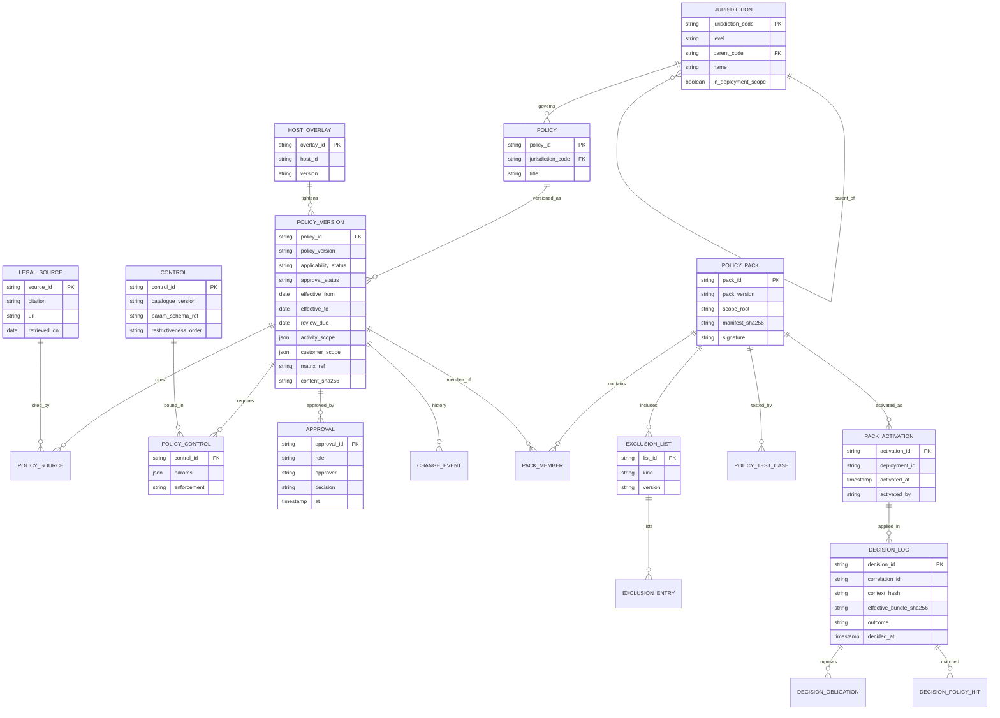
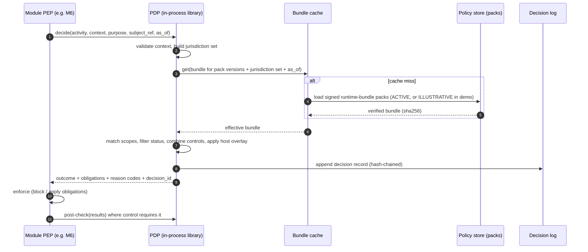
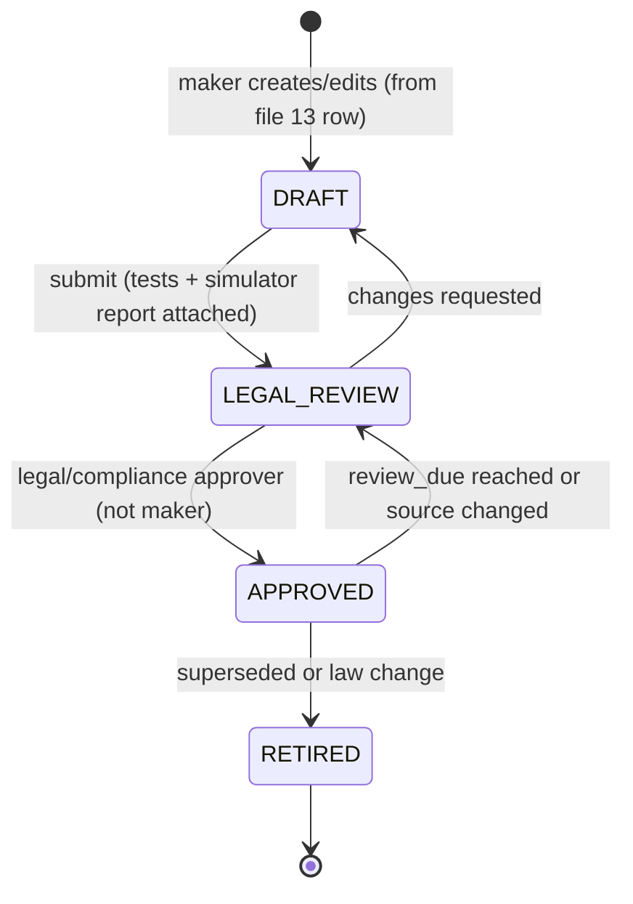

# 14 - Jurisdiction-Aware Policy Layer Design

**Label key:** [REC] recommendation | [ASSUME] assumption | [UNKNOWN] | [MANAGER] needs manager approval | [LEGAL-CONFIRM] legal/compliance must confirm | [DOC p.N] PDF page.
**Status:** planning only, 2026-11-09. Short schema/contract sketches are illustrative, not code.

> **This document does not state what any law requires.** It designs the *mechanism* that holds legal policies as versioned, approved data. All legal content (which regimes apply, what they require, to which activity) lives in **`13-nyc-regulatory-applicability-matrix.md`** and must be confirmed by legal/compliance before any policy is APPROVED. Every policy shown here is a placeholder marked **ILLUSTRATIVE - NOT A LEGAL CONCLUSION**.

## 0. Requirement change and what it replaces

| Item | Before (files 02-09) | Now | Label |
|---|---|---|---|
| Initial market | US and UK, separate installs | **New York City, USA** | User (authoritative) |
| MVP legal scope | US pack + UK pack | **Federal + New York State + New York City only**. No 50-state rulebooks | User (authoritative) |
| How markets differ | `config/markets/US`, `config/markets/UK`; `market` claim | **Jurisdiction policy packs** (versioned, approved data) resolved per customer context; `market` claim becomes a **deployment scope + jurisdiction claims** | User; design [REC] |
| UK / other countries | MVP | ~~Future expansion~~ **Superseded 2026-11-10 (DEC-50, DEC-51; file 21):** Track A "Conventional" = US / US-NY / US-NY-NYC **and** GB / GB-ENG / GB-ENG-LDN (London); Track B "Islamic" = an Islamic bank, UAE onshore [ASSUME] (`AE`, `AE-<emirate>`). Other US states and other countries stay future expansion via new packs, no core rewrite | User (authoritative, 2026-11-10); DEC-13 superseded |
| Institution type | Conventional only | `institution_type` `CONVENTIONAL` or `ISLAMIC` from the deployment profile; `ISLAMIC` adds the tighten-only institution-type overlay `LI` (§4.1, §5; DEC-54) | DEC-51, DEC-54 |
| Data residency | One instance per market [DOC p.54, p.74] | Still a **deployment** concern, separate from policy. **2026-11-10:** Track A runs separate data cells `A-US` and `A-UK` (own database each, in-region; DEC-52); Track B is a separate bank-hosted deployment (DEC-53). The policy layer works identically in every cell | [REC] [LEGAL-CONFIRM]; DEC-28 superseded |

Consequence for other files (applied in files 07, 08, 09 on 2026-11-09): file 09's "US/UK switch" demo becomes "NYC customer vs out-of-scope/unknown-jurisdiction customer"; file 07's `market_code` becomes `deployment_scope` + jurisdiction context; file 08 §3 regime list moves to file 13. [REC]

## 1. Design goals and hard constraints

| # | Goal / constraint | Label |
|---|---|---|
| PG-1 | Legal rules are **data** (policy records), never `if state == "NY"` in business logic. A CI lint forbids jurisdiction literals in `core/` outside the policy package | [REC] |
| PG-2 | Shared intelligence core is unchanged when a jurisdiction is added | User |
| PG-3 | Every policy is versioned, effective-dated, sourced (citation + URL), approved (maker-checker) and replayable | User; [DOC p.9, p.13, p.63] |
| PG-4 | **Fail safe**: uncertainty -> `PENDING_LEGAL_REVIEW` -> restrictive default. The system never invents a legal decision | User |
| PG-5 | Same PDP and packs in standalone and plugin modes; host may **tighten**, never silently loosen | User; [REC] |
| PG-6 | **No credit-decision output type exists** anywhere in the contract or the PDP vocabulary (see §13); outputs are labelled not for credit decisioning (file 15 IC7) | User; [DOC p.53, p.69] |
| PG-7 | Minors: separate protected journey with a **two-tier block list** (§13.3): commercial activities, credit referral and model training always OFF; non-commercial educational uses OFF unless an explicit legal/compliance approval record exists | User; [DOC p.31, p.44, p.67] |
| PG-8 | No sensitive characteristics or unsupported inferences for commercial targeting | User; [DOC p.28, p.43] |

## 2. Jurisdiction hierarchy (logical levels)

| Level | Code scheme | MVP | Examples | Label |
|---|---|---|---|---|
| L0 `GLOBAL_BASELINE` | `*` | Yes | Our own non-legal product safeguards (no credit decisions, LLM guardrails, no sensitive inference). Not law; internal policy | [REC] |
| L1 `NATIONAL` (federal / country) | ISO 3166-1 alpha-2: `US`, `GB`, `AE` | Yes: `US`, `GB` (Track A); `AE` (Track B) | Federal / national policies | User (2026-11-10) |
| L2 `SUBNATIONAL` (state/province/nation/emirate) | ISO 3166-2: `US-NY`, `GB-ENG`, `AE-<emirate>` | Yes: `US-NY`, `GB-ENG` (Track A); `AE-<emirate>` (Track B, emirate unknown [ASSUME], e.g. `AE-DU` or `AE-AZ` as examples only) | NY State, England, emirate policies | User; [ASSUME] |
| L3 `LOCAL` (city/county) | Custom: `US-NY-NYC`, `GB-ENG-LDN` [ASSUME deployment-defined local codes] | Yes: `US-NY-NYC`, `GB-ENG-LDN` (Track A) | NYC, London policies | User |
| L2/L3 future states | `US-CA`, `US-NJ`, ... | No | Added as packs | User |
| L1+ future international | `GB-WLS`, `GB-SCT`, `EU` (supranational, modelled as L1 with `supranational=true`), other countries [REC] | No | Added as packs | User; [MANAGER] |
| `LI` institution-type overlay (not a jurisdiction level) | `PACK-INST-ISLAMIC` | Yes, Track B only (`institution_type = ISLAMIC`) | Sharia-layer controls (§5); restrictive-only | DEC-54 |

Notes:
- The hierarchy is a tree held as data (`jurisdiction.parent_code`). Resolution walks ancestors, so `US-NY-NYC` implies `US-NY` and `US`. [REC]
- Supranational (e.g. EU) needs a second parent; modelled as `jurisdiction_membership` (many-to-many) rather than a single parent. [REC] [UNKNOWN until needed]
- Jurisdictions not present in the store are **UNKNOWN_JURISDICTION**, never treated as "no rules". See §10.
- **Cells and tracks (2026-11-10, file 21 §2):** a cell serves only the jurisdiction roots in its deployment profile (`A-US`: `US`; `A-UK`: `GB`; `B-AE`: `AE`). A customer whose residence and booking fall in different cells resolves to `UNKNOWN` (DEC-24, DEC-25); a jurisdiction from the other track is `UNSUPPORTED_JURISDICTION`. [REC]

## 3. Policy data model

### 3.1 Policy record fields (required)

| Field | Type | Notes |
|---|---|---|
| `policy_id` | string, stable | e.g. `POL-US-NY-NYC-0007`. Never reused |
| `policy_version` | SemVer | Major = semantic change in obligation; minor = scope widening/narrowing; patch = citation/text fix [REC] |
| `jurisdiction_level` | enum L0-L3 | |
| `jurisdiction_code` | string | From §2 |
| `title`, `summary` | text | Plain-language; written by legal or from file 13 |
| `legal_sources[]` | `{citation, url, retrieved_on, excerpt_ref?}` | Citation + URL mandatory; `GLOBAL_BASELINE` uses `INTERNAL-POLICY` source [REC] |
| `activity_scope[]` | enum list | From the activity taxonomy (§3.3) |
| `customer_scope` | predicate (data) | e.g. `age_status in [ADULT]`, `residence in subtree(US-NY-NYC)`, `relationship in [RETAIL]` |
| `product_scope`, `channel_scope`, `purpose_scope` | lists | Optional; empty = all |
| `effective_from`, `effective_to` | date | Bitemporal with `recorded_at` |
| `review_due` | date | Past due -> policy status degrades (see §10) |
| `applicability_status` | `APPLICABLE` / `NOT_APPLICABLE` / `PENDING_LEGAL_REVIEW` | Legal judgement recorded, not computed |
| `required_controls[]` | `{control_id, params, enforcement: BLOCK / OBLIGATION / MONITOR}` | Machine-readable, from control catalogue (§5) |
| `approval_status` | `DRAFT` / `LEGAL_REVIEW` / `APPROVED` / `RETIRED` | Only APPROVED + APPLICABLE policies grant anything; PENDING always restricts. Governance lifecycle field: policy schemas are outside the forbidden-term linter's output scope (§13.1) |
| `maker`, `approver`, `approved_at`, `approval_evidence_ref` | | Maker != approver (maker-checker) [DOC p.9, p.63] |
| `matrix_ref` | string | Row ID in file 13 that justifies this policy [REC] |
| `illustrative` | bool | `true` -> cannot be APPROVED (schema invariant, §8.1) |
| `illustrative_assumption` | `ASSUME_APPLICABLE` / `ASSUME_NOT_APPLICABLE` / absent | Allowed only when `illustrative: true` (schema invariant). Honoured only inside an `ILLUSTRATIVE` bundle in a standalone demo deployment (§8.4, DEC-44); ignored everywhere else. Never changes `applicability_status` |
| `supersedes[]` | policy refs | Explicit pre-emption only, set by legal on an APPROVED policy (§4.2); never inferred |
| `change_history[]` | append-only | `{version, changed_by, changed_at, reason, diff_ref, ticket_ref}` |
| `content_sha256` | hash | Of canonicalised record; signed in pack manifest |

### 3.2 ER diagram



### 3.3 Activity taxonomy (what a policy can scope to) [REC]

`TXN_ENRICHMENT`, `PROFILE_BUILD`, `SEGMENTATION_INSIGHT`, `SEGMENTATION_COMMERCIAL`, `NEEDS_PREDICTION`, `CHURN_PREDICTION`, `PRODUCT_RECOMMENDATION`, `CREDIT_PRODUCT_REFERRAL`, `RETENTION_SUGGESTION`, `MARKETING_ELIGIBILITY`, `EXPLANATION_GENERATION`, `ASSISTANT_QA`, `DATA_RETENTION`, `AUDIT_EXPORT`, `MODEL_TRAINING`, `FAIRNESS_MONITORING`. Taxonomy is versioned; an unknown activity in a request is DENY. Note: there is **no** `CREDIT_DECISION` activity (§13).

### 3.4 Customer jurisdiction context (input to resolution)

| Attribute | Source | Notes |
|---|---|---|
| `residence_jurisdiction` | Host (coarse, e.g. `US-NY-NYC`), never full address | [DOC p.8] minimisation; derivation of city from ZIP is the host's job [ASSUME] |
| `booking_entity_jurisdiction` | Host account/legal entity | Where the account is booked |
| `servicing_location` / `channel_location` | Host / channel | e.g. branch in NYC vs digital |
| `product_jurisdictions[]` | Catalogue | Where product is offered/licensed |
| `channel` | Request | `MOBILE_APP`, `WEB`, `BRANCH_STAFF`, `EMAIL`, `SMS`, `PUSH`, `CALL_CENTRE` |
| `age_status` | Derived from host birth year-month | `ADULT`, `MINOR_PROTECTED`, `AGE_UNKNOWN` |
| `consents[]`, `preferences[]` | Host consent service | Per source and purpose [DOC p.8, p.56] |
| `vulnerability_flag` | Host only, never inferred | [DOC p.17, p.54] |
| `as_of` | Request | Selects effective policy versions; enables replay |

Which of these attributes legally "connect" a customer to a jurisdiction (residence vs booking vs channel) is **[LEGAL-CONFIRM]** per row in file 13. The design treats them as a **union** (§4) so it is safe while unconfirmed.

## 4. Policy resolution

### 4.1 Algorithm [REC]

1. **Validate context.** Missing/unknown jurisdiction attribute -> mark `UNKNOWN_JURISDICTION` (does not abort; applies the restrictive default pack, §10).
2. **Jurisdiction set** = union over all context attributes of `{code} ∪ ancestors(code)`, plus `GLOBAL_BASELINE`. E.g. residence `US-NY-NYC`, booking `US-NY` -> `{*, US, US-NY, US-NY-NYC}`.
3. **Deployment scope check.** If any jurisdiction in the set is outside the deployment's `in_deployment_scope` (e.g. customer residence `US-CA` in an NYC-only MVP) -> that jurisdiction resolves to the `UNSUPPORTED_JURISDICTION` restrictive default (insight-only or deny, per §10). [REC] [MANAGER]
4. **Candidate policies** = policy versions in the runtime bundle (L0 plus packs in pack state `ACTIVE`, or `ILLUSTRATIVE` in a standalone demo deployment; §8.4, DEC-45) where jurisdiction ∈ set, `activity ∈ activity_scope`, customer/product/channel/purpose scope predicates match, and `effective_from <= as_of < effective_to`.
5. **Status filter.**
   - `APPROVED` + `APPLICABLE` -> contributes controls.
   - `APPROVED` + `NOT_APPLICABLE` -> recorded in decision log as "considered, not applicable"; contributes nothing.
   - `PENDING_LEGAL_REVIEW` (any approval status) or `LEGAL_REVIEW` -> contributes its controls **as BLOCK** plus obligation `FLAG_PENDING_LEGAL_REVIEW` (fail safe). [REC]
   - `DRAFT` or `RETIRED` -> ignored for decisions; DRAFT can be evaluated only in the simulator.
   - `review_due` passed -> treated as `PENDING_LEGAL_REVIEW` [REC] (DEC-14: no grace period).
   - **`ILLUSTRATIVE` bundle only (DEC-44):** a policy with `illustrative_assumption: ASSUME_APPLICABLE` contributes its controls as if APPROVED + APPLICABLE; `ASSUME_NOT_APPLICABLE` is logged as considered; a policy without an assumption follows the PENDING rule above. Every such decision carries flag `ILLUSTRATIVE` and reason code `POLICY_ILLUSTRATIVE_ASSUMPTION`. Locked L0 controls apply unchanged.
6. **Combine controls** per `control_id` using the control's combining rule (§4.2).
6a. **Institution-type overlay `LI`** (DEC-54; file 21 §4): when the deployment profile has `institution_type = ISLAMIC`, merge `PACK-INST-ISLAMIC` with the same combining rules, after the jurisdiction packs and before the host overlay. The overlay is **restrictive-only by CI invariant** (no policy may grant an activity, widen an allow-list or raise an upper bound), cannot touch locked L0 controls and cannot relax either tier of the minors list. `CONVENTIONAL` deployments load no overlay. The institution type comes only from the signed deployment profile, never from a request.
7. **Host overlay** (plugin): merge with the same combining rules; host can only add or tighten (§11).
8. **Produce decision**: `PERMIT`, `PERMIT_WITH_OBLIGATIONS`, `DENY`, or `INDETERMINATE`; `INDETERMINATE` is enforced as `DENY` and logged. Output includes `effective_bundle_sha256`, matched policy IDs/versions, obligations, reason codes, `decision_id`.

### 4.2 Conflict resolution

Default: **most restrictive wins** [REC], pending legal confirmation that no lower-level rule is meant to *pre-empt or relax* a higher one [LEGAL-CONFIRM]. Implemented per control type, not as a single global rule, because "restrictive" means different things:

| Control kind | Combining rule | Example |
|---|---|---|
| Boolean block (e.g. minor block) | `deny-overrides`: any BLOCK -> BLOCK | Any level blocks marketing -> blocked |
| Required obligation (explanation, human review, audit) | Union of obligations | Federal requires explanation, NYC requires language X -> both |
| Enumerated allow-list (channels, purposes) | Intersection | Federal allows {app,email,sms}, NY allows {app,email} -> {app,email} |
| Numeric upper bound (e.g. max contacts/week) | Minimum | 3 vs 2 -> 2 |
| Numeric lower bound (e.g. notice period) | Maximum | |
| **Retention period** | **Not auto-resolved.** A "keep at least N" and a "delete after M" may conflict; if `min_keep > max_keep` -> `INDETERMINATE` + `PENDING_LEGAL_REVIEW` conflict record; if compatible -> keep within `[max(min_keep), min(max_keep)]`, default to the lower end of the window when none is mandated [REC] [LEGAL-CONFIRM] |
| Explanation language list | Union | |
| Pre-emption (federal law displaces state) | **Not modelled automatically.** Expressed explicitly by legal as `policy.supersedes[]` on an APPROVED policy, never inferred | [LEGAL-CONFIRM] |

Every control declares its combining rule in the catalogue, so adding a policy cannot need code. A **monotonicity property** is tested: adding any APPLICABLE policy never makes a decision more permissive (§14); the same property is tested for adding the institution-type overlay to any bundle (DEC-54).

### 4.3 Resolution sequence



## 5. Control catalogue (machine-readable control IDs) [REC]

Controls are **mechanisms we can enforce**, independent of any law. A policy says *which* control applies *where*; the catalogue says *how* the system enforces it. Parameters are validated by JSON Schema per control.

| control_id | Purpose | Params (illustrative) | Enforced by (PEP) | Combining |
|---|---|---|---|---|
| `CTL-CONSENT-PURPOSE` | Processing allowed only with valid consent for purpose + source | `purpose`, `sources[]`, `accept_implied: false` | All modules pre; M8 | deny-overrides |
| `CTL-MINOR-PROTECT` | Minor protected journey; two-tier block list (§13.3) | `tier1_blocked[]` (fixed, locked), `tier2_blocked[]`, `tier2_allowed_by_approval[]`, `approval_record_ref?`, `txn_enrichment_scope: AGE_ROUTING_ONLY` | M1, M2 (age/routing only), M3, M4, M5, M6, M7, M9, model training | deny-overrides; locked against packs and overlays |
| `CTL-SENSITIVE-EXCLUDE` | Excludes listed sensitive attributes from features/targeting | `exclusion_list_id`, `version` | Feature build (M1), M3-M6, model training | union of lists |
| `CTL-PROXY-REVIEW` | Proxy variables blocked unless approved per use | `proxy_list_id`, `allowed_uses{}` | M3-M6, model registry | union; allowed-use intersection |
| `CTL-NO-INFERENCE` | Forbids inferring listed characteristics from transactions | `forbidden_inference_list_id` | M2 categoriser, M9 | union |
| `CTL-HUMAN-REVIEW` | Output must be reviewed by a person before use; creates a `review_item` (file 07) in state QUEUED; only CLEARED_TO_SHOW releases the output; EXPIRED/REJECTED never shown | `role`, `activities[]`, `sla_hours` | M6, M7 (output flagged `requires_human_review`) | union; min SLA |
| `CTL-EXPLANATION` | Reason codes + plain-language explanation required | `languages[]`, `max_reasons`, `template_required` | M4-M7, M9 | union |
| `CTL-AI-DISCLOSURE` | Mark output as AI-assisted for staff/customer surfaces | `surface[]`, `text_template_id` | M9, API response | union |
| `CTL-RETENTION` | Retention window per entity | `entity`, `min_keep`, `max_keep` | Purge jobs, audit store | see §4.2 |
| `CTL-AUDIT-LOG` | Decision + data-access logging level | `level: STANDARD/FULL`, `export_required` | All | max level |
| `CTL-MARKETING-SUPPRESS` | Suppress commercial recommendations (opt-out, pause-offers, vulnerability) | `triggers[]` | M6, M7 | deny-overrides |
| `CTL-CHANNEL-ALLOW` | Channels on which a suggestion may be surfaced | `channels[]` | M6, M7 output | intersection |
| `CTL-CONTACT-LIMIT` | Frequency/time-window limits for suggested outreach | `max_per_window`, `window`, `quiet_hours` | M7 | min / union of quiet hours |
| `CTL-VULNERABILITY-ROUTE` | Host-flagged vulnerable customer routed to human, commercial off | `route_role` | M6, M7 | deny-overrides |
| `CTL-CREDIT-REFERRAL-ONLY` | Credit products only as "refer to credit platform for assessment" | `referral_target` | M6, M9 | fixed (always on in L0) |
| `CTL-ADVERSE-ACTION-HANDOFF` | Any situation that might look like an adverse credit outcome is not produced by us; route to credit platform/host process | `handoff_target`, `message_template_id` | M6, M9 refusal path | fixed (always on in L0) |
| `CTL-MODEL-APPROVED-ONLY` | Only registry entries cleared to serve may score this activity: `RULESET` in status `ACTIVE`, or `ML_MODEL` in status `APPROVED` (MRM approval reference required; unavailable while DEC-19 is blocked). `SHADOW` models never serve (DEC-47) | `min_status`, `ruleset_requires_mrm_approval` (default false) | M4, M5 | fixed |
| `CTL-FAIRNESS-MONITOR` | Outcome monitoring by group/segment | `metrics[]`, `thresholds` | M8 batch | union; strictest threshold |
| `CTL-LLM-GUARDRAIL` | LLM wording only, numbers verified, template fallback | `allow_llm: bool` | M9 | AND of allow_llm |
| `CTL-DATA-MINIMISE` | Field allow-list per activity | `fields[]` | Inbound adapters, M1 | intersection |
| `CTL-DSR-SUPPORT` | Data subject request handling (access/delete/object) | `request_types[]`, `sla_days` | API, M8 | union; min SLA |
| `CTL-DATA-RESIDENCY` | Processing location constraint | `allowed_deployments[]` | Bootstrap / deployment check | intersection |
| `CTL-DEFAULT-DENY` | Restrictive default for unknown/pending | `allowed_activities[]` (default: none or insight-only) | PDP | deny-overrides |
| `CTL-CATALOGUE-ELIGIBILITY` (DEC-54) | Catalogue item may be suggested only if it carries every attribute the bundle requires; the Islamic overlay requires `sharia_status = SHARIA_APPROVED` (or, in an `ILLUSTRATIVE` demo bundle only, the separate attribute `illustrative_sharia_assumption: ASSUME_COMPLIANT`, activator-confirmed) | `required_item_attributes{}` | M6 candidate generation (before ranking), M9 | intersection of required attributes |
| `CTL-TERMINOLOGY` (DEC-54) | Explanations, assistant answers, reason-code texts and templates use approved terms only (illustrative Islamic list: "finance" not "loan", "profit"/"profit rate" not "interest") [SHARIA-CONFIRM] | `term_list_id`, `version`, `on_violation: BLOCK_AND_FALLBACK` | M9 output validator, template CI lint, reason-code library build | union of term lists |
| `CTL-PROHIBITED-CATEGORY` (DEC-54) | Merchant categories and product types the institution does not promote: never suggested, never in offers or rewards, never a ranking/targeting feature, never used to infer religion; M2 labels them neutrally for budgeting only | `category_list_id` [SHARIA-CONFIRM], `uses_blocked[]` | M2 (label only), M3, M6, M7, M9, feature build | union of lists and blocked uses |
| `CTL-SHARIA-APPROVAL` (DEC-55) | Packs, catalogue items, templates and reason-code texts used in a customer-facing output need `sharia_approval_status = SHARIA_APPROVED` with a reference; otherwise BLOCK, reason `SHARIA_REVIEW_PENDING` | `artefact_kinds[]`, `allow_illustrative` (demo bundles only) | M6, M7, M9, pack load, template load | deny-overrides |

**Two-track parameters (2026-11-10):** `CTL-CONTACT-LIMIT` carries Track B telemarketing parameters in the AE pack (`channels_counted[]` includes in-app/push until file 20 IQ4 is answered; consent dimensions per file 20 row E08; DEC-67). `CTL-HUMAN-REVIEW` gets Track A policies in `PACK-GB`, mirrored in `PACK-US` as internal policy, covering offer suppression, retention-offer allocation and vulnerability routing (file 19 U02/UQ4; DEC-66). The Sharia overlay controls map to file 20 SDC-01..SDC-18 as listed in file 21 §4.4. GB pack scope waits for the UK entity type (DEC-65, BLOCKED-EXTERNAL).

Catalogue is versioned (`catalogue_version`); retiring a control requires all packs to drop it first. New control = code change in the PDP/PEP (the *only* kind of change that touches code), done once and reused by every jurisdiction. [REC]

## 6. Enforcement points per module

PDP = Policy Decision Point (decides). PEP = Policy Enforcement Point (in each module's service layer, enforces). [REC] The PDP is an **in-process library** in `core/policy/` (no network hop) exposed also via `POST /v1/policy/decisions` for hosts (file 15). Modules never read raw policies; they call `decide()` and receive obligations.

| Module (file 06) | Pre-processing PEP: activity checked | Post-processing PEP | Main controls |
|---|---|---|---|
| M1 Customer Intelligence | `PROFILE_BUILD`: consent, data minimisation, sensitive exclusion, minor check (tier 2) | Strip excluded features from snapshot; record feature list hash | CONSENT, DATA-MINIMISE, SENSITIVE-EXCLUDE, MINOR-PROTECT |
| M2 Transaction Intelligence | `TXN_ENRICHMENT`: consent per source; for minors age/routing checks only | Categories pass forbidden-inference check (no health/religion etc. labels) | CONSENT, NO-INFERENCE, MINOR-PROTECT (routing) |
| M3 Segmentation | `SEGMENTATION_INSIGHT` or `_COMMERCIAL`; minor check | Commercial memberships dropped for blocked customers; proxy check of rule inputs | MINOR-PROTECT, PROXY-REVIEW, SENSITIVE-EXCLUDE |
| M4 Needs | `NEEDS_PREDICTION` | Needs flagged commercial-use vs insight-use | MINOR-PROTECT, MODEL-APPROVED-ONLY, EXPLANATION |
| M5 Churn | `CHURN_PREDICTION` | Score withheld if blocked; reason codes required | MINOR-PROTECT, MODEL-APPROVED-ONLY, EXPLANATION |
| M6 Recommendation | `PRODUCT_RECOMMENDATION` / `MARKETING_ELIGIBILITY` / `CREDIT_PRODUCT_REFERRAL` | Every candidate gated: suppress, channel filter, credit -> referral only, human-review flag; suppressed rows kept with reason | MARKETING-SUPPRESS, CHANNEL-ALLOW, CREDIT-REFERRAL-ONLY, VULNERABILITY-ROUTE, HUMAN-REVIEW, MINOR-PROTECT, EXPLANATION, ADVERSE-ACTION-HANDOFF |
| M7 Retention | `RETENTION_SUGGESTION` | Contact limits, quiet hours, support-first ordering; outcome recording (file 07 `retention_outcome`) | CONTACT-LIMIT, MARKETING-SUPPRESS, VULNERABILITY-ROUTE, MINOR-PROTECT, HUMAN-REVIEW, EXPLANATION |
| M8 Risk & Compliance | Hosts the PDP, decision log, fairness monitor, retention jobs | Fairness reports, retention purge | All; FAIRNESS-MONITOR, RETENTION, AUDIT-LOG |
| M9 Orchestrator | `EXPLANATION_GENERATION` / `ASSISTANT_QA`: LLM allowed? languages? | Output validator; AI-disclosure; refusal for credit-decision/adverse-action intents | LLM-GUARDRAIL, EXPLANATION, AI-DISCLOSURE, ADVERSE-ACTION-HANDOFF, MINOR-PROTECT |

Rules: (1) a module that skips the pre-PEP cannot produce output - the result type requires a `decision_id` field, so the type system enforces the call [REC]; (2) obligations not understood by a PEP -> DENY (unknown obligation is not ignorable) [REC]; (3) batch jobs call the PDP per customer but reuse the cached bundle.

## 7. Decision log / audit record

Append-only, hash-chained (extends `audit_record` in file 07). One record per PDP call; batch may write compact records referencing a shared bundle hash. [REC]

```json
{
  "decision_id": "dec_01J...",
  "correlation_id": "corr-...", "trace_id": "W3C traceparent",
  "decided_at": "2026-11-09T14:02:11Z", "as_of": "2026-11-09",
  "deployment_id": "nyc-mvp-01", "mode": "STANDALONE|PLUGIN",
  "caller": {"module": "M6", "service_identity": "svc-retail-intel", "host_id": null},
  "activity": "PRODUCT_RECOMMENDATION", "purpose": "PERSONALISATION",
  "subject_ref": "cust_tok_...",
  "context_hash": "sha256 of canonical context (no PII)",
  "jurisdiction_set": ["*", "US", "US-NY", "US-NY-NYC"],
  "packs": [{"pack_id": "PACK-US-NYC", "pack_version": "0.3.0", "manifest_sha256": "..."}],
  "host_overlay": {"overlay_id": null},
  "effective_bundle_sha256": "...",
  "policy_hits": [
    {"policy_id": "POL-US-0003", "version": "1.0.0", "applicability": "APPLICABLE", "effect": "OBLIGATION"},
    {"policy_id": "POL-US-NY-NYC-0007", "version": "0.2.0", "applicability": "PENDING_LEGAL_REVIEW", "effect": "BLOCK"}
  ],
  "outcome": "DENY",
  "obligations": [{"control_id": "CTL-AUDIT-LOG", "params": {"level": "FULL"}}],
  "reason_codes": ["POLICY_PENDING_LEGAL_REVIEW"],
  "flags": ["PENDING_LEGAL_REVIEW"],
  "prev_hash": "...", "record_hash": "..."
}
```

- No names, addresses, raw descriptions, or sensitive attributes in the log; context is stored by hash with the input reference held in the lineage chain for replay. [REC] [DOC p.8, p.13]
- Retention of decision logs is itself governed by `CTL-RETENTION` for entity `DECISION_LOG` [LEGAL-CONFIRM].
- Erasure (DSR delete) never rewrites a chained record: `subject_ref` is a token, any personal payload stored beside the log is encrypted with a per-subject key, and erasure destroys that key and the host token mapping (crypto-shredding, file 07 §8.2). The chain stays verifiable; replay of an erased subject's inputs is no longer possible, but the outcome, pack versions and hashes remain. [REC] [LEGAL-CONFIRM]
- `PENDING_LEGAL_REVIEW` hits also emit an internal `policy.review.required` event (file 15) feeding a legal work queue. [REC]

## 8. Policy-as-data format, caching and versioning

### 8.1 Format [REC]

- Source of truth: **YAML** files in a `policy-packs/` repo (reviewed via pull request), validated by **JSON Schema (2020-12)**; compiled to canonical JSON + manifest at build. Pydantic models in the PDP mirror the schema (file 03).
- Expressions in `customer_scope` use a **small closed predicate DSL** (`all/any/not`, `eq`, `in`, `in_subtree`, `lt/gt`) - not a general language. [REC] Rationale: auditable by non-engineers; OPA/Rego or Cedar considered later if expressions outgrow this [REC] [UNKNOWN].
- Pack manifest lists member policy versions, catalogue version, exclusion list versions, sha256 of each file, and a detached signature (signing key held by compliance; standalone uses dev key). PDP refuses unsigned or hash-mismatched packs. [REC]

Illustrative policy file (**ILLUSTRATIVE - NOT A LEGAL CONCLUSION**):

```yaml
# policy-packs/US-NY-NYC/POL-US-NY-NYC-0007.yaml
schema: policy/v1
policy_id: POL-US-NY-NYC-0007
policy_version: 0.2.0
jurisdiction: {level: LOCAL, code: US-NY-NYC}
title: "PLACEHOLDER - local rule affecting automated personalisation"
illustrative: true                       # schema forbids APPROVED when true
legal_sources:
  - citation: "TBD - see 13-nyc-regulatory-applicability-matrix.md row C0?"
    url: "https://example.invalid/placeholder"
    retrieved_on: 2026-11-09
matrix_ref: "13#C-TBD"
activity_scope: [PRODUCT_RECOMMENDATION, MARKETING_ELIGIBILITY]
customer_scope: {all: [{in_subtree: {attr: residence_jurisdiction, code: US-NY-NYC}},
                       {eq: {attr: age_status, value: ADULT}}]}
channel_scope: []
effective_from: 2026-01-01
review_due: 2027-01-01
applicability_status: PENDING_LEGAL_REVIEW
required_controls:
  - {control_id: CTL-HUMAN-REVIEW, enforcement: OBLIGATION, params: {role: relationship_staff}}
approval_status: LEGAL_REVIEW
maker: dev.a
approver: null
change_history:
  - {version: 0.1.0, changed_by: dev.a, changed_at: 2026-11-01, reason: "initial placeholder"}
  - {version: 0.2.0, changed_by: dev.a, changed_at: 2026-11-09, reason: "scope narrowed to adults"}
```

Schema-level invariants (validated in CI): `illustrative: true` cannot be `APPROVED`; `APPROVED` requires `approver != maker`, non-empty `legal_sources` with URL, and `matrix_ref`; `required_controls` must exist in the catalogue version referenced by the pack; params validate against each control's param schema. [REC]

Signing keys carry a key class: `DEMO` (standalone demo; dev key) or `DEPLOYMENT` (pilot/plugin; held by compliance). A non-demo deployment trusts no `DEMO`-class key (DEC-44).

### 8.2 Versioning [REC]

| Artefact | Version | Immutability |
|---|---|---|
| Policy version | SemVer per policy | Immutable once LEGAL_REVIEW; edits create a new version |
| Policy pack | SemVer per pack (`PACK-US`, `PACK-US-NY`, `PACK-US-NYC`, `PACK-GLOBAL-BASELINE`) | Immutable, signed |
| Control catalogue | SemVer | Immutable |
| Exclusion lists | SemVer | Immutable |
| Activation | `deployment_id` + pack versions + timestamp | Append-only |

Effective-dating plus immutable versions means a decision can be **replayed** with `as_of` + recorded pack versions and must produce the identical outcome (CMP-12 in file 08). [DOC p.13]

### 8.3 Caching [REC]

- Compiled **effective bundle** cached in-process keyed by `(sorted pack manifest hashes, overlay hash, jurisdiction_set, as_of_date)`; bundles are immutable so there is no TTL-based staleness, only **invalidation on activation** (activation event bumps a generation counter).
- Per-decision results are **not** cached across requests (consent/preference inputs change); batch jobs reuse the bundle.
- If the policy store is unreachable at start-up -> service does not become `ready`; if a reload fails at runtime -> keep last verified bundle, raise alert, and after a configurable max-age switch to `CTL-DEFAULT-DENY` [MANAGER - max-age value].

### 8.4 Pack lifecycle and runtime bundle (DEC-45, DEC-44) [REC]

Pack-level `pack_state` is separate from the per-policy `approval_status` (§3.1, §9).

| Pack state | Meaning | In runtime bundle? | Who moves it |
|---|---|---|---|
| `DRAFT` | Uploaded or authored | No (simulator only) | `policy_author` |
| `VALIDATED` | CI passed (schema, invariants, golden cases, monotonicity); manifest signed by the build; stored and listed. **This is the "loaded but unapproved" state** | No (simulator candidate only) | System, on `:validate` |
| `IN_LEGAL_REVIEW` | Submitted with the simulator report; member policies in LEGAL_REVIEW | No | `policy_author` (`:submit`) |
| `APPROVED` | Every member policy APPROVED by `policy_approver` (maker != checker); `illustrative: false` | No | `policy_approver` (impossible while DEC-11 is unresolved) |
| `ACTIVE` | Activated with recorded MGR/LEG sign-off; `policy.pack.activated` | Yes (any deployment) | `policy_release` |
| `ILLUSTRATIVE` | Demo activation of a `VALIDATED` pack whose policies are all `illustrative: true` (DEC-44) | Yes, only when `mode = STANDALONE`, `demo = true` and the synthetic-only guard is on; any other deployment refuses it at load (`ILLUSTRATIVE_PACK_REFUSED`, not ready) | `policy_release` in the demo deployment; activator != maker. The activator confirms each `illustrative_assumption` in the activation record; this is the second-user check of DEC-44 |
| `RETIRED` | Superseded or withdrawn; rollback = activating an earlier version | No | `policy_release` |

- A runtime bundle is L0 + `ACTIVE` packs, or L0 + `ILLUSTRATIVE` packs; never mixed.
- **`/ready`** = database up + verified L0 + every pack configured for the deployment verified and loadable. With no jurisdiction pack in the bundle the instance is ready, but `CTL-DEFAULT-DENY` denies every non-governance activity; `GET /v1/capabilities` shows the empty bundle.
- **L0 `PACK-GLOBAL-BASELINE`** is internal policy and restrictive-only: a CI invariant rejects any L0 policy that grants an activity, so the L0 permit whitelist (§10) is empty in v1. It is approved as `INTERNAL_POLICY` by the developer (subsystem owner) with a second-person review, and its `pack_state` is `ACTIVE` once that internal approval and activation are recorded (no DEC-11 approver needed). It is signed with the `DEMO` key only in a deployment with `demo = true`; every deployment with `demo = false` (including a non-demo standalone) uses the `DEPLOYMENT` key. COMP reviews its content at GATE-3A.
- **Changing an assumption** means uploading a new pack version (packs are immutable). A simulation whose candidate hits PENDING_LEGAL_REVIEW policies writes an audit record and emits `policy.review.required` with `source: SIMULATION`; that is the legal-queue event shown in the demo (file 09 §7).
- **Watermark (`ILLUSTRATIVE` bundle):** every response, event, export, explanation and dashboard screen carries `illustrative: true` and "illustrative - not legal advice - not for real customers"; set by the shared-core response assembler.
- API: file 15 §2.1 (DEC-46).

## 9. Approval workflow



| Step | Who | Evidence |
|---|---|---|
| Draft | DEV or compliance analyst (maker) | matrix_ref, sources, controls, golden cases |
| Technical check | CI | schema, invariants, unit tests, monotonicity, simulator diff vs current pack |
| Legal review | LEG (checker) | Applicability status set; approval record signed |
| Pack build + sign | `policy_release` role (file 08 SEC-02) | Manifest, signature |
| Activation | `policy_release` role (ops) with MGR/LEG sign-off [MANAGER] | Activation record; `policy.pack.activated` event |
| Periodic review | LEG on `review_due` | New version or re-approval |

**Track B dual approval (DEC-55, DEC-63; file 21 §4.3):** packs, catalogue items, templates and reason-code texts in an `ISLAMIC` deployment also carry `sharia_approval_status` (`NOT_REVIEWED` -> `IN_SHARIA_REVIEW` -> `SHARIA_APPROVED` / `SHARIA_REJECTED`), set only by the new role `sharia_approver` (the bank's Sharia Compliance function / ISSC secretariat). Separation of duties per file 20 SDC-17 in its strictest form (role matrix SOD-9): `sharia_approver` holds no `policy_author`, `policy_approver` or `policy_release` scope; per user, the Sharia approver differs from the maker and from the legal approver of the same pack version, and the activator differs from both (file 21 §4.3). A Track B pack reaches `APPROVED` only when both the legal approver and the Sharia approver have signed; otherwise BLOCK. Interim approvers are roles only (Track A: Head of Compliance; Track B: Head of Compliance + Sharia Compliance/ISSC); no pack is approved or activated until a named person and backup are recorded (DEC-11, DEC-63). [SHARIA-CONFIRM]

`applicability_status` is set by the legal approver only; developers cannot mark a policy `NOT_APPLICABLE`, and an `illustrative_assumption` never changes it. [REC] The policy states above sit inside the pack lifecycle in §8.4 (DEC-45); the endpoints are in file 15 §2.1 (DEC-46). Roles map to file 08 SEC-02 (`policy_author`, `policy_approver`, `policy_release`; role-to-scope matrix file 15 §5.1, file 08 SEC-19) [MANAGER].

## 10. Fail-safe behaviours

| Condition | Behaviour | Label |
|---|---|---|
| Applicability uncertain (`PENDING_LEGAL_REVIEW`) | Policy's controls enforced as BLOCK; outcome flagged; legal queue event | User |
| Customer jurisdiction missing | `UNKNOWN_JURISDICTION` -> default pack: commercial activities DENY; service/insight only if consent valid [MANAGER] | [REC] |
| Jurisdiction outside deployment scope (e.g. `US-CA` in MVP) | `UNSUPPORTED_JURISDICTION` -> same restrictive default; never "borrow" NYC rules | [REC] |
| Age unknown | Treat as `MINOR_PROTECTED` for commercial activities | [REC] |
| Consent unknown / consent service down | No processing for that purpose | [DOC p.8, p.16] |
| No policy matches an activity | DENY (no implicit permit), except L0 baseline activities explicitly whitelisted. **The L0 whitelist is empty in v1** (DEC-45); every permit comes from an `ACTIVE` pack or, in a standalone demo, an `ILLUSTRATIVE` pack (DEC-44) | [REC] |
| `ILLUSTRATIVE` pack in a plugin, pilot or production deployment, or with `demo = false`, or without the synthetic-only guard | Refused at load; not ready (`ILLUSTRATIVE_PACK_REFUSED`) | [REC] DEC-44 |
| Pack not in `ACTIVE` / `ILLUSTRATIVE` state (`DRAFT`, `VALIDATED`, `IN_LEGAL_REVIEW`, `APPROVED`, `RETIRED`) | Never in the runtime bundle; simulator only | [REC] DEC-45 |
| Conflicting controls not auto-resolvable | `INDETERMINATE` -> DENY + conflict record | [REC] |
| Pack signature/hash invalid | Refuse to load; not ready | [REC] |
| `review_due` passed | Treated as PENDING_LEGAL_REVIEW | [REC] [MANAGER grace period?] |
| Unknown control or obligation | DENY | [REC] |
| PDP exception | DENY; error logged with correlation id | [REC] |
| Host overlay tries to loosen | Loosening part rejected; stricter of the two applied; `policy.overlay.rejected` event | User; [REC] |
| `institution_type = ISLAMIC` without `PACK-INST-ISLAMIC`, or any pack, catalogue, template or model tagged for another track | Refused at bootstrap; not ready (fail-closed) | [REC] DEC-51 |
| Track B artefact not `SHARIA_APPROVED` (outside an `ILLUSTRATIVE` demo bundle) | BLOCK, reason `SHARIA_REVIEW_PENDING` | [REC] DEC-55 |
| Residence and booking in different cells (e.g. NYC resident booked in London) | `UNKNOWN` -> restrictive default; no cross-cell join | [REC] DEC-52 |

Fail-safe never fabricates: no response states "permitted by law X"; reason codes only cite policy IDs and statuses. [REC]

## 11. Standalone vs plugin operation

| Aspect | Standalone | Plugin | Label |
|---|---|---|---|
| PDP code | `core/policy` | Same | [REC] |
| Policy store | Local signed packs on disk/Postgres (`PolicyStorePort` local adapter) | Our packs **plus** host-supplied overlay via `PolicyStorePort` host adapter (file or API push, file 15) | [REC] |
| Who approves | Our maker-checker; all MVP packs carry `illustrative: true` until legal approves. The demo runs them in pack state `ILLUSTRATIVE` (watermarked; DEC-44), which is not approval | Host compliance may approve/sign overlays; our packs still require our approval process; `ILLUSTRATIVE` packs are refused at load | [MANAGER] |
| Precedence | n/a | **Host policy wins if stricter**; otherwise ours. Merge uses the same combining rules (§4.2), so "stricter" is defined per control, not by who wrote it | User |
| Host wants looser | Not accepted automatically. Requires a new version of *our* pack via §9, with host legal evidence attached | [REC] [MANAGER] |
| Host has own PDP | Host may call `POST /v1/policy/decisions` to query ours, and/or pass `host_policy_decision_ref` in requests; we still run our PDP (defence in depth, both must permit) | [REC] |
| Decision log | Local | Local + export to host audit sink (file 15 `audit-export`) | [REC] |
| Jurisdiction context | Synthetic customers carry it | Host supplies it per request; if absent -> UNKNOWN_JURISDICTION | [REC] |

## 12. Adding a new state or country (no core change)

1. **Legal:** add rows to an applicability matrix (file 13 pattern) for the new jurisdiction. [LEGAL-CONFIRM]
2. **Reference data:** add `jurisdiction` record(s) with parent (e.g. `US-CA` parent `US`; `GB` level NATIONAL). Mark `in_deployment_scope` for the target deployment.
3. **Author policies** in a new pack `PACK-US-CA` (YAML), referencing existing control IDs only.
4. **Exclusion lists / language lists / retention windows** for the jurisdiction as pack data.
5. **Golden cases** for the jurisdiction in the simulator (§14), including cross-jurisdiction customers (e.g. NYC resident booked in NJ).
6. **CI**: schema, invariants, monotonicity, simulator diff, contract tests unchanged.
7. **Approval** (§9), sign, activate on the target deployment.
8. **Deployment decision** for international: add a **data cell** (own database, in-region) to the track's deployment profile, or a separate deployment of the **same image** where the track requires it (`CTL-DATA-RESIDENCY`; file 21 §2-§3; DEC-51..DEC-53). [LEGAL-CONFIRM]
9. Catalogue, currency, language and category maps are added as **market reference data** (not policy) - existing config mechanism (file 04). [REC]

Only if the jurisdiction needs an enforcement mechanism that no control provides is code touched: add one control to the catalogue (reusable by every jurisdiction), never jurisdiction-specific branching. [REC]

## 13. Customer and recommendation safeguards

### 13.1 No credit decisions - architectural constraint [REC]

- The contract (file 15) and PDP vocabulary contain **no** type, enum, field or activity representing credit approval, decline, limit, pricing, or adverse action. Allowed credit-related output is only `CREDIT_REFERRAL` ("refer to credit platform for assessment").
- Enforced by: (a) JSON Schema lint in CI with a denylist of terms (`approve*`, `decline*`, `credit_decision`, `adverse_action`, `credit_limit`, `apr_offer`, ...). **Linter scope (D-05 decision):** customer-outcome output types only - response and event payload schemas for insights, segments, predictions, recommendations (incl. their status enums), retention actions and outcomes, review items, explanations and assistant answers. Our own values in these schemas are named to pass it (recommendation status `DISMISSED_BY_CUSTOMER`, not `DECLINED`; review state `CLEARED_TO_SHOW`, not `APPROVED`). **Out of scope:** governance and lifecycle schemas that are not customer outcomes - policy records and pack reads (`approval_status: APPROVED`, `approver`, `approved_at`), the model registry and `model.status_changed` events (`APPROVED`/`RETIRED`), `MINOR-APPROVAL-*` records and the control ID `CTL-MODEL-APPROVED-ONLY`. The linter config lists these schema paths explicitly; any new exclusion needs compliance sign-off; (b) M9 tool registry has no tool that writes or decides; (c) `CTL-CREDIT-REFERRAL-ONLY` and `CTL-ADVERSE-ACTION-HANDOFF` live in `GLOBAL_BASELINE` and cannot be overridden by any pack (baseline controls are marked `locked: true`). [REC] [DOC p.53, p.69]
- Assistant requests such as "approve this loan" -> refusal + handoff template. [DOC p.39-40]
- Purpose limitation: every customer-level response and customer-outcome event carries `permitted_use` and `not_for_credit_decisioning: true` (file 15 IC7); host integration terms prohibit credit use of our outputs [LEGAL-CONFIRM].

### 13.2 Sensitive-attribute and proxy-variable exclusion lists [REC]

Design (contents to be confirmed by legal, sourced from file 13 [LEGAL-CONFIRM]):

| List | kind | Effect | Example entries (PLACEHOLDER categories, not legal conclusions) |
|---|---|---|---|
| `EXCL-SENSITIVE` | Attributes never used as features or targeting criteria | Feature build drops; schema of feature store rejects | race/ethnicity, religion, health, sexual orientation, gender identity, immigration status, disability, marital status, national origin [placeholder; legal to confirm per jurisdiction] |
| `EXCL-FORBIDDEN-INFERENCE` | Characteristics we must not infer from transactions | Category taxonomy has no such labels; M2 lint; M9 output validator | e.g. inferring health from pharmacy spend, religion from donations [DOC p.28, p.43]; **every track (DEC-54): religion or religious observance is never inferred from merchant categories, donations, Islamic product holdings or the institution type** (a Track B customer is not assumed to be Muslim) |
| `EXCL-PROXY` | Variables that may proxy a sensitive attribute | Blocked for commercial targeting unless `allowed_uses` approved; always allowed for fairness testing in the restricted store | ZIP/postcode, fine-grained geography, first-language, certain merchant categories, income band for some uses [DOC p.30, p.43, p.64] |
| `EXCL-PROTECTION-ONLY` | Signals usable only for customer protection, never targeting | Usable in `CTL-VULNERABILITY-ROUTE`/support-first; blocked in M6 ranking | gambling, payday-loan categories [file 08 PRV-06] |

Entry schema: `{attribute_or_feature, kind, jurisdictions[], allowed_uses[], rationale, matrix_ref, version}`. Each model registry entry must declare its feature list; CI checks it against the union of applicable lists. Fairness testing data stays in the restricted store models cannot read (file 08 CMP-10).

### 13.3 Minors' protected journey [REC]

This is the **single authoritative minors' block list**; files 05, 07, 08 and 15 reference it rather than repeating it.

- **Age threshold per jurisdiction (DEC-60):** the age of majority is deployment-profile config per jurisdiction (`US` 18, `GB` 18, `AE` [ASSUME 21] restrictive default; all [LEGAL-CONFIRM]). Below the threshold or unknown = `MINOR_PROTECTED` / `AGE_UNKNOWN`. The threshold can only make the block apply to more people; the tiers below are identical in every track, and **Tier 1 is never relaxed**.
- `age_status = MINOR_PROTECTED` (or `AGE_UNKNOWN`) triggers `CTL-MINOR-PROTECT` from `GLOBAL_BASELINE` with a **two-tier block list**:

| Tier | Activities (§3.3) | Effect |
|---|---|---|
| Tier 1 - always BLOCK | `SEGMENTATION_COMMERCIAL`, `CHURN_PREDICTION`, `PRODUCT_RECOMMENDATION`, `MARKETING_ELIGIBILITY`, `RETENTION_SUGGESTION`, `CREDIT_PRODUCT_REFERRAL`, `MODEL_TRAINING` | Never permitted for minors by any pack, overlay or approval record |
| Tier 2 - BLOCK unless approved | `PROFILE_BUILD`, `NEEDS_PREDICTION`, `SEGMENTATION_INSIGHT`, `EXPLANATION_GENERATION`, `ASSISTANT_QA` | BLOCK unless a signed `MINOR-APPROVAL-*` record allows a **named non-commercial educational use** (recorded purpose `MINOR_EDU`, legal basis and grantor) |
| Limited | `TXN_ENRICHMENT` | Only age and routing checks (to classify the customer and route to the protected journey); no categorisation output used downstream |
| Governance (not blocked) | `DATA_RETENTION`, `AUDIT_EXPORT`, `FAIRNESS_MONITORING` | Allowed so that purge, audit and monitoring still work; never produce customer-facing output |

- `CTL-MINOR-PROTECT` is **locked** against packs and host overlays; only a signed `MINOR-APPROVAL-*` record (legal/compliance), referenced by `approval_record_ref` in a jurisdiction policy, can relax the tier-2 group, never tier 1. Without the record the block stands regardless of other packs. [User] [MANAGER] [LEGAL-CONFIRM]
- Credit referral for minors is never enabled (tier 1, locked). [DOC p.31, p.43, p.81]
- Minors' data is excluded from model training datasets (tier 1 `MODEL_TRAINING`; file 07 §8.1 training filter).
- MVP: adults only; minors ingested only to prove the block path (file 09). [MANAGER]

## 14. Testing

| Test type | What | Label |
|---|---|---|
| Schema + invariant tests | Every YAML validates; illustrative-not-approved; maker != approver; controls exist | [REC] |
| Policy unit tests | Per policy: inputs that should/should not match its scope | [REC] |
| Combining-rule tests | Per control kind, table-driven | [REC] |
| Property tests (Hypothesis) | **Monotonicity** (adding a policy never loosens), **determinism** (same inputs -> same outcome), **fail-safe** (removing any context attribute never loosens), **locked baseline** (no pack can permit a locked-blocked activity) | [REC] |
| Golden cases | Curated `(context, activity) -> expected outcome + obligations` files per pack; legal reviews the expectations, not the code | [REC] |
| Policy-pack simulator | CLI + dashboard page: load candidate pack, run all golden cases + a synthetic population, show diff vs the current runtime bundle (decisions changed, by activity and jurisdiction). Required attachment for LEGAL_REVIEW | [REC] |
| Replay tests | Stored decisions re-run with recorded pack versions -> identical | [DOC p.13] |
| Module PEP tests | Each module refuses to produce output without `decision_id`; unknown obligation -> DENY | [REC] |
| Contract tests | PDP query endpoint and decision log export (file 15) | [REC] |
| Negative/security | Tampered pack, unsigned overlay, host loosening, unknown jurisdiction, minors (every tier-1 activity DENY even with a `MINOR-APPROVAL-*` record; tier-2 DENY without it), credit-decision prompts | [REC] |
| Track and overlay tests (DEC-51..DEC-55) | Overlay monotonicity; overlay policy that grants fails CI; bootstrap refuses missing overlay or cross-track artefacts; non-Sharia-approved item BLOCK; terminology violation -> fallback; prohibited category never a feature; cross-cell and cross-track customers restrictive default | [REC] |
| Linter tests | Forbidden-term linter fails on a seeded `approve*`/`decline*` value in a customer-outcome schema and passes on the listed governance schemas only (§13.1) | [REC] |
| Pack lifecycle and illustrative guard (DEC-44, DEC-45) | `VALIDATED` pack never decides at runtime; `ILLUSTRATIVE` pack refused in plugin mode, with `demo = false`, without the synthetic guard, or with a `DEMO` key in a non-demo deployment; mixed bundle refused; every `ILLUSTRATIVE` output watermarked; a policy without `illustrative_assumption` still BLOCKs in the demo; L0 policy granting an activity fails CI | [REC] |

## 15. Worked example (ILLUSTRATIVE - NOT LEGAL CONCLUSIONS)

All policies below are invented placeholders to show the mechanics. Real content comes only from file 13 after legal approval.

**Context:** synthetic customer `cust_tok_A`, `residence=US-NY-NYC`, `booking_entity=US-NY`, `age_status=ADULT`, consent `INSIGHT=granted`, `PERSONALISATION=granted`, `MARKETING=withdrawn`, channel `PUSH`, product `SAV-DEMO-01` (savings, non-credit). Activity `PRODUCT_RECOMMENDATION`, as_of 2026-11-09.

Jurisdiction set: `{*, US, US-NY, US-NY-NYC}`.

| Policy (ILLUSTRATIVE) | Level | Status | Controls | Effect here |
|---|---|---|---|---|
| `POL-BASE-0001` no credit decisions | L0 | APPROVED/APPLICABLE (internal) | CTL-CREDIT-REFERRAL-ONLY, CTL-ADVERSE-ACTION-HANDOFF (locked) | n/a (non-credit product) |
| `POL-BASE-0002` minors protected | L0 | APPROVED/APPLICABLE | CTL-MINOR-PROTECT | Not matched (adult) |
| `POL-US-0003` placeholder federal | L1 | APPROVED/APPLICABLE (hypothetical - assumes legal approval and `illustrative: false`) | CTL-EXPLANATION{languages:[en]}, CTL-AUDIT-LOG{FULL} | Obligations |
| `POL-US-0004` placeholder federal | L1 | APPROVED/APPLICABLE (hypothetical - assumes legal approval and `illustrative: false`) | CTL-CONSENT-PURPOSE{purpose:PERSONALISATION}, CTL-CHANNEL-ALLOW{[MOBILE_APP,EMAIL,PUSH]} | Consent ok; channels |
| `POL-US-NY-0002` placeholder state | L2 | APPROVED/APPLICABLE (hypothetical - assumes legal approval and `illustrative: false`) | CTL-CHANNEL-ALLOW{[MOBILE_APP,EMAIL]}, CTL-EXPLANATION{languages:[en,es]} | Narrows channels |
| `POL-US-NY-NYC-0007` placeholder local | L3 | PENDING_LEGAL_REVIEW | CTL-HUMAN-REVIEW | Fail safe: enforced as BLOCK |
| `POL-US-NY-NYC-0009` placeholder local | L3 | APPROVED/NOT_APPLICABLE | (none) | Logged as considered |

Resolution:
1. Consent for PERSONALISATION valid -> pass. MARKETING withdrawn -> `CTL-MARKETING-SUPPRESS` (baseline trigger `marketing_opt_out`) means the item may be shown as a *service insight* but not pushed as an offer.
2. Channels: `{MOBILE_APP,EMAIL,PUSH} ∩ {MOBILE_APP,EMAIL}` = `{MOBILE_APP,EMAIL}` -> `PUSH` not allowed.
3. Explanation languages: union -> `[en, es]`.
4. `POL-US-NY-NYC-0007` PENDING -> BLOCK of `PRODUCT_RECOMMENDATION` for this scope + `PENDING_LEGAL_REVIEW` flag.
5. Outcome: **DENY** for `PRODUCT_RECOMMENDATION`; recommendation stored as `SUPPRESSED` with reason `POLICY_PENDING_LEGAL_REVIEW`; insight-only `NEEDS_PREDICTION` output (separate decision) still delivered. Decision log as §7.
6. After legal sets `0007` to `APPROVED/APPLICABLE` with `CTL-HUMAN-REVIEW` as OBLIGATION (hypothetical), the same request yields **PERMIT_WITH_OBLIGATIONS**: channels `{MOBILE_APP,EMAIL}`, explanation `[en,es]`, `requires_human_review=true` (a `review_item` is queued; the suggestion is shown only after `CLEARED_TO_SHOW`), audit FULL. Replay of the earlier decision with old pack versions still returns DENY.

Variant: same customer with `residence=US-CA` -> `US-CA` outside deployment scope -> `UNSUPPORTED_JURISDICTION` -> commercial DENY; NYC rules are not applied by analogy.

## 16. Open items

File 12 is the single decision register; each item below is cross-referenced there (DEC ID assigned in file 12).

| # | Item | Owner | Register |
|---|---|---|---|
| J1 | ~~Confirm UK/other markets are future expansion, not MVP~~ SUPERSEDED 2026-11-10: UK (London) in Track A, Islamic bank in Track B | [MANAGER] | DEC-13 superseded by DEC-50/DEC-51 |
| J2 | Which context attributes connect a customer to a jurisdiction (residence/booking/channel) per regime | [LEGAL-CONFIRM] (file 13) | see file 12 (formerly 14-J2); DEC ID assigned in file 12 |
| J3 | Confirm "most restrictive wins" as default; list any pre-emption cases | [LEGAL-CONFIRM] | see file 12 (formerly 14-J3); DEC ID assigned in file 12 |
| J4 | Default for UNKNOWN/UNSUPPORTED jurisdiction: deny all vs insight-only | [MANAGER] [LEGAL-CONFIRM] | see file 12 (formerly 14-J4); DEC ID assigned in file 12 |
| J5 | Grace period after `review_due`; max-age of last-good bundle | [MANAGER] | see file 12 (formerly 14-J5); DEC ID assigned in file 12 |
| J6 | Contents of exclusion and proxy lists for US/NY/NYC | [LEGAL-CONFIRM] | see file 12 (formerly 14-J6); DEC ID assigned in file 12 |
| J7 | Who signs packs in plugin mode (us, host compliance, both) | [MANAGER] | see file 12 (formerly 14-J7); DEC ID assigned in file 12 |
| J8 | ~~Data residency implications for future international markets~~ SUPERSEDED 2026-11-10 | [LEGAL-CONFIRM] | DEC-28 superseded by DEC-52/DEC-53 |
| J10 | Sharia content: prohibited terms, prohibited categories, product eligibility, ISSC approval process | [SHARIA-CONFIRM] | DEC-54, DEC-55; file 20 (written 2026-11-10) |
| J9 | Predicate DSL sufficient vs adopting OPA/Rego or Cedar | [REC] revisit at first new jurisdiction | see file 12 (formerly 14-J9); DEC ID assigned in file 12 |

## Change log (validation pass 2026-11-09)

- §0: stale process note replaced ("applied in files 07, 08, 09 on 2026-11-09") (D-15).
- §1: goals renamed G1-G8 -> **PG-1..PG-8** (shared ID scheme; avoids clash with roadmap gates GATE-n) (D-06, R-03). PG-6 cites the IC7 not-for-credit label (D-11); PG-7 cites the two-tier minor list (D-01).
- §3.1: `illustrative` and `supersedes[]` fields added (D-44); `approval_status` noted as a governance field outside linter scope (D-05).
- §3.2 ER diagram: `DECISION_LOG.decision_id` type `uuid` -> `string` (prefixed ULID `dec_...`) (D-21); re-rendered with mermaid-cli: PASS.
- §4.2: monotonicity test reference "(§9)" -> "(§14)" (D-14).
- §5: `CTL-MINOR-PROTECT` params and PEPs follow the two-tier list (D-01); `CTL-HUMAN-REVIEW` linked to the `review_item` workflow states (G-1).
- §6: main-controls column completed (M1/M2/M6/M7/M9 MINOR-PROTECT; M6 EXPLANATION, ADVERSE-ACTION-HANDOFF; M7 HUMAN-REVIEW, EXPLANATION) (D-18).
- §7: erasure vs hash-chained decision log via crypto-shredding (G-4).
- §8.1 YAML: citation "row C0?" and `matrix_ref: "13#C-TBD"` (D-16).
- §9: "Release role"/"Ops" replaced by the `policy_release` role (D-24); link to role-to-scope matrix (G-2).
- §13.1: forbidden-term linter scoped to customer-outcome output types with an explicit governance-schema exclusion list; our own values renamed (`DISMISSED_BY_CUSTOMER`, `CLEARED_TO_SHOW`) - same choice in files 07 and 15 (D-05); IC7 purpose limitation (D-11).
- §13.3: `CTL-MINOR-PROTECT` redefined as the authoritative two-tier block list (tier 1 always blocked incl. `MODEL_TRAINING`; tier 2 only via `MINOR-APPROVAL-*`; `TXN_ENRICHMENT` age/routing only); locked against packs and overlays (D-01).
- §15: hypothetical status wording for illustrative policies (D-17); channel `APP` -> `MOBILE_APP` (D-19); full `CTL-` control names (R-16).
- §16: J1-J9 cross-referenced to file 12 register "(formerly 14-Jn); DEC ID assigned in file 12" (D-03).

## Change log (readiness fixes 2026-11-09)

- §3.1: `illustrative_assumption` field (DEC-44). §4.1: runtime bundle defined; ILLUSTRATIVE evaluation rule. §5: `CTL-MODEL-APPROVED-ONLY` covers `RULESET` ACTIVE / `ML_MODEL` APPROVED, SHADOW never serves (DEC-47).
- §8.1: signing key classes. New §8.4 pack lifecycle (`DRAFT`, `VALIDATED`, `IN_LEGAL_REVIEW`, `APPROVED`, `ACTIVE`, `ILLUSTRATIVE`, `RETIRED`), runtime bundle, `/ready`, restrictive-only L0 and its approval/signing, watermark (DEC-45, DEC-44).
- §4.3 sequence label: loads runtime-bundle packs (Mermaid text only; not re-rendered). §9 link to §8.4 and file 15 §2.1 (DEC-46); §10 L0 whitelist empty in v1 plus two new fail-safe rows; §11 approval row; §14 lifecycle/illustrative tests.
- After the readiness re-run: §8.4 activator confirms illustrative assumptions; L0 key class follows the `demo` flag and L0 is ACTIVE; simulation emits `policy.review.required` (`source: SIMULATION`); §14 simulator diff is against the runtime bundle.

## Change log (two-track scope 2026-11-10)

- Two-track scope (DEC-50..DEC-64; file 21; file 12 §H.7): §0 UK back in scope (Track A), Track B Islamic bank, institution type row; data residency via cells (DEC-52, DEC-53). §2 `GB`, `GB-ENG`, `GB-ENG-LDN`, `AE`, `AE-<emirate>` [ASSUME]; `LI` overlay row; cell routing note. §4.1 step 6a institution-type overlay (restrictive-only CI invariant); §4.2 monotonicity extended. §5 four new controls (`CTL-CATALOGUE-ELIGIBILITY`, `CTL-TERMINOLOGY`, `CTL-PROHIBITED-CATEGORY`, `CTL-SHARIA-APPROVAL`). §9 `sharia_approver` and Track B dual approval; interim role approvers (DEC-63). §10 three fail-safe rows; §12 step 8 cells. §13.2 religion/observance never inferred (all tracks). §13.3 age threshold per jurisdiction (DEC-60), Tier 1 unchanged. §14 track/overlay tests. §16 J1 and J8 superseded, J10 added. UK and UAE/Sharia legal content: files 19 and 20 (in progress); nothing here states that a law applies.
- Files 19/20 cited as written 2026-11-10; §5 note on Track B `CTL-CONTACT-LIMIT` telemarketing parameters (DEC-67), Track A `CTL-HUMAN-REVIEW` policies (DEC-66), SDC mapping pointer (file 21 §4.4) and DEC-65.
- 2026-11-10 (readiness re-run fixes): `CTL-CATALOGUE-ELIGIBILITY` demo case uses the attribute `illustrative_sharia_assumption: ASSUME_COMPLIANT` (no illustrative `sharia_status` value).
- 2026-11-10 (independent two-track validation): §9 Track B SoD aligned with file 21 §4.3, file 20 SDC-17 and role matrix SOD-9 (was "never also `policy_author`" only; now no author, approve or release scope, plus per-user checks against maker and legal approver). Portfolio disclosure control and profile integrity are specified in file 21 §10A and §3.1.
